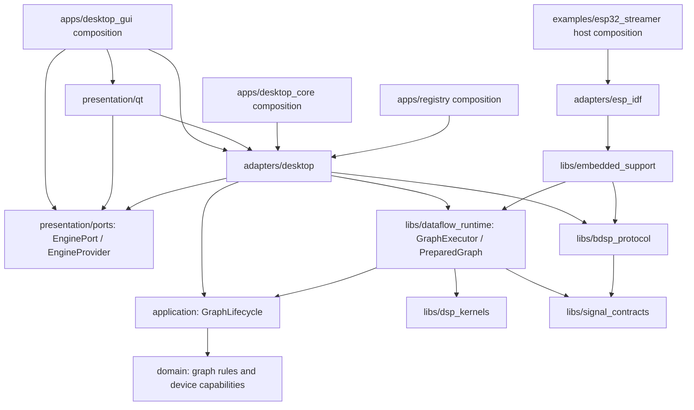

# Architecture map

This map describes the migration's current implementation. Acceptance status and
remaining gates are tracked in [the current checklist](refactoring/progress-checklist.md).
Stable identifiers and configuration keys remain distinct from UI names. Current
document/graph/processing/CONTROL/DATA editions are 2/3/2/2/4; old editions are rejected.

Arrows represent source dependencies. GraphLifecycle uses preparation/runtime
ports; GraphExecutor implements them. Applications construct the concrete
adapters and serialize lifecycle calls. The diagram does not represent network
traffic or a thread hierarchy.

| Responsibility | Canonical location / target |
| --- | --- |
| Numeric/Structured contracts, exact literals, borrowed DataFrameView, bounded OwnedDataFrame and compact PreparedNumericGather | `libs/signal_contracts` / `signal_contracts` |
| Exact ten-dtype Converter/Reduce policies, Float32 window/FFT/Bark/Mel kernels and selected backend | `libs/dsp_kernels` / `dsp_kernels` |
| NumericProcessingGraph, stable kind mappings, registered parameters, port compatibility and actual capability/resource admission | `domain` / `graph_domain` |
| Numeric preparation/runtime ports, GraphLifecycle transactional pending/working state, ProcessingControlService owner/token/TTL/revisions/replay/persistence | `application` / `graph_application` |
| Single PreparedGraph/GraphExecutor, owning RuntimeContext, prepared workspaces, incremental History/count/coordinates, typed endpoint callbacks and snapshot queries; [API](numeric-runtime-api.md) | `libs/dataflow_runtime` / `dataflow_runtime` |
| Stream payload codec, existing framing, fragmentation and assembly | `libs/bdsp_protocol` / `bdsp_protocol` |
| Embedded admission, bounded stream session and synthetic source glue | `libs/embedded_support` / `embedded_support` |
| Qt/device/TCP/UART, capture, registry, files and WLED | `adapters/desktop` |
| ESP-IDF byte transport and shared SDK source component | `adapters/esp_idf` |
| Workspace, editor, settings, themes, presenter and renderers | `presentation/qt` |
| Qt-facing command/snapshot input port and delivery DTOs | `presentation/ports` / `qt_engine_ports` |
| Concrete GUI, CLI and registry dependency assembly | `apps/desktop_gui`, `apps/desktop_core`, `apps/registry` |

NumericEngine assembles the portable executor, lifecycle and ProcessingControlService.
Capture is configured per source node and delivers the declared Native Float32
PCM format; prepared nodes perform the graph's explicit DSP/conversions. GUI
delivery contains bounded owners and compact History row events. WLED timer/socket
work and cold history queries remain outside the prepared processing path.

Numeric compatibility checks primitive dtype, rank/extents, representation,
channels and declared physical coordinates/clocks. Retained semantic labels are
passive metadata; node kinds and explicit operations select algorithms. View
inputs adopt the connected numeric contract atomically within their rank family,
with undo. Input captions show dtype/rank; views do not edit producer dimensions. Display names
are presentation metadata and do not rename stable kinds or ports.

GraphPanel selects line/points/bars/pie for vectors, image2d/surface3d for matrices,
and current numeric metrics for scalars. There is no implicit flattening or
scalar-to-series conversion. ScalarView supports independent stable input ports,
with per-input presentation names/visibility. IndexExtract is a prepared processing
operation selecting a logical vector/matrix element and channel into an exact
same-dtype scalar; packet extraction is outside this implementation. Accumulation
belongs to explicit processing History nodes: compact events invalidate GUI
snapshots, while renderers project complete authoritative matrices. Ordinary
matrices retain their row/column order and do not acquire ring semantics.

A prepared local History with a known clock exposes its complete typed-zero
capacity before first ingress; occupancy and row ordinal remain zero. Resize
preserves newest rows and truncates/zero-extends the older age tail without
advancing processing counters. GUI projects all authoritative snapshot cells,
including zero slots, rather than reconstructing padding from occupancy. Until
all slots have real timestamps, the complete axis uses frame ages; no partial
seconds axis or invented analysis cadence is used. Explicit unavailable payloads
remain distinct from an initialized empty History.

Spectrogram frequency/time display choices belong to graph view preferences
(`frequency_axis_mode`, `time_axis_mode`), shared across image2d/surface3d.
Source coordinate metadata remains authoritative: Hertz uses declared bin/Mel
centre frequencies and seconds use recorded row coordinates relative to the
newest History row. Position mode only changes labels/readouts, preserving
sample storage, processing, camera and generic matrix row direction. Missing
physical coordinates fall back to positions. Temporal frame zero is newest.
Grid divisions follow viewport size and measured numeric label extents. Camera
rotation/distance do not change divisions, values or grid buffers; only their
projection and visible boundary walls change. Cropped/reversed labels and grid
positions use the same coordinate projection. Physical selectors explicitly
report unavailable source coordinates instead of promising Hertz/seconds.

Draft connection rejection names both node IDs and port IDs. Persistent schema
and protected-file diagnostics live in the editor toolbar with full accessible
text/tooltips, not an additional global bottom strip.

Desktop matrix projections use a GUI-owned immutable NumericMatrixSnapshot shared
by the adapter, 2D image and 3D wrapper/native renderer. The 3D transpose is an
indexed view over the same storage, not another matrix. A delivered frame is
projected once per endpoint/plane; pause retains the frozen snapshot and replaces
one pending snapshot. Renderer image/GPU resources remain separate. Delivery
ownership remains bounded and separate from HistoryPresentation projection storage;
GUI ownership never borrows mutable DSP workspace or adds embedded dependencies.

GuiPresenter receives an abstract EngineProvider and owns active/inactive clients
through EnginePort. Desktop GUI composition constructs local NumericEngine or TCP/UART NumericRemoteEndpoint
adapters; the presenter does not instantiate or downcast them. Qt-facing command
and display DTOs live outside the portable application/domain. Editor JSON
formatting still uses desktop graph adapters, represented by UI -> Desktop above.
NumericDeliveryContext pins contract metadata and arena storage across queued
presentation. Device-selection and control/delivery revision fences prevent stale
callbacks from replacing current bindings.

Canonical targets are declared beside these responsibilities. Former `src/*`
implementation trees and relative forwarding headers are removed. Stable target
and include names remain available through canonical include directories;
`portable_dsp` and `dsp_core` are compatibility names for the common kernel.

Preparation validates geometry and resource limits, builds topology and allocates
workspaces. Processing uses those prepared buffers and a contiguous history ring.
History materialization, GUI models, JSON and network payload ownership belong to
adapter/control boundaries. Borrowed output data must be consumed before the next
tick; asynchronous retention uses an owned bounded buffer or explicit desktop
snapshot. A prepared execution bundle belongs to the executor that created it.

TCP and UART carry shared BDSP framing, CONTROL2 and DATA4. Desktop UART
selects a complete numeric processing endpoint and supports the same service
commands as TCP. Endpoint overrides
apply to a runtime configuration copy, preserving user configuration documents.
WiFi/socket provisioning and physical I2S/Bluetooth sources remain firmware hooks.

Host SDK builds and installed external consumers do not require Qt or ESP-IDF.
Firmware components compile the shared sources using the firmware toolchain,
instead of linking host archives. Source SDK installation preserves component
topology under `share/PortableDSP/embedded`. See [embedded-sdk.md](embedded-sdk.md).
The stock entrypoint owns NVS initialization without erase, admitted last-known-good
restore, explicit-only Persist and selective DATA retirement while retaining CONTROL
transport/session state. Configured resource ceilings are capped by actually supplied
host memory. Native archive compilation, host fake-IDF execution, hardware and native
graphics acceptance are distinct evidence scopes.
