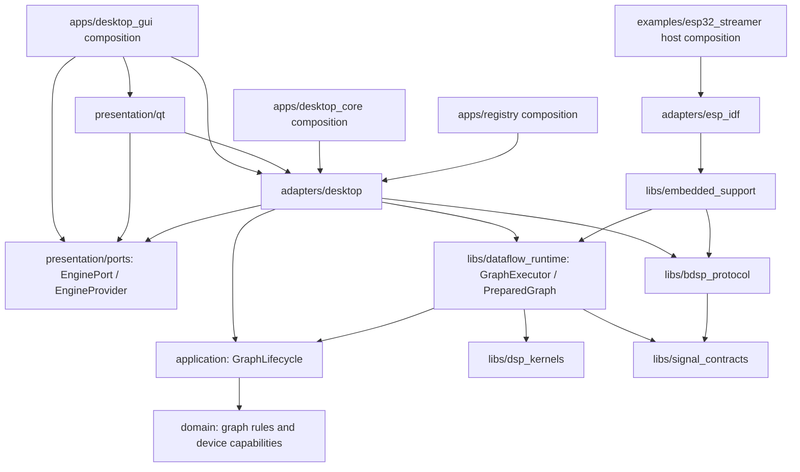

# Architecture map

This map describes the migration's current implementation. Acceptance status and
remaining gates are tracked in [refactor-execution.md](refactor-execution.md).
Product name, saved identifiers, configuration keys and BDSP wire bytes remain
unchanged. The pinned responsibility reference is recorded in that ledger.

Arrows represent source dependencies. GraphLifecycle uses preparation/runtime
ports; GraphExecutor implements them. Applications construct the concrete
adapters and serialize lifecycle calls. The diagram does not represent network
traffic or a thread hierarchy.

| Responsibility | Canonical location / target |
| --- | --- |
| Frame semantics, metadata, borrowed views, bounded retained buffers | `libs/signal_contracts` / `signal_contracts` |
| Numerical windows, FFT, Mel, stereo kernels and selected backend | `libs/dsp_kernels` / `dsp_kernels` |
| Typed graph definition, compatibility, validation and capabilities | `domain` / `graph_domain` |
| Prepare, Apply, Start, Stop and working/pending graph lifecycle | `application` / `graph_application` |
| Prepared execution plan, mutable state, bounded workspaces, history ring | `libs/dataflow_runtime` / `dataflow_runtime` |
| Stream payload codec, existing framing, fragmentation and assembly | `libs/bdsp_protocol` / `bdsp_protocol` |
| Embedded admission, bounded stream session and synthetic source glue | `libs/embedded_support` / `embedded_support` |
| Qt/device/TCP/UART, capture, registry, files and WLED | `adapters/desktop` |
| Desktop capture worker and legacy analysis compatibility API | `adapters/desktop/analysis` / `analyzer` |
| ESP-IDF byte transport and shared SDK source component | `adapters/esp_idf` |
| Workspace, editor, settings, themes, presenter and renderers | `presentation/qt` |
| Qt-facing command/snapshot input port and delivery DTOs | `presentation/ports` / `qt_engine_ports` |
| Concrete GUI, CLI and registry dependency assembly | `apps/desktop_gui`, `apps/desktop_core`, `apps/registry` |
| Historical visualizer entrypoint using the same desktop runtime | `apps/compatibility_gui` |

GraphProgram remains a desktop JSON/domain and owned-frame compatibility adapter;
it delegates computation to the same PreparedGraph implementation. Actual
AudioPipeline uses GraphExecutor and GraphLifecycle. Capture workers deliver PCM;
the graph determines which numerical stages execute. Legacy Analyzer/FFT helpers
delegate to common kernels and retain their historical public API. They do not
define a second graph scheduler.

GuiPresenter receives an abstract EngineProvider and owns active/inactive clients
through EnginePort. Desktop GUI composition constructs the local/TCP EngineClient
adapters; the presenter does not instantiate or downcast them. Qt-facing command
and display DTOs live outside the portable application/domain. Editor JSON
formatting still uses desktop graph adapters, represented by UI -> Desktop above.
The owned TypedFrame compatibility header remains Qt-free; the portable codec
wrapper uses its pure include directory without linking qt_engine_ports.

Canonical targets are declared beside these responsibilities. Former `src/*`
implementation trees and relative forwarding headers are removed. Stable target
and include names remain available through canonical include directories;
`portable_dsp` and `dsp_core` are compatibility names for the common kernel.
The historical visualizer's optional packets 1–4 serial display retains its
original wire parser configuration; the new SDK/NetworkInput TCP and UART session
uses the shared typed-stream codec and messages 11–14.

Preparation validates geometry and resource limits, builds topology and allocates
workspaces. Processing uses those prepared buffers and a contiguous history ring.
History materialization, GUI models, JSON and network payload ownership belong to
adapter/control boundaries. Borrowed output data must be consumed before the next
tick; asynchronous retention uses an owned bounded buffer or explicit desktop
snapshot. A prepared execution bundle belongs to the executor that created it.

TCP and UART carry the same BDSP framing and typed stream messages. Desktop UART
binds an explicitly selected endpoint to an existing NetworkInput; it does not
send engine-control messages to the ESP streaming example. Endpoint overrides
apply to a runtime configuration copy, preserving user configuration documents.
WiFi/socket provisioning and physical I2S/Bluetooth sources remain firmware hooks.

Host SDK builds and installed external consumers do not require Qt or ESP-IDF.
Firmware components compile the shared sources using the firmware toolchain,
instead of linking host archives. Source SDK installation preserves component
topology under `share/PortableDSP/embedded`. See [embedded-sdk.md](embedded-sdk.md).
Native ESP-IDF/optimized backend and hardware acceptance remain separate when the
SDK/device is unavailable; offscreen desktop checks do not prove native graphics.
