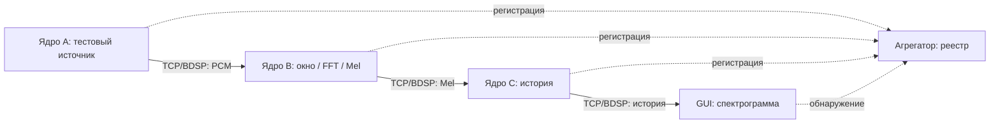

# Архитектура аудиосистемы: решения и контекст

Дата фиксации: 5 октября 2026 года. Документ сохраняет требования и решения,
согласованные с владельцем проекта. Это описание назначения системы и границ
ответственности, а не утверждение, что все перечисленные возможности реализованы.

## Зачем нужна система

Приложение захватывает или генерирует аудио, анализирует его, формирует историю,
отображает результаты и передаёт данные другим компонентам, включая WLED.
В дальнейшем анализ используется для определения ритма и коротких всплесков,
например хай-хэтов. Вычислительная часть должна подходить для последующего
переноса на микроконтроллеры и выделения в отдельный репозиторий.

Главная идея: **схема определяет реальный маршрут данных**. Редактор не должен быть
декорацией над независимо работающим захардкоженным конвейером. Если соединение
разорвано, соответствующая ветка перестаёт получать данные. Если вход уже содержит
Mel или историю, ядро не выполняет захват и FFT повторно.

Обработка не зависит от скорости GUI. Задержка, скрытие или закрытие графика не
останавливает захват, DSP, накопление истории и выходы, необходимые работающей
схеме. Предпочтительнее пропустить кадр отображения, чем задержать аудио.

## Термины

| Термин | Значение |
| --- | --- |
| Узел схемы | Одна логическая операция: источник, преобразование, представление или выход. Не обязательно отдельный поток или процесс. |
| Ядро / runtime | Исполнитель схемы и владелец жизненного цикла её компонентов. Может работать без GUI. |
| Устройство / сетевой компонент | Зарегистрированный участник сети с устойчивым UUID, адресом, возможностями и состоянием. На нём может работать ядро с несколькими узлами. |
| Поток данных | Типизированная последовательность кадров, опубликованная выходом и принимаемая входами. Это не поток ОС. |
| Агрегатор | Центральный реестр компонентов для обнаружения и получения их адресов, состояний и возможностей. |
| Черновик | Редактируемая схема, в том числе невалидная. Не обязательно совпадает с исполняемой. |
| Рабочая схема | Последняя подтверждённая ядром схема. |
| Представление | Экземпляр графика, связанный с конкретным узлом отображения конкретной схемы и устройства. |

Слово «нода» в разговоре может означать узел редактора или отдельный сетевой
участник. В коде и протоколе эти сущности должны различаться.

## Что есть сейчас и что является целью

На момент фиксации контекста в репозитории есть:

- `portable_dsp` с численными алгоритмами без Qt, сокетов и платформенного захвата;
- `AudioPipeline`, владеющий захватом, анализом, историей и WLED;
- miniaudio 0.11.25 через FetchContent, адаптер за `IAudioSource`;
- `pipeline_cli` на `QCoreApplication`, без Qt Widgets;
- GUI `core_app`, presenter и локальный/удалённый `EngineClient`;
- управление удалённым ядром и подписки через TCP/BDSP;
- отдельный TCP-агрегатор с регистрацией, снимком реестра и переподключением;
- редактор QtNodes, черновик и последняя рабочая схема, сохранение конфигурации;
- док-панели, локализация русского/английского интерфейса и темы.

Реализация от 5 октября добавляет граф версии 2 с явными PCM, Window,
WindowFunction, StereoFFT, BarkWeighting, SpectrumMerge, Mel и History стадиями.
Источники, накопители истории и представления имеют независимое состояние.
Неактивная ветка применяется и очищает зависимые графики; ошибки типов, циклы
и недопустимые параметры явно отклоняются. Перемещение узлов не перезапускает DSP.

Типизированные NetworkInput/NetworkOutput, реестр возможностей и выполнение
стадий на разных ядрах реализованы. Короткая проверка трёх CLI-процессов сравнивает
историю с локальным исполнением, перезапускает источник и проверяет передачу
недоступности входа через продолжающее работать промежуточное ядро. Несколько
экземпляров графиков, изоляция документов устройств и очередь применения также
покрыты короткими GUI-проверками. Это не заявление о длительной или физической
аппаратной проверке: длительные тесты отменены владельцем на текущем этапе.

Текущий настроенный WLED-адаптер один; граф с несколькими WLED-узлами отклоняется
явно, без молчаливого игнорирования лишних выходов. Это ограничение не относится
к источникам, историям, представлениям и NetworkOutput. Детали исполнения и
ограничений: [runtime](../src/pipeline/README.md),
[сетевой протокол версии 2](network-stream-v2.md).

Не считать существующий числовой демонстрационный граф рабочим аудиопайплайном.
Не считать наличие TCP-клиента готовностью распределённого DSP.

## Границы ответственности

| Слой / компонент | За что отвечает | Что остаётся за его границей |
| --- | --- | --- |
| Переносимое DSP | Оконные функции, FFT, спектральные преобразования, Mel, численные операции; подготовка и повторное использование буферов | Qt, UI, TCP, устройства, таймеры ОС |
| Исполнитель схемы | Проверка типов и параметров, порядок операций, состояние отдельных узлов, обработка кадров, переключение рабочей схемы | Графические модели QtNodes и создание виджетов |
| Аудиоадаптер | Открытие устройства, получение PCM, ограниченная очередь, диагностика и восстановление захвата | DSP, история, отрисовка и сеть в callback |
| Сетевой адаптер | Кодирование, транспорт, подписки, ограниченные очереди, тайм-ауты и восстановление | Вычислительные алгоритмы и расположение узлов |
| Агрегатор | Реестр устройств, доступность, адреса и опубликованные возможности | Передача всех аудиокадров через центральный сервер |
| Конфигурация | Версии формата, миграции, пресеты, черновик, рабочая схема, сохранение неизвестных полей | Неявное изменение работающего графа при загрузке UI |
| Presenter / контроллер GUI | Команды, подтверждения, состояние редактирования, выбор ядра и подписки | Прямое управление внутренними объектами захвата и DSP |
| Редактор QtNodes | Узлы, соединения, параметры, координаты, undo/redo и отображение ошибок | Выполнение DSP внутри моделей графических узлов |
| График | Отрисовка последнего снимка конкретного узла, локальные настройки и камера | Производство обязательных данных для остальных веток |

Использовать направленные зависимости и интерфейсы на границах. Применять идеи
чистой архитектуры там, где они позволяют заменить транспорт, захват или GUI.
Полная инфраструктура DDD не является самостоятельной целью: не нужны лишние
сущности и абстракции вокруг численных операций. Основные понятия предметной
области — схема, узел, порт, кадр, поток, устройство и состояние исполнения.

Headless runtime сейчас может использовать Qt Core/Network. Это не означает,
что вычислительное ядро должно зависеть от Qt. Выделение DSP в отдельный репозиторий
не должно требовать переноса GUI или настольных адаптеров.

## Режимы запуска и владение ядром

### Консольное ядро

Ядро читает конфигурацию или выбранный пресет и запускает описанную схему без
окон, графических объектов и зависимости от GUI. Оно может захватывать звук,
генерировать тестовые данные, принимать сетевой поток, выполнять только часть
преобразований и публиковать результаты.

Должна быть возможность выбрать пресет по устойчивому ID или уникальному имени.
GUI и CLI используют общий загрузчик и одинаковое исполнение схемы. Невалидную
явно выбранную схему консоль должна отклонять с понятной ошибкой, а не незаметно
запускать другую обработку.

### GUI с локальным ядром

GUI создаёт и владеет экземпляром того же ядра. Все операции проходят через
клиентский интерфейс команд и снимков. Закрытие приложения останавливает его
локальное ядро и завершает принадлежащие ему потоки.

### GUI с удалённым ядром

GUI подключается к отдельно запущенному процессу. Закрытие GUI не останавливает
этот процесс. Локальная сохранённая схема клиента не должна автоматически
перезаписывать удалённую. Редактирование и применение адресованы выбранному ядру;
черновики и состояние интерфейса разных устройств не смешиваются.

Существующие команды запуска, уже поддержанные кодом:

```powershell
./cmake-build-release/bin/pipeline_cli.exe --config config.json
./cmake-build-release/bin/pipeline_cli.exe --server --port 8213 --synthetic
./cmake-build-release/bin/core_app.exe --remote-host 127.0.0.1 --remote-port 8213
```

`--preset <id-or-name>` использует общий с GUI загрузчик конфигурации.
Обнаружение устройств в GUI выполняется через явно настроенный агрегатор;
распределённые порты используют настройки из документа. Формат и примеры
сетевой конфигурации приведены в [описании протокола](network-stream-v2.md).

## Узлы и данные

Библиотека узлов делится на четыре раздела:

| Раздел | Примеры | Назначение |
| --- | --- | --- |
| Входы | Аудиозахват, тестовый источник, сетевой вход | Создать или получить типизированный поток |
| Преобразования | Формирование окна, оконная функция, стерео FFT, спектральное взвешивание, объединение, усиление, Mel, история | Изменить данные или накопить состояние |
| Графики | Исходный сигнал, оконный сигнал, сигнал после оконной функции, FFT, Mel, спектрограмма | Опубликовать данные конкретного представления |
| Выходы | Сетевой выход, WLED | Передать результат за пределы локальной обработки |

Определения портов, параметров, ограничений и значений по умолчанию должны иметь
единственный источник истины, общий для редактора и исполнителя. Инспектор
выбранного узла показывает его параметры, состояние и доступный предпросмотр.
Настройки источника и обработки относятся к соответствующим узлам. Общие
настройки приложения содержат язык, тему, автоприменение, FPS и поведение UI.

Типизированные кадры должны позволять передавать:

- стерео PCM;
- окно стерео PCM и результат оконной функции;
- спектры левого и правого каналов после FFT;
- объединённый спектр;
- Mel;
- историю для спектрограммы.

Кадр несёт частоту дискретизации, номер, поколение потока, временную метку,
признак разрыва и необходимые параметры размерности/частотной шкалы. Временные
метки и последовательность должны сохранять происхождение данных через стадии.
Сравнивать монотонные часы разных устройств как синхронизированные нельзя.

Каждый узел с состоянием имеет собственные буферы и историю. Несколько источников
и несколько экземпляров одного графика допустимы. Смешивание источников или
каналов происходит только явно, а не как побочный эффект общих глобальных полей.

### Стерео и спектрограмма

FFT выполняется отдельно для левого и правого каналов. Нельзя сначала свести PCM
в моно: интересующая частота может быть только в одном канале, а противофазные
каналы могут взаимно уничтожиться.

Объединение выполняется после FFT. Поддерживаются среднее, максимум и
энергетическое объединение RMS; по умолчанию — RMS. FFT-график по умолчанию
показывает левый канал. Одна спектрограмма с объединённым результатом достаточна
для основного сценария анализа ритма, но архитектура допускает дополнительные
независимые представления.

При выделении стадий сохранить численное поведение: Hann, существующее
Bark-взвешивание **после FFT**, выбранный режим объединения и параметры Mel.
Спектральное взвешивание нельзя перепутать с оконной функцией или применить дважды.

### Отключение и применение

Отсутствующий вход означает неактивную ветку. Все зависимые от неё узлы не
получают данных; независимые ветки продолжают работу. Пустая ветка отображения
очищается, а не удерживает старый кадр как работающий результат.

Циклы, несовместимые типы и недопустимые параметры — ошибки применения.
Невалидный черновик сохраняется, но не заменяет рабочую схему. Интерфейс постоянно
показывает состояние «Черновик / Применяется / Работает / Ошибка» и причину отказа.

Новый план исполнения готовится отдельно и переключается на границе кадра.
Подтверждение связано с запросом, устройством, поколением и ревизией графа.
Устаревшие подтверждения и кадры не меняют состояние нового документа.
Координаты, масштаб, прокрутка и камера не требуют перекомпиляции DSP.

## Сеть: TCP, BDSP и поиск устройств

### Обнаружение

Базовая модель — центральный агрегатор по известному настраиваемому адресу.
Компоненты регистрируются, получают начальный снимок реестра и дальнейшие
обновления. Реестр должен описывать UUID, endpoint, состояние, поддерживаемые
версии/операции и опубликованные типизированные потоки.

GUI использует этот реестр для выбора устройств и совместимых источников.
Сетевой вход сохраняет UUID поставщика и ID потока, а не только текущий IP.
Изменение адреса после переподключения не должно требовать перерисовать схему.
Недоступное устройство остаётся видимым со своим состоянием.

UDP broadcast, mDNS и другие способы поиска агрегатора можно рассмотреть позже.
Они не являются принятой обязательной частью первой реализации. Поиск устройств
через реестр и поиск самого сервера реестра — разные задачи.

### Передача и управление

Агрегатор — реестр, а не центральный ретранслятор аудио. После обнаружения ядра
соединяются напрямую по TCP с BDSP framing. Управление и типизированные данные
относятся к одной системе; существующий engine endpoint и агрегатор выполняют
разные роли внутри неё.

По умолчанию сейчас агрегатор использует порт 8212, engine endpoint — 8213;
оба адреса/порта конфигурируемы. Существующие engine-пакеты версии 1 используют
QDataStream Qt_6_0, little-endian и float32. Типизированные распределённые кадры
используют переносимый кодек версии 2 и согласование возможностей; отдельный
stream endpoint по умолчанию использует порт 8214. Формат описан в
[протоколе потоков](network-stream-v2.md).

Новые переносимые структуры и кодек не должны зависеть от Qt. Существующие
форматы нельзя молча менять: совместимость проверяется эталонными пакетами,
а неподдерживаемая версия возвращает явную ошибку. CRC/session token существующего
BDSP/реестра не является аутентификацией или шифрованием. Расширение удалённого
управления должно сохранять явное разрешение мутаций; автоматическое обнаружение
не предоставляет права изменять чужую схему.

Один выход допускает несколько подписчиков. Очереди ограничены по памяти;
медленный подписчик не блокирует обработку и остальных получателей. При потере
кадра отмечается разрыв последовательности, а накопители реагируют на него
согласно своему типу. Протокол проверяет размеры до выделения памяти.

Управляющая команда получает подтверждение или ошибку. После обрыва связи
команды изменения схемы не переигрываются молча. Stop отменяет повторные попытки;
после остановки не доставляются кадры предыдущего поколения.

Для новых потоковых соединений принята последовательность восстановления
1, 2, затем 5 секунд. Существующий агрегатор имеет собственный механизм задержек;
это не утверждение, что все текущие адаптеры уже используют одну политику.

Не вводить сжатие и сложную адаптацию к плохому каналу как отдельный проект.
Недостаточная пропускная способность должна быть видна в диагностике. Система
не должна компенсировать её неограниченными очередями и возрастающей задержкой.

## Распределённые сценарии

Принята **отдельная схема на каждое ядро**. Пользователь запускает ядра с их
конфигурациями и явно соединяет сетевые входы/выходы. GUI выбирает устройство и
редактирует его схему. Автоматического разбиения единого холста, SSH-развёртывания
или запуска процессов на чужих машинах в текущем решении нет.



Другой сценарий: мини-сервер выполняет захват, FFT, Mel и историю, а рабочая
станция получает только необходимые данные отображения. Можно подписаться на
спектр или Mel раньше истории для отдельного графика. Если получателю нужен уже
вычисленный результат, он не запускает предыдущие стадии заново.

Каждый core может сочетать роли источника, обработчика и получателя. Это не
требует запуска отдельного процесса на каждый прямоугольник редактора.

## Конфигурация и сохранение

- Конфигурация описывает устройство/ядро, его граф, параметры узлов, сетевые
  привязки и выбор пресета. Она должна быть достаточна для headless-запуска.
- Рабочая схема, редактируемый черновик и настройки представления различаются.
  Сейчас используются `pipeline_graph` и `scene_graph`; будущие миграции должны
  сохранять их смысл и исходные пользовательские данные.
- Пресет — именованная схема с устойчивым ID и параметрами. Допускаются несколько
  пользовательских пресетов; смена пресета проходит обычную проверку применения.
- У каждого представления устойчивый ключ: устройство, граф и узел. Сохранение
  окон не подменяет маршрутизацию обработки.
- Формат версионируется. Старые документы мигрируются, неизвестные поля
  сохраняются. Невалидный документ можно открыть и исправить без потери черновика.
- Перемещение узлов, zoom/pan и камера сохраняются без применения DSP. При
  автосохранении запись отложенная, закрытие завершает ожидающую запись; при
  отключённом автосохранении используется явная команда сохранения.

## Представления и рабочее пространство

Основное рабочее место по умолчанию: большая спектрограмма сверху с собственными
настройками сбоку, Pipeline снизу. Дополнительные графики открываются по желанию;
док-панели можно перемещать, объединять во вкладки, отделять и скрывать.

Каждый график имеет соответствующий узел. Можно создать несколько экземпляров
одного типа с разными входами и настройками. Видимость панели управляет подпиской
и отрисовкой, но не удаляет узел и не останавливает независимые ветки/WLED.

Центрирование редактора вписывает все блоки без изменения координат. Упорядочивание
— отдельная явная операция с undo. Параметры, предпросмотр и показ скрытой панели
не должны самопроизвольно менять расположение.

Название «Спектрограмма / Spectrogram» используется для представления вместо
Surface; внутренние имена Qt API и совместимые ключи старых документов не следует
переименовывать без учёта миграции. «Оконный сигнал» означает выделенный фрагмент,
«Сигнал после оконной функции» — его обработанную версию.

Камера должна свободно двигаться вокруг центра спектрограммы, под ней и через
неё, без ограничения границами осей. Максимальное удаление нужно уменьшить
примерно втрое относительно прежнего. Сохраняются физические WASD, Space/Ctrl,
Shift, Z и переназначение управления. Фон и оси согласуются с темой приложения.
Рендерер заменён на QOpenGLWidget с собственной камерой. Короткая нативная
проверка охватывает движение под график/сквозь него, диапазоны, изменение формы
данных и 24 цикла отделения/закрепления с пересозданием контекста. Это проверка
конкретных сценариев Windows, а не гарантия работы всех драйверов и мониторов.

## Производительность, захват и диагностика

Базовый анализ — 60 кадров/с при непрерывном захвате. Это не доказывает достаточность
для коротких всплесков: важны также размер окна, шаг и перекрытие. Достаточность
проверяется синтетическими короткими высокочастотными импульсами.

Захват использует miniaudio device API, а не playback engine. Callback копирует
PCM и метаданные в заранее выделенную SPSC-очередь; DSP, логирование, сеть,
блокировки и выделение памяти в нём запрещены. Windows использует WASAPI;
Linux — PulseAudio/monitor, включая PipeWire через PulseAudio-совместимость.
Недоступный loopback не должен незаметно переключаться на микрофон.

GUI получает ограниченный набор последних снимков, рисует только видимые
изменившиеся представления, максимум 60 раз/с. Движение камеры не должно заново
строить данные истории. Подготовленные FFT/Mel-буферы переиспользуются.

Телеметрия показывает время захвата, очередей, операций узлов, истории, сети,
доставки GUI и отрисовки; загрузку буферов, потери и разрывы. Хранение ограничено,
экспорт выполняется вне измеряемой обработки. Настольные результаты не являются
доказательством соблюдения бюджета памяти/времени микроконтроллера.

WLED получает данные из собственной ветки схемы независимо от GUI. MajorPeak
передаётся в герцах; тишина и ошибки сети обрабатываются явно. Настройки света
остаются отдельным разделом интерфейса, параметры соответствующего выхода —
частью конфигурации схемы.

## Проверки и ограничения тестовых источников

Быстрые тесты разделяются по ответственности: DSP, UI/редактор, сеть и захват.
Короткие интеграционные проверки выполняются для связанных изменений, а не
после каждого мелкого изменения. По уточнению владельца проекта от 5 октября
2026 года 30-минутные прогоны и остальные длительные тесты на текущем этапе
отменены. Они допускаются при подготовке коммита и не являются условием
завершения текущей реализации. Не запускать их автоматически при рефакторинге.

Для функциональных и нативных тестов использовать 5–10 синусоид разных частот,
меняющихся со временем, а не музыку. Тестовый источник — конфигурируемый узел,
не скрытый специальный путь, обходящий остальную схему.

Беззвучная генерация проверяет полный маршрут после источника, но **не проверяет
драйверный захват miniaudio**. Для настоящего capture-теста требуется отдельный
виртуальный аудиоendpoint/monitor либо реальное устройство. Нельзя обещать, что
обычный системный loopback захватит сигнал, который не был отправлен в доступный
ему endpoint. Вывод теста на физические динамики не должен быть неявным действием.

Обязательные сценарии готовности архитектуры:

- левый/правый/противофазный сигнал и правильное объединение после FFT;
- разрыв соединения, очищение зависимого графика и сохранение независимых веток;
- несколько экземпляров графика и независимых накопителей истории;
- заблокированный GUI на 5 секунд при продолжающихся DSP и сетевых выходах;
- переключение пресетов, ручное/автоматическое применение, видимый отказ,
  undo/redo, закрытие сразу после перемещения и восстановление документа;
- распределённая цепочка из трёх ядер и сравнение с одним ядром;
- несколько подписчиков, медленный получатель, перезапуск и смена поколения;
- нативные ресайз, докинг и камера отдельно от offscreen-проверок;
- короткая проверка памяти, очередей и задержек; длительный прогон отложен до
  подготовки коммита согласно указанной выше политике.

Windows — основная локальная проверка. Не тратить отдельный локальный цикл на
Linux-сеанс без необходимости; переносимость поддерживать сборками/тестами CI.
Непроверенные физические устройства, WLED, отключение endpoint и многомониторные
сценарии отмечать явно.

## Как использовать этот документ

При изменении архитектуры сверять границы ответственности и реальные маршруты
данных с этим документом. Обновлять раздел «Что есть сейчас» после реализации и
проверки возможностей. Новые решения отмечать явно, не выдавая предложения
разработчика за ранее согласованное требование владельца проекта.

Связанные материалы: [сборка и текущий запуск](../README.MD),
[существующий агрегатор и его протокол](../src/aggregator/README.md).

## Визуальный baseline спектрограммы

Эталон — Git `93139d1`: `Q3DSurface` и `SpectrogramGraphModifier`. Собственный
OpenGL остаётся ради quaternion-камеры со свободным полётом. Из Qt 6.10
восстановлены автоматическое отношение X/Z, центрированный диапазон Y 0..2,
reversed X и направление Z, перенормировка выбранных диапазонов, Ebony/ArmyBlue,
точечный diffuse/specular свет и пространственные оси. Формулы сверены с
`surface.frag` и `Surface3DRenderer::calculateSceneScalingFactors`; private Qt API
не используется. Baseline имел ShadowQualityNone. По пожеланию владельца ровные
участки остаются без сплошной cell wireframe, видны линии изломов. Срезы показывают
реальные выбранные строки/колонки в 2D; точная native 3D slice-сцена и sphere
selection пока не воспроизведены.

GPU buffers, glyph atlas и 60fps coalescing сохранены. Камера не пересобирает mesh;
persisted v2 pose не меняется при инициализации, неизвестные camera-state поля
сохраняются. DSP, transport и пользовательский config не затронуты.

Короткая беззвучная проверка: `build-gui/bin/native_spectrogram_lifecycle.exe --quick`.
Сравнение: `native_spectrogram_lifecycle.exe --compare-baseline <отдельная-папка>`
сохраняет plane/peaks/bands baseline/current PNG и `comparison.json`. Одинаковые
32x96 данные генерируются без audio pipeline; адаптер переводит Qt zoom/viewport
в физическое расстояние камеры при одинаковой ориентации и FOV 45°. Baseline
создаётся неизменённым modifier. Численные проверки покрывают форму/ranges и
разворот осей; native проверки — срезы, camera-only frames, dock/float/context teardown.

Профилирование регрессии FPS: bounded `core::perf` теперь отдельно измеряет
handoff, mesh/normals, creases, uploads, surface/edges, walls, glyph labels/atlas,
overlay, CPU frame и scheduling; opt-in GPU timer читается только при готовом
результате. Экспорт JSON выполняется после измерений, без записи на каждый кадр.
Поиск изломов через дерево float-координат заменён линейным обходом известной
топологии двух треугольников каждого cell; нормали каждого sample вычисляются
один раз и переиспользуются в исходной triangle soup. Endpoints, порядок линий,
порог 5° и формулы нормалей сохранены. Plane/peaks/bands дали pixel equality.

`native_spectrogram_lifecycle.exe --profile <папка>` проверяет 50x400 snapshots
с шестью меняющимися пиками, маленькое/большое окно и camera-only (по 10 секунд).
Генератор заранее вычисляет общие центры/амплитуды, чтобы повторные sin на каждом
sample не тормозили GUI искусственно. `QT_VIS_PROFILE_MS` ограничивает время
диагностического этапа (500..10000 мс). Для полного pipeline выставить
`QT_VIS_SHORT_PROFILE_MS=30000`, `QT_VIS_TRACE_FILE=<отдельный-json>` и запустить
`render_tests.exe`: временный config, восемь in-memory tones без playback,
семь секунд наполнения history и 30 секунд измерения DSP/GUI/render. Этот режим
не заменяет исходную resize-flood проверку и не меняет её assertions.

Планировщик собственного renderer использует single-shot deadline от начала
последнего фактического paintGL, 16,67 мс. Возобновление после idle не добавляет
новые обязательные 17 мс, если бюджет предыдущего кадра уже истёк; queued update
и dirty mailbox остаются по одному. Скрытое окно не крутит периодический timer.
`spectrogram.frame_gap` показывает фактическую частоту, `spectrogram.schedule` —
ожидание от dirty до постановки paint request. Qt TimerQuery уничтожается один
раз в текущем owning context: явный `destroy()` перед destructor в Qt 6.10
обнуляет внутренний context, а destructor затем обращается к этому указателю.

Локальный результат 2026-10-05: на 50x400 geometry mean снизился примерно
с 25 до 3 мс, crease search с 17 до менее 1 мс. 30-секундный pipeline с восьмью
тонами дал DSP 60,01/с и render 51,94 FPS; CPU paintGL mean 4,36 мс, p95 5,75,
p99 7,5 мс. Фактический frame gap mean 19,245 мс, p95 29,75, p99 35 мс:
стабильные 60 FPS пока не достигнуты. Отдельный synthetic renderer дал около
58,5 FPS. Queue consume p95 1,25 мс, GUI heartbeat p95 19 мс. Старый полный
multi-screen render benchmark не объявлен PASS: resize flood произвёл 35/46
requests вместо требования >100. Его assertions сохранены; короткий pipeline,
GPU-enabled teardown, bounded telemetry и четыре native lifecycle цикла прошли.
Три изображения plane/peaks/bands после оптимизации пиксельно совпали с принятым
видом до оптимизации. Длительные/full проверки не выполнялись.

## Настройки графиков и фиксированное пространство истории

Раздел GUI «Графики» хранит общие значения в `ui.graph_rendering` версии 1,
а индивидуальные переопределения — в `ui.graph_views[identity].surface_override`.
Общий `SurfaceSettings` нормализует настройки для GUI и renderer; локальная
presentation/camera-конфигурация не является вторым источником параметров света
и цветовой шкалы. Неизвестные поля сохраняются. По умолчанию используется
зелёно-красная шкала, тени выключены, фон следует теме. Явные light/dark настройки
сохраняются; режим system реагирует на изменения темы ОС.

GUI передаёт renderer ёмкость истории и число полос до доставки данных.
Недостающие столбцы дополняются виртуальными нулями слева, действительные данные
выравниваются справа. Пустая история и очистка не уменьшают размеры сцены;
DSP-история не заполняется искусственными записями.

Типизированная история движка и TCP имеет порядок `[кадр][частотная полоса]`.
GUI передаёт её через `update_frame_history`; этот вход явно преобразует данные
в совместимый с прежним renderer порядок `[полоса][кадр]`. Старый `update`
остаётся для band-major входов. Нельзя исправлять ошибку формата перестановкой
подписей осей: X соответствует времени, Z — частотным полосам.

Тени используют отдельный проход карты глубины 1024×1024. Ресурсы выделяются
только при включении и уничтожаются в соответствующем OpenGL-контексте.
Ошибка видеобэкенда показывается неблокирующим статусом. Сетка поверхности,
сетка пространства, освещение, его интенсивность, яркость, фон и градиент
настраиваются; свободная камера сохраняется. Единый переключатель сетки
пространства меняет `axis_grid` и `floor_grid` совместно. Различающиеся значения
из старого документа сохраняются до явного изменения пользователем.
Яркость задаётся в пределах 10–200%, интенсивности света и фонового освещения —
0–200%, исходные значения — 100% от базовых параметров renderer.

По уточнённому требованию владельца время X теперь увеличивается вместе с
индексом кадра в положительном направлении оси. Это сознательное изменение
старого reversed-X, а не исправление подписей поверх прежних координат.
Координаты Y/Z и свободная камера сохраняются. Светлый фон и стены сцены
используют выбранный цвет фона без отдельного синего оттенка темы ArmyBlue.

## Формы данных, семантика портов и представления: направление развития

Пожелание владельца: различать форму численных данных и их назначение, чтобы
переиспользовать обработку и графики, передавать данные между ядрами и создавать
специализированные представления пакетов. Следующее описание — проектное
направление, а не утверждение о готовности нового универсального протокола.

Форма содержит тип элемента, размерности, число каналов и порядок хранения.
Семантика отдельно описывает PCM, оконный PCM, спектр, Mel или историю,
единицы и координаты осей. Совпадение формы не означает совместимость:
FFT нельзя кормить Mel-вектором как PCM без явного преобразования. При компиляции
схемы нужно проверять контракт потребителя, а на сетевом входе — ещё и размеры,
конечность значений и метаданные. Универсальный транспорт числовых массивов
не должен отменять существующие проверки типов или разрешать ошибочные связи.

| Данные | Форма | Оси и значение |
| --- | --- | --- |
| PCM / оконный PCM | Каналы × сэмплы | Время сэмпла из sample rate; амплитуда сигнала |
| Стереоспектр | Каналы × FFT-бины | Частота из sample rate и FFT size; спектральная величина |
| Объединённый спектр / Mel | Вектор | Частотные бины / Mel-полосы; не взаимозаменяемые единицы |
| История спектра / Mel | Кадры × полосы | Координаты времени и частотных полос, величина в ячейке |
| Пакет WLED | Структура полей протокола | Поля, единицы и масштабирование конкретной версии пакета |

Mel преобразует спектральный вектор в другой вектор. Двумерный массив появляется
при накоплении истории. Отрисовка такой матрицы поверхностью в 3D не превращает
payload в трёхмерный массив: высота — значение ячейки. WLED получает Mel и
метаданные, а его адаптер формирует отдельный пакет. Предпросмотр пакета должен
иметь специализированную таблицу полей и не записывать диагностические значения
в редактируемые параметры узла. Неопределённые и нечисловые значения показываются
как диагностическая недоступность, без подстановки `[null]` в конфигурацию.

В перспективе численные представления выбираются по форме и контракту осей,
а структурные payload — через реестр специализированных представлений.
Переносимое описание payload и контракты принадлежат ядру/протоколу;
виджеты, форматирование и выбор отображения принадлежат GUI. До отдельной
реализации используются существующие TypedFrame и проверяемые порты графа.

Подпись «Гц» допустима только с реальными координатами частот: индекс Mel-полосы
не равен герцам. Подпись «секунды» требует временных координат кадров и обработки
разрывов, а не деления индекса на предполагаемые 60 FPS. Будущая версия
метаданных должна передавать координаты/единицы осей и временные метки истории,
с совместимым чтением старых пакетов. Пока единицы обозначаются честно как
индекс кадра и номер полосы там, где физических координат нет.

## Фундамент тем и уточнения интерфейса

Стандартные виджеты оформляются одним стилем Fusion и общей палитрой сервиса
`ui::Theme`. Это выбранный подход приложения для предсказуемой поддержки обеих
тем; он не означает, что Qt автоматически оформляет произвольный OpenGL-рисунок.
`QStyleHints::setColorScheme`/`unsetColorScheme` связывает явный выбор и режим
System с платформой. Собственная палитра описывает семантические роли для
Active/Inactive/Disabled, а специальное оформление ограничено центральными
правилами акцента и разделения областей. Новые стандартные элементы наследуют
эту основу без ручного прохода по всем виджетам или отдельных class palette.

QtNodes и спектрограмма используют актуальные семантические цвета палитры.
Обновление темы не пересоздаёт схему, график и камеру, не меняет маршрут DSP.
Редактируемые цвета пользователя отличаются от режима «по теме»: явное
переопределение не должно исчезать при выборе Light/Dark.

Основания решения: [рисование Qt Widgets стилем](https://doc.qt.io/qt-6/style-drawing.html),
[палитра и цветовая схема в Qt 6.10](https://doc.qt.io/qt-6.10/qstylehints.html),
[приоритеты Qt Style Sheets](https://doc.qt.io/qt-6/stylesheet.html).
Правила для дальнейших изменений находятся в корневом `AGENTS.md`.

Название панели редактора — «Поток данных» / «Data Flow». Это название GUI,
а не миграция пространства имён pipeline, ключей протокола или dock ID.
Локальное ядро означает исполнитель внутри GUI-процесса; удалённое ядро —
отдельный процесс или устройство с доступным управляющим TCP endpoint.
Регистрация в реестре сама по себе не гарантирует возможности управления:
наблюдатель без управляющего endpoint не должен предлагаться как рабочее ядро.

По последнему уточнению ось времени спектрограммы обозначает возраст в кадрах:
новейший кадр имеет возраст 0, предыдущий — 1, самый старый в полной истории —
capacity−1. Геометрия, подписи, выбор ячейки и срезы должны использовать один
контракт. Это заменяет интерпретацию оси как возрастающего индекса кадра,
описанную в предыдущей итерации. Секунды требуют реальных временных координат.

Переключатель выхода узла (`enabled`, по умолчанию true) означает gate/mute:
отключённый узел выдаёт недоступность, зависимые представления очищаются,
другие ветки продолжают работать. Это не транзитный bypass между разными
семантическими типами. Валидная применённая схема запускает её локальный
источник, но явная команда Stop сохраняет запрет до явного запуска;
изменение координат узлов не возобновляет захват. Подробности реализации
подтверждаются целевыми runtime-тестами, а не наличием кнопки в редакторе.

Контракт редактируемой шкалы: `gradient_stops` содержит 2–16 точек
`{position: 0..1, color: "#RRGGBB"}` с различными позициями и краями 0/1.
Пустой список означает выбранную стандартную шкалу. Один нормализатор и helper
`SurfaceSettings::gradientStops` предоставляют одинаковые цвета поверхности,
легенде, срезу и GUI; некорректный список не попадает в shader. Существующие
`gradient` и индивидуальные настройки сохраняются. Изменение шкалы не требует
перестроения сетки геометрии.

Линии поверхности имеют отдельные `mesh_width` (0,5–3, исходное 1),
`mesh_color` (`auto` или явный цвет), `mesh_contrast` (0–1, исходное 1).
Автоматический цвет сохраняет принятый вид линий; пользовательский цвет
не перезаписывается при смене темы. Сетки пространства и поверхности остаются
разными элементами. Яркость и свет редактируются компактно: слайдер, текущее
значение, кнопка «Сброс», без отдельной строки с пределами.

Выделение точки и панель среза — элементы взаимодействия: они рисуются
контрастно поверх сцены, в то время как поверхность, оси и тени сохраняют
собственные корректные правила глубины. Смена камеры или темы не должна
скрывать выбранную точку внутри заполненной поверхности.

Короткие проверки этой итерации (2026-10-05) выполнены на Windows:
численные DSP и совместимость Hann, типизированный граф с gate, автозапуск/Stop,
консоль и обнаружение endpoint — 6 тестов прошли за 8,95 с. Проверка presenter
подтвердила отмену запуска по позднему ACK после Stop. Editor прошёл проверку
ручного включения источника, сохранения намерения до Apply и очистки устаревших
preview. Найденный при этом пропуск signal binding после блокированной загрузки
пресета устранён повторным подключением реальных моделей, без дублирования.

GUI проверен в offscreen и отдельно в нативном сеансе: новый контрол наследует
палитру, открытые popup меняются Light/Dark/System, редактирование точек шкалы
через цветовой диалог и сохранение работают. Настройки без autosave не пишутся
до явного Save. Реальный кратковременный реестр и управляющий endpoint проверены
через GUI: появление, отключение/серое состояние, возвращение и потеря реестра.
Нативные framebuffer-проверки подтвердили возраст истории, маркер точки,
непрозрачный срез поверх поверхности, общий градиент, фон и тени; изменений
камеры и лишней загрузки геометрии при изменении оформления не обнаружено.
Логи находятся в `build-gui/qa-*.log`, картинки спектрограммы — во временных
каталогах `qt-render-age-*`. Длительные, полные и Linux-прогоны не выполнялись.


### Уточнения после пользовательской проверки интерфейса

- Частота DSP остаётся 60 кадров/с; общий `ui.graph_rendering.gui_fps_mode`
  (`fixed`/`screen`) и `gui_target_fps` ограничивают только GUI. По умолчанию
  60, экранный режим использует refreshRate с fallback60, предел20..240.
  Это потолок, а не обещание достигнутогоFPS: неизменённые данные не перерисовываются.
  ИндикаторFPS виден с нулём при отсутствии обновлений, пока пользователь его включил.
- `axis_precision`0..3 (default0), `reverse_time`, `reverse_bands` меняют представление
  и согласованные координаты выбора/срезов. Возраст свежего кадра всегда0;
  Mel-полосы остаются индексами, не вымышленнымигерцами.
- Сеткапространства включена в factorydefaults; явные старые значения сохраняются.
  Mesh width/contrast/color находятся рядом. Сброс цвета в Qtchooser возвращает
  mesh к автоцвету, фон к палитре темы; отмена chooser ничего не сохраняет.
- Цветовой редактор показывает полосуpreview и presets Green/Red, Black/Yellow,
  Viridis, Ice/Fire, Rainbow. `gradient_layout` preset/linear/log описывает позиции
  цветовых переходов, **не логарифмирует FFT/DSP**. Customstoppositions остаются
  явными; преобразуются только при пользовательском выборе раскладкипереходов.
- Автоприменение скрывает ручную кнопкуApply. Обычные applying/applied/draft
  сообщения не занимают строку редактора; ошибки сохраняют доступное описание.
- Разрыв совместимой processingсвязи сохраняет историю и продолжает нулевые кадры
  по известному исходному clock/контракту. Повторное соединение продолжает поток.
  Смена размеров/источника инвалидирует только несовместимую ветвь. GUI не очищает
  все views на каждом graphACK. ExplicitStop/смена выбранного устройства отделены.
- GUI/editor/screenshots/nativeQA не входят в обычный quick-проход. Их запускают
  только для конкретного воспроизводимого дефекта/по запросу, без повторения уже
  проверенных сценариев. `tests/run-tests.ps1 -TestName ...` выбирает точные случаи;
  `-List` только перечисляет их. Профилиquick/dsp защищены исключениемUI/device/
  integration/native/performance labels; graph_settings_theme теперь ui;integration.


Проверка этих правок на Windows: сборка `core_app` прошла. Выполнены только
`spectrogram_geometry` (0,04с), `graph_disconnect_continuity` (0,08с),
`default_runtime_start` с подменяемым источником (0,40с) и целевой
`typed_graph_runtime` (5,37с). Последний проверяет в том числе беззвучные
внутренние источники; он помечен integration и исключён из обычного quick.
Сетевые/socket и CLI-проверки также перенесены из quick в integration.
Сухой `quick -List` выбирает9 проверок без запуска приложений и окон.
GUI/editor/native/screenshot/FPS/длительные проверки в этом цикле не запускались;
визуальное расположение новых элементов ожидает пользовательской проверки.
Логи: `build-gui/qa-granular-*.log`.

### Параметры конкретного представления

Диапазоны, направление и точность осей, цветовая шкала и скорость камеры находятся
в боковой панели соответствующего графика. В общих настройках остаются частота
отрисовки и оформление 3D-представлений. Пользовательские изменения конкретной
спектрограммы сохраняются в `graph_views[identity].surface_override`, отдельно от
DSP-схемы; загрузка настроек не вызывает обратную запись. Для 2D-графиков общий
`GraphPanel` предоставляет диапазоны и направление X/Y, точность и автодиапазон.
Автоматический контраст текста рассчитывается по фактическому фону сцены.
Редактор потока данных использует удержание физических клавиш и монотонный шаг
времени для плавного перемещения; потеря фокуса или скрытие останавливает движение.
Статусные пиктограммы компонентов убраны: они не являются кнопками управления.
Оси X/Y/Z создаются общим AxisControlWidget (для 2D — X/Y): компактные числовые
поля, автоматический диапазон и разворот относятся к своей оси. Общая точность
подписей задаётся в настройках графиков; локальные старые ключи сохраняются, но
не перекрывают общую точность. Скорость камеры и редактора хранится единым
camera_controls.movement_speed, 0,5–10, по умолчанию 3. Команды приложения
используют Alt (Alt+D, Ctrl+S, Alt+P, Alt+,); стандартные сочетания текстовых полей
не изменяются. Меню выбора процессора открывает управление: прямое подключение
к TCP-ядру отдельно от обнаружения через реестр. Изменения отображения не меняют
DSP-контракты и типы сетевых пакетов.
Параметры выбранного узла отображаются поверх viewport редактора: выбор и снятие
выделения не меняют размеры viewport и положение камеры. Alt+A упорядочивает
схему, Alt+F центрирует её; команды действуют в редакторе и не перехватывают
ввод текста. Alt+R сбрасывает камеру активной спектрограммы. Панель среза
перетаскивается внутри графика, её нормализованное положение сохраняется в
graph_views[identity].slice_position. Рамка рисуется внутри области отсечения.
Встроенные цветовые пресеты доступны только для чтения; пользователь создаёт
редактируемую копию, сохраняет и удаляет собственные пресеты. При отделении
графика сохраняется тот же заголовок с меню размещения, без переключения
нативного/пользовательского заголовка после создания окна. Стабильные внутренние
ключи pipeline не переименовываются вместе с пользовательским названием.


Меню «Отображение» содержит команды компоновки, камеры и потока данных; список
доступных графиков находится в настройках графиков. Представления узлов схемы
объединяются во вкладки при переходе к новой компоновке и при добавлении нового
узла; последующие запуски сохраняют закрытые/отделённые панели. Клик по
графиковому узлу переключает последнее используемое представление, сохраняя
клавиатурный фокус редактора. Создание области доступно через контекстное меню.
Параметры узла находятся справа в изменяемой панели splitter, без перекрытия
канвы. Ctrl+S сохраняет настройки, Alt+A упорядочивает
поток данных, Alt+F центрирует, Alt+R сбрасывает камеру, Alt+L — расположение.
Название категории локализуется отдельно от её стабильного ключа в реестре.


Управление размещением использует стандартные QDockWidget/QMainWindow. Меню
«Размещение» сохраняет экземпляр графика при отделении, возвращает его во вкладки
или располагает графики рядом/друг под другом. Дополнительные селекторы и кнопки,
дублирующие это меню, отсутствуют.

Открытое представление и действительно отображаемое представление различаются:
для сохранения используется !dock->isHidden(), для подписок, передачи кадров,
таймеров и рисования — QDockWidget::visibilityChanged. Неактивная вкладка может
иметь QWidget::isVisible()==true; это не разрешение на рендеринг. При повторной
активации возобновляются обновления без сброса истории и камеры. DSP не зависит
от этого состояния. См. https://doc.qt.io/qt-6/qdockwidget.html#visibilityChanged.

Меню «Файл» сохраняет текущие настройки (Ctrl+S), сохраняет их в выбранный JSON
(Ctrl+Shift+S) и открывает выбранный файл (Ctrl+O) через перезапуск приложения. Сохранение атомарное;
путь меняется после успешной записи. Некорректный файл не закрывает приложение.
Адрес выбранного удалённого обработчика сохраняется при таком перезапуске.

В редакторе Ctrl+C / Ctrl+X / Ctrl+V сохраняют стандартный смысл и не
перехватывают ввод в полях параметров. Вставка берёт последнюю позицию указателя
в viewport и образует одну undo-операцию. QtNodes может копировать incident
connections, выходящие за пределы выделения; перед вставкой сохраняются только
связи между скопированными узлами. Неизвестные поля параметров не удаляются.

Область графика создаётся явной командой контекстного меню узла: новая вкладка,
разделение или отдельное окно. Обычный клик переключает представление в последней
области, с которой взаимодействовал пользователь, и ничего не открывает, если
таких областей нет. При замене используется существующий renderer; остальные
области и их настройки сохраняются. Alt-клик больше не создаёт окно.

Инспектор узла — правая панель горизонтального splitter рядом с канвой и
библиотекой. Без выбора содержит подсказку. Перетаскивание разделителя меняет
ширину; клик сворачивает/возвращает предыдущую ширину. Выбор узла раскрывает
свёрнутую панель. Пресеты расположены слева в нижней панели приложения.
