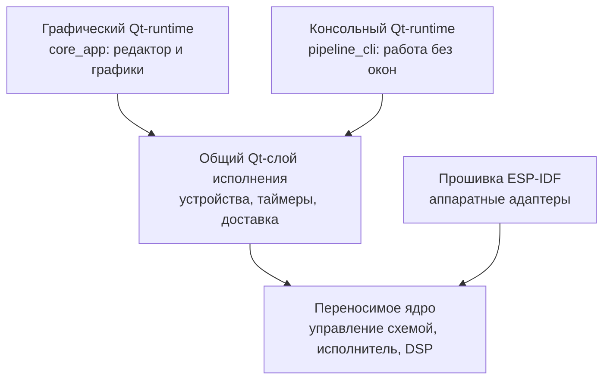
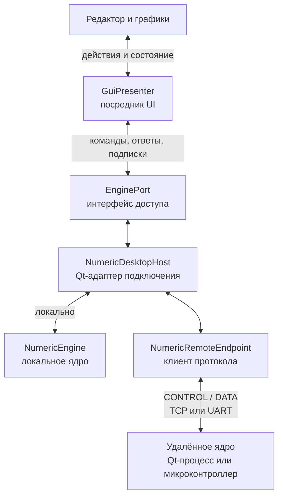
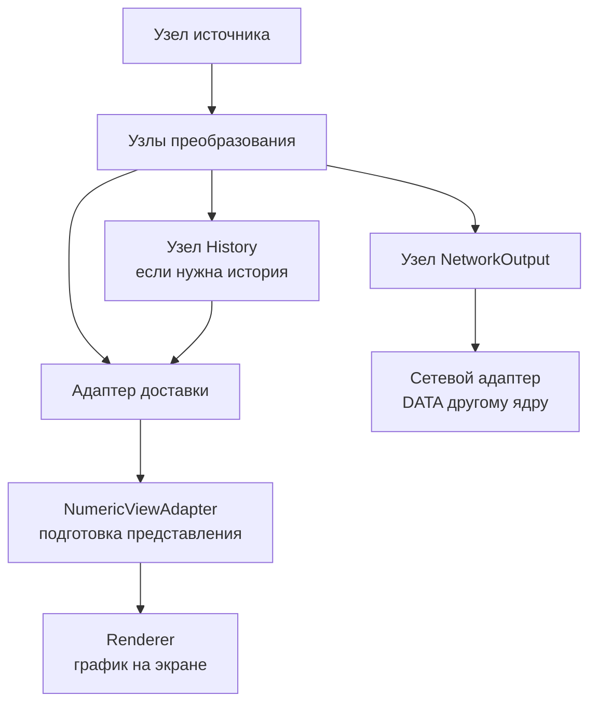

# Архитектура Barelief

Система позволяет собрать схему обработки из узлов, запустить её в локальном
или удалённом ядре и показать результаты на графиках. Переносимое ядро выполняет
вычисления; Qt-слой подключает устройства, файлы и сеть; интерфейс помогает
редактировать и наблюдать систему.

## Термины

| Термин | Что означает |
| --- | --- |
| **Схема обработки** (`graph`) | Набор узлов, их параметров, портов и связей. Определяет весь маршрут данных |
| **Узел** (`node`) | Одна операция в схеме: источник, FFT, Mixer, History или сетевой выход |
| **Порт узла** | Вход или выход данных. На вход приходит один поток; выход может соединяться с несколькими входами |
| **График / представление** (`chart`, `view`) | Отображение результата: линия, столбцы, спектрограмма, числовые показатели |
| **Ядро обработки** | Исполнитель схемы, её рабочее состояние и управление применением изменений |
| **DSP** | Цифровая обработка сигнала: численные преобразования, спектральный анализ, смешивание и другие операции |
| **Удалённое ядро** | Другой процесс или устройство со своей схемой и исполнителем, доступное через TCP или UART |
| **Адрес ядра** | Точка подключения к сервису: например, host/port TCP или выбранный serial-порт |
| **Адрес порта данных** | Выбранный выход/вход внутри схемы: идентичность схемы, узла, направление и номер порта |

В документации «схема» обозначает целый `graph`, «узел» — его отдельный `node`,
а «график» — изображение данных. Стабильные имена API, например `GraphExecutor`
и `graph_id`, помогают найти соответствующий код. Слово `endpoint` в коде
встречается и для подключения к ядру, и для адреса порта данных; ниже эти случаи
названы явно.

## Графический и консольный запуск с Qt

Runtime здесь означает среду, в которой приложение обслуживает события,
источники и выполнение схемы. У Qt-приложений два способа запуска:

| Часть | За что отвечает |
| --- | --- |
| **Графический Qt-runtime — `core_app`** | Запускает `QApplication`, редактор, настройки и графики; подключается к локальному или удалённому ядру |
| **Консольный Qt-runtime — `pipeline_cli`** | Запускает `QCoreApplication` без окон; применяет выбранную схему, обслуживает обработку и при необходимости сетевой сервер |
| **Общий Qt-слой исполнения** | `NumericEngine` и адаптеры захвата, таймеров, конфигурации и обмена. Этот код используется обоими Qt-приложениями |
| **Переносимое ядро** | Управляет схемой и выполняет численные операции через `GraphExecutor`, без зависимости от Qt |
| **Прошивка ESP-IDF** | Подключает то же переносимое ядро к ресурсам микроконтроллера через свои адаптеры |

Стрелки показывают состав запуска с локальной обработкой. Каждый такой запуск
создаёт собственный экземпляр ядра; названия Qt-runtime обозначают способы
запуска, а вычисления во всех случаях выполняет переносимый исполнитель.

Qt-адаптеры сейчас находятся в `adapters/desktop/`. Каталог обозначает имеющиеся
платформенные реализации; графический и консольный запуск используют общий код.
Подробности — в [Qt-слое исполнения](desktop-runtime.md).

## Как интерфейс обращается к ядру

Редактор и графики связаны с обработкой через несколько частей с разными задачами:

| Участник | За что отвечает |
| --- | --- |
| **`GuiPresenter` — посредник интерфейса** | Получает действия пользователя, передаёт схему выбранному ядру, сопоставляет ответы и обновляет состояние UI |
| **`EnginePort` — интерфейс доступа к ядру** | Задаёт доступные команды, подписки, ответы и доставку данных. Это программная граница между UI и реализацией подключения |
| **`NumericDesktopHost` — Qt-адаптер подключения** | Реализует `EnginePort` для GUI, размещает локальное ядро или удалённый клиент в worker-потоке и передаёт сообщения через границу потоков |
| **`NumericRemoteEndpoint` — клиент удалённого ядра** | Преобразует операции интерфейса доступа в обмен CONTROL/DATA по TCP или UART |
| **CONTROL / DATA** | CONTROL передаёт команды и состояние; DATA — результаты выбранных портов и их время |

На рисунке две альтернативы выбора ядра. При локальном выборе работает
`NumericEngine` внутри приложения; при удалённом команды и данные проходят
через протокол к другому процессу или устройству.

Подключение GUI является управляющим: при запуске оно пытается применить локальную
схему к выбранному ядру. Отказы и сохранение описаны в
[конфигурации](configuration-and-storage.md), последовательность обмена — в
[протоколе](../reference/protocol.md).

## Как данные становятся графиком

**Источник** отдаёт отсчёты. **Узлы преобразования** вычисляют результаты по связям
схемы. **History**, если он нужен, накапливает кадры в ядре. **Адаптер доставки**
передаёт ограниченные владеющие результаты потребителям. **Адаптер представления**
(`NumericViewAdapter`) готовит данные для отрисовки, а **renderer** рисует график.
Сетевой выход — отдельный узел схемы с собственным транспортным адаптером.

Рисунок показывает общий путь; конкретные операции и наличие History задаются
схемой пользователя. Подробный пример связей узлов есть в
[переносимом ядре](portable-core.md).

Частота дискретизации, темп анализа и частота отрисовки настраиваются отдельно.
History принадлежит обработке. Скрытое представление прекращает рисовать,
при этом исполнение схемы и сетевые выходы продолжают работать.

## Страницы системы

| Область | Что объясняет |
| --- | --- |
| [Переносимое ядро](portable-core.md) | Контракты, узлы, подготовка и исполнение схемы |
| [Qt-слой исполнения](desktop-runtime.md) | Графический и консольный запуск, источники, Apply и доставка |
| [Интерфейс](interface.md) | Редактор, Presenter, доступ к ядру и путь результата к графику |
| [Хранение](configuration-and-storage.md) | Черновик, применённая схема, файл проекта и Persist |
| [Embedded и обмен](embedded-and-exchange.md) | Удалённые ядра, общий SDK, CONTROL/DATA и ресурсы устройства |

Контракты, DSP, domain/application и переносимый runtime не зависят от Qt,
miniaudio, сокетов ОС или ESP-IDF. JSON и сетевой I/O находятся за пределами
подготовленной обработки. Асинхронная граница передаёт ограниченный владеющий буфер.

Для практического запуска используйте [руководство](../reference/build-and-run.md),
для точных API и форматов — [справочники](../README.md#руководства-и-справочники).
Задачи и ещё не принятые направления ведутся в
[issues](https://github.com/KobaProduction/Barelief/issues).
