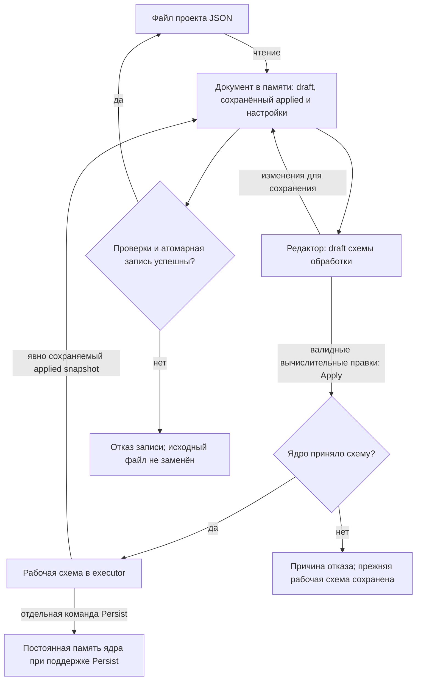

# Конфигурация и хранение

[Карта архитектуры](README.md) · [Формат проекта](../reference/project-format.md)

Проект хранится в UTF-8 JSON. Он объединяет редактируемую схему, отдельно
сохранённую применённую схему, привязки адаптеров и пользовательское представление.
Эти части имеют разных владельцев: executor исполняет схему обработки,
Qt-адаптер читает и сохраняет документ, GUI управляет размещением и настройками вида.

## Границы документа

| Данные | Где находятся | Кто использует |
| --- | --- | --- |
| Редактируемый draft | `scene_graph` | Редактор и подготовка следующего Apply |
| Сохранённый applied snapshot | Необязательный `pipeline_graph` | Восстановление явно сохранённой рабочей схемы |
| Конфигурационные зависимости | `configuration_bindings` внутри схемы | Domain resolver: SampleClock и FrequencyGrid |
| Привязки устройств/сети | `nodes[].adapter`, настройки `network` | Desktop routing и capture |
| Положение, подписи, inline-поля | `position`, `presentation` узлов | Редактор |
| Окна, графики, язык и тема | `ui` | Presentation и ConfigManager |
| Пресеты | `ui.pipeline_presets` | Явно выбранные снимки схемы и вида |

Функции чтения и сохранения файла сами по себе не применяют схему. При запуске
GUI отправляет редакторский draft на Apply; валидные вычислительные правки
редактора также применяются автоматически. Ручная кнопка Apply скрыта, а
сохраняемое поле `ui.pipeline_auto_apply` сейчас не отключает этот режим.
CLI отдельно отправляет Apply после чтения выбранного draft. Изменение темы,
камеры или положения блоков не меняет вычисления.

В следующей схеме участвуют редактор, документ в памяти, файл проекта и
исполнитель выбранного ядра. Draft — редактируемая схема обработки;
applied — успешно принятая рабочая схема. Сохранённый applied snapshot в файле
не становится рабочей схемой только из-за чтения файла. Запись проекта сохраняет
известные изменения вместе с расширениями исходного документа. Persist — другое
действие: сохраняет рабочую схему в постоянной памяти удалённого ядра, если
такая возможность поддерживается.

## Сохранение без потери расширений

`project_storage::OwnedProjectSource` сохраняет исходный документ и его точные
JSON-значения. `NumericProjectDocument` добавляет активный путь и baseline
дисковых байтов. Типизированный снимок схемы используется для исполнения; он не заменяет
весь пользовательский JSON при сохранении.

`stage_numeric_draft` и `stage_numeric_presentation` записывают известные поля
поверх source-owned документа. Неизвестные соседние поля сохраняются, а узлы,
порты, параметры и пресеты согласуются по стабильной identity. Через Qt JSON
проецируются зарегистрированные настройки, а точные числовые literals остаются
на специальной границе. Поддержанные редакции и поля описаны в
[справочнике формата](../reference/project-format.md).

`save_numeric_project` проверяет документ и существующий файл до замены через
`QSaveFile` с отключённым direct-write fallback. Изменение или удаление исходного
файла после загрузки вызывает `SourceChanged`; требуется явный reload или
SaveAs. Повторная проверка перед commit уменьшает окно гонки, но не является
межпроцессным compare-and-swap. Ошибка не разрешает записать поверх malformed
или неподдерживаемого документа.

## Первый запуск и пользовательские настройки

Графическое приложение без явного пути использует `config.json` рядом с exe.
GUI создаёт стартовый демонстрационный проект только при отсутствии локального
config и удалённой/serial-привязки. Существующий повреждённый файл сохраняется;
он не даёт разрешения заменить его демо. Builder проекта выполняет построение
данных; отдельный startup-сценарий GUI активирует схему.

`ConfigManager` читает зарегистрированные настройки и передаёт только изменения
в source document. Глобальные theme/language/autosave отделены от снимка
представления пресета. Режим autosave определяет запись редакторских изменений,
а не наличие работающей схемы в executor.

## Удалённое хранение

CONTROL Apply изменяет рабочую схему выбранного ядра. Команда Persist
отдельно сохраняет конкретную applied graph revision через
`ProcessingPersistencePort`, если ядро объявило эту возможность.
Обычный Qt-адаптер `NumericEngine` этот persistence-порт не подключает и
`explicit_persist` не объявляет. Сохранение GUI-проекта и Persist embedded-ядра
являются разными действиями.

GUI с `--remote-host` или serial-подключением работает как управляющий клиент:
startup пытается применить локальный редакторский draft к выбранному ядру,
а последующие валидные правки автоматически отправляются на Apply. Принятый
Apply заменяет его рабочую схему. Read-only ядро, конфликт ревизии,
неподдерживаемые adapter metadata или отказ admission могут отклонить запрос.
Успешный Apply сам по себе не означает Persist удалённой схемы.

Реализация: [project source](../../adapters/project_storage/),
[NumericProjectDocument](../../adapters/desktop/src/numeric_project_document.cpp),
[ConfigManager](../../adapters/desktop/gui_config/src/config_manager.cpp).
