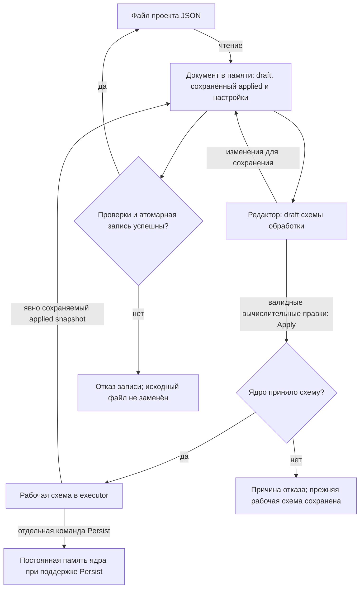

# Конфигурация и хранение

[Карта архитектуры](README.md) · [Формат проекта](../reference/project-format.md)

Проект хранится в UTF-8 JSON. Он объединяет редактируемую схему, отдельно
сохранённую применённую схему, привязки адаптеров и пользовательское представление.
Эти части имеют разных владельцев: executor исполняет схему обработки,
Qt-адаптер читает и сохраняет документ, GUI управляет размещением и настройками вида.

## Границы документа

| Данные | Где находятся | Кто использует |
| --- | --- | --- |
| Редактируемый draft | `scene_graph` | Редактор и подготовка следующего Apply |
| Сохранённый applied snapshot | Необязательный `pipeline_graph` | Восстановление явно сохранённой рабочей схемы |
| Конфигурационные зависимости | `configuration_bindings` внутри схемы | Domain resolver: SampleClock и FrequencyGrid |
| Привязки устройств/сети | `nodes[].adapter`, настройки `network` | Desktop routing и capture |
| Положение, подписи, inline-поля | `position`, `presentation` узлов | Редактор |
| Окна, графики, язык и тема | `ui` | Presentation и ConfigManager |
| Пресеты | `ui.pipeline_presets` | Явно выбранные снимки схемы и вида |

Доступ к редактору при загрузке, выборе примера и сохранении идёт через
зарегистрированную панель `dataFlow`, а не через дерево дочерних виджетов
главного окна. Закрытие панели или её перенос в отдельное окно не прекращает
доступ к схеме и её сохранение.

Функции чтения и сохранения файла сами по себе не применяют схему. При запуске
GUI отправляет редакторский draft на Apply; валидные вычислительные правки
редактора также применяются автоматически. Ручная кнопка Apply скрыта, а
сохраняемое поле `ui.pipeline_auto_apply` сейчас не отключает этот режим.
CLI отдельно отправляет Apply после чтения выбранного draft. Изменение темы,
камеры или положения блоков не меняет вычисления.

В следующей схеме участвуют редактор, документ в памяти, файл проекта и
исполнитель выбранного ядра. Draft — редактируемая схема обработки;
applied — успешно принятая рабочая схема. Сохранённый applied snapshot в файле
не становится рабочей схемой только из-за чтения файла. Запись проекта сохраняет
известные изменения вместе с расширениями исходного документа. Persist — другое
действие: сохраняет рабочую схему в постоянной памяти удалённого ядра, если
такая возможность поддерживается.

## Сохранение без потери расширений

`project_storage::OwnedProjectSource` сохраняет исходный документ и его точные
JSON-значения. `NumericProjectDocument` добавляет активный путь и baseline
дисковых байтов. Типизированный снимок схемы используется для исполнения; он не заменяет
весь пользовательский JSON при сохранении.

`stage_numeric_draft` и `stage_numeric_presentation` записывают известные поля
поверх source-owned документа. Неизвестные соседние поля сохраняются, а узлы,
порты, параметры и пресеты согласуются по стабильной identity. Через Qt JSON
проецируются зарегистрированные настройки, а точные числовые literals остаются
на специальной границе. Поддержанные редакции и поля описаны в
[справочнике формата](../reference/project-format.md).

CLI использует эти же проекции вместо разбора всего source через Qt JSON.
`read_numeric_network_settings` извлекает зарегистрированные serial/route поля
с лимитом маршрутов, переданным владельцем исполнения. Неизвестные числовые
расширения, включая не представимые в QJsonValue, не стирают сетевые настройки
или привязки устройств; известные невалидные поля отклоняются до публикации.

`save_numeric_project` проверяет документ и существующий файл до замены через
`QSaveFile` с отключённым direct-write fallback. Автосохранение отклоняет
изменённый, повреждённый или неподдерживаемый файл. Обычные «Сохранить»/Ctrl+S записывают читаемый текущий формат без
дополнительного предупреждения. Предупреждение требуется при замене
существующего повреждённого или неподдерживаемого документа. Явное сохранение
может создать или восстановить отсутствующий файл без модального вопроса;
изменение читаемого активного файла другим процессом по-прежнему отклоняется.
«Сохранить как» использует обычное подтверждение выбора существующего файла
в файловом диалоге; дополнительное предупреждение приложения относится только
к нечитаемому содержимому.
По умолчанию выбрана «Отмена». Сохранение использует контракты редактора,
без повторного опроса формата физических аудиоустройств; подготовка исполнения
продолжает разрешать их реальные форматы. Подтверждение разрешает заменить и файл, который не удалось открыть,
но не разрешает записать невалидный текущий документ.

Согласие связано с точными байтами и путём назначения. Если файл изменился
во время подтверждения или записи, операция отклоняется. Отмена не меняет
исходный файл, baseline и активный путь; успешная атомарная запись обновляет
их и снимает предупреждение о загрузке. Повторная проверка перед commit
уменьшает окно гонки, но не является межпроцессным compare-and-swap.

## Первый запуск и пользовательские настройки

Графическое приложение без явного пути использует `config.json` рядом с exe.
Явный путь нормализуется до абсолютного: завершающий разделитель после имени
файла не мешает чтению выбранного проекта. При неподдерживаемой версии ошибка
указывает найденную и ожидаемую редакции; автоматической миграции нет.
GUI создаёт стартовый демонстрационный проект только при отсутствии локального
config и удалённой/serial-привязки. Существующий повреждённый файл сохраняется;
он не даёт автоматического разрешения заменить его демо. Явное сохранение
текущей схемы может заменить этот файл после подтверждения пользователя. Builder проекта выполняет построение
данных; отдельный startup-сценарий GUI активирует схему.

`ConfigManager` читает зарегистрированные настройки и передаёт только изменения
в source document. Глобальные theme/language/autosave отделены от снимка
представления пресета. Режим autosave определяет запись редакторских изменений,
а не наличие работающей схемы в executor.

## Состояние окон при ошибке проекта

Закрытие графика сохраняет состояние open/closed, а переключение активной
вкладки меняет только её отрисовку. Инициализация навигации не открывает
закрытые представления. Перед восстановлением дополнительного окна проверяются
device, graph и наличие соответствующего блока; окна удалённых узлов не создаются.
Дополнительные диагностические представления не открываются автоматически.
Новые представления по умолчанию находятся в группе вкладок над Data Flow;
отдельное окно или разбиение создаётся явной командой размещения.

При валидном исходном проекте workspace и graph_views сохраняются обычной
операцией UI preferences, без staging текущего вычислительного draft.
Автосохранение включено по умолчанию. Сигналы модели отмечают конкретные ID
изменённых узлов и отдельно положение, представление и adapter. Узел отдаёт
свои текущие настройки через `numeric_node()`, `presentation()` и `adapter()`;
связями владеет модель графа. Обычная правка параметра заменяет только этот
узел через `stage_numeric_nodes`, перемещение — только position. Загрузка схемы,
изменение связей или execution interval требуют полного снимка графа.
Уведомления одного события объединяются через queued event без таймаута покоя.
GUI снимает только изменённые значения; один постоянный QThread готовит
source-owned изменения, проверяет их и выполняет атомарную запись QSaveFile.
Завершение возвращается событием, периодического опроса настроек нет.
Правки во время записи остаются в следующем наборе изменений; устаревший
результат не снимает их dirty-флаг. При отказе набор восстанавливается полным
снимком для повторной попытки. Ручной Save и закрытие дожидаются текущей записи
и сохраняют последние значения. Проверка внешнего изменения файла и сохранение
неизвестных исходных полей действуют и в фоновом пути.
Повторная валидация неизменённых графов использует ограниченный 8 МиБ кеш
в потоке: ключ включает точные байты, редакцию схемы и режим допуска. Любое
изменение содержимого проверяется заново; ошибки не кешируются.

Если проект не удалось загрузить, его файл остаётся защищённым, а размещение
и закрытые окна сохраняются отдельно в `<project>.workspace.ini` через
ConfigManager. Это ограниченное workspace recovery, не замена проекта:
версия 1, предел 4 МиБ, атомарная запись QSettings и SHA-256 исходных байтов.
При изменении источника либо неподдерживаемой версии recovery не загружается.
Восстановление не применяет DSP, не восстанавливает удалённые блоки и не снимает
ошибку загрузки. Пока граф не принят, сериализованная ADS topology не загружается,
а графики без блоков остаются закрытыми; используется безопасное исходное размещение.
Для нового рабочего проекта используется Save As; ручной Save также может
заменить защищённый исходник после отдельного подтверждения.

## Удалённое хранение

CONTROL Apply изменяет рабочую схему выбранного ядра. Команда Persist
отдельно сохраняет конкретную applied graph revision через
`ProcessingPersistencePort`, если ядро объявило эту возможность.
Обычный Qt-адаптер `NumericEngine` этот persistence-порт не подключает и
`explicit_persist` не объявляет. Сохранение GUI-проекта и Persist embedded-ядра
являются разными действиями.

GUI с `--remote-host` или serial-подключением работает как управляющий клиент:
startup пытается применить локальный редакторский draft к выбранному ядру,
а последующие валидные правки автоматически отправляются на Apply. Принятый
Apply заменяет его рабочую схему. Read-only ядро, конфликт ревизии,
неподдерживаемые adapter metadata или отказ admission могут отклонить запрос.
Успешный Apply сам по себе не означает Persist удалённой схемы.

Реализация: [project source](../../adapters/project_storage/),
[NumericProjectDocument](../../adapters/desktop/src/numeric_project_document.cpp),
[ConfigManager](../../adapters/desktop/gui_config/src/config_manager.cpp).

Частотные профили — отдельные JSON-документы версии 3 с пределом 1 ГиБ для данных всего прогона.
Desktop codec проверяет Fs, FFT, окно, спектральную величину, сетку Hz,
reference/floor, настройки обучения и ограниченную кривую gain. Сохранение
использует атомарный `QSaveFile`; roundtrip сохраняет неизвестные поля.
Компактный экспорт содержит общую статистику и происхождение композиций,
без обязательных подробных спектров каждого файла. При загрузке в узел
`FrequencyNormalizer` JSON входит в параметры проекта, но разбирается только
при подготовке через внедрённый loader. Несовместимый кандидат не заменяет
работающую схему.

В основной схеме результат файлового анализа передаётся типизированным массивом
`ArrayFill.values`. Непустой массив содержит ровно `size` конечных Float32;
пустой выбирает заполнение скаляром `value` (по умолчанию 1). Runtime получает
готовые значения без разбора внешнего формата на hot path.
`ArrayMultiply.operation` явно выбирает `multiply` или `add`;
при сложении доступны `floor_enabled`/`floor` для сохранения нижнего порога входа.
Параметры, операции и Undo/Redo сохраняются обычным механизмом проекта. JSON
офлайн-профиля для исполнения этого числового маршрута не требуется.

## Массив коэффициентов блока

Применение частотного профиля записывает `ArrayFill.values` как типизированный
`NumericArray`, а normalizer получает `gains` того же типа. JSON-адаптер хранит
объект `{type:"numeric_array",values:"f32le-base64:..."}`: IEEE-754 binary32
little-endian в каноническом Base64. Идентификаторы параметров/узлов сохраняются;
новый тип порта не вводится. `numeric_array_codec` разбирает внешний формат,
domain проверяет математические размер и конечность, runtime подготавливает
владеющие коэффициенты. JSON/CSV/Base64 не входят в processing path.
Ручной CSV разбирается на границе UI; пустой typed array задаёт заполнение
скалярным `value`. CONTROL использует внешний codec и владеющие encoded buffers,
не передаёт borrowed temporary строки. Unknown fields документа остаются у
source owner. Подробности — в [руководстве](../guides/music-spectrum.md).
Применение к маршруту `ArrayFill → ArrayMultiply` требует его устойчивые IDs
узлов и портов коэффициентов и ведущего кадра. Если `ArrayFill` питает несколько
связей, запрос отклоняется без изменения черновика; для независимой коррекции
ветвей нужны отдельные источники коэффициентов.

## Сканирование музыки и частотная функция

Офлайн-измерения и готовый профиль сохраняются независимо. Документ сканирования
`barelief.music_scan` v1 содержит frontend/cadence, диагностический порог тихих
кадров, полные средние/максимумы каждого трека, отдельные тихие/нулевые показатели
и bounded previews. Порог не фильтрует исходные измерения: исключается точный ноль.

Профиль v4 содержит переносимую FrequencyCurve: метод объединения максимумов
треков, полином Чебышёва или кусочную кубическую функцию лог-амплитуды в Гц,
параметры регуляризации, измеренный диапазон, спектр для оценки достоверности
и исходный массив gains. JSON и файлы принадлежат desktop adapter; математическая
агрегация, аппроксимация и вычисление gain — dsp_kernels. Сканирование и построение
не зависят от текущей схемы. Применение вычисляет коэффициенты на её объявленной
сетке до передачи NumericArray в существующий ArrayMultiply, без изменения DSP.
Отсутствующие/внешние диапазоны получают единицу, экстраполяции нет.

Версия 3 без функции сохраняет точную проверку frontend и прежние коэффициенты;
старые профили не переобучаются при чтении. Оба новых документа сохраняют unknown
fields, проверяют численные размеры/конечность, ограничивают JSON/распаковку 1 ГиБ
и заменяют файл/результат атомарно. Полные трековые массивы и previews используют
существующий f32/f64 little-endian + qCompress/Base64 codec. Применённый проект
хранит рассчитанный массив, поэтому при смене сетки функцию применяют повторно.
Подробнее — [руководство](../guides/music-spectrum.md#анализ-файлов-и-профили).
