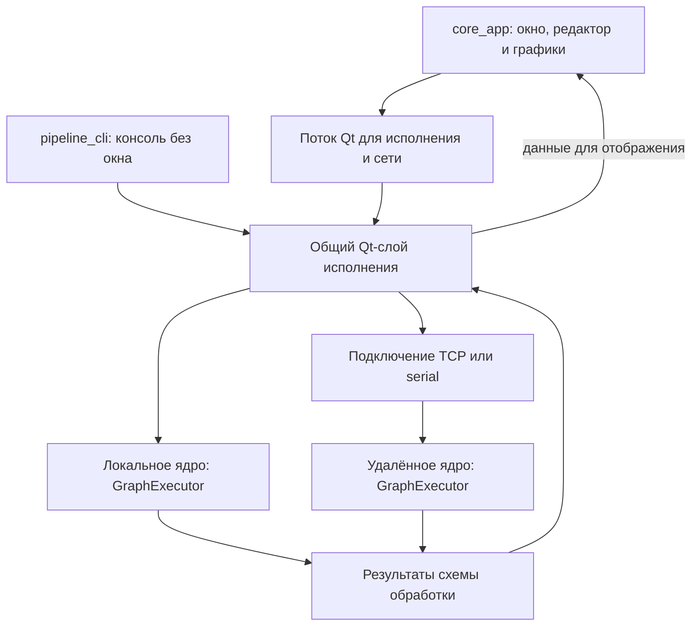
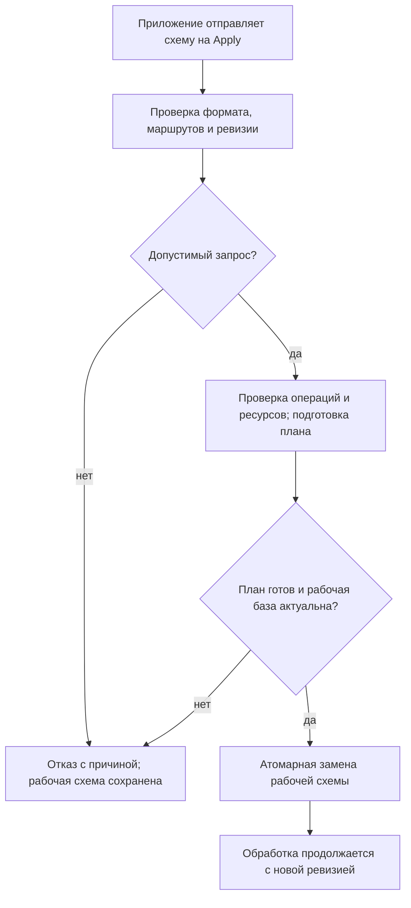

# Общий слой исполнения с Qt

[Карта архитектуры](README.md) · [Переносимое ядро](portable-core.md) · [Интерфейс](interface.md)

`core_app` — графическое Qt-приложение: редактор, настройки и графики.
`pipeline_cli` — консольное Qt-приложение: выполняет схему обработки без окна.
Оба используют общий Qt-слой исполнения, который подключает переносимое ядро
к устройствам, файлам, таймерам и сети. Математические операции и выполнение
схемы принадлежат единственной реализации `dataflow_runtime::GraphExecutor`.
Каждое локальное или удалённое ядро владеет своим экземпляром этого исполнителя.

Cold ProfileDecorator необязательного research runner явно выбирает runtime
и его admission.frame. CONTROL-проекция контрактов, preflight reply envelope
и серверный codec используют этот выбранный frame-профиль. Вызов
control_limits() без аргумента сохраняет обычные desktop-границы. Wire/arena,
replay, DATA и асинхронная доставка имеют отдельные неизменённые лимиты;
большой declared contract сам по себе не разрешает большой DATA payload.
Удалённый клиент должен явно допускать контракт peer своим профилем;
запуск research runner не расширяет границы обычного GUI-клиента.

Существующие реализации Qt-слоя находятся в `adapters/desktop/`: захват через
miniaudio, TCP/serial через Qt и платформенные ресурсы ОС, включая политику
таймеров Windows. Наличие Qt не делает эти адаптеры автоматически переносимыми
на микроконтроллер. Прошивка подключает общий вычислительный SDK через свои адаптеры.

## Состав и ответственность

| Часть | Назначение |
| --- | --- |
| `NumericEngine` | Связывает `GraphLifecycle` и `ProcessingControlService` с executor, захватом и доставкой результатов |
| `NumericDesktopHost` | В GUI размещает локальное или удалённое подключение, CONTROL-сервер и реестр в отдельном потоке Qt |
| `SourceIngress` | Управляет физическим захватом, локальными часами, генераторами и внешними входами |
| `ExecutionBoundary` | Сериализует доступ к executor и его опубликованному состоянию |
| `DeliveryHub` | Создаёт ограниченные владеющие результаты для потребителей и диагностические previews |
| `NumericRoutingAdapter` | Связывает NetworkInput/NetworkOutput с выбранными адресами портов данных и транспортными адаптерами |
| `NumericRemoteEndpoint` | Представляет удалённое ядро через тот же `EnginePort`, согласует управление и подписки на адреса портов данных |

Платформенные ресурсы собираются в entrypoint приложения. `NumericEngine` получает
фабрику захвата и обработчики routing-адаптера; переносимое ядро не создаёт Qt
объекты и не читает JSON. Код границ находится в
[Qt-адаптерах исполнения](../../adapters/desktop/runtime/src/), а сборка подключений GUI — в
[DesktopEngineProvider](../../apps/desktop_gui/include/core_app/desktop_engine_provider.h).

Ошибка вычисления в потомке не означает потерю входного PCM-пакета.
`SourceIngress` не превращает такую ошибку в разрыв захвата и не сбрасывает
состояние ресэмплера или скользящего окна в других ветвях. Реальные потери
определяются интервалами принятых отсчётов и признаками разрыва источника.
Для переменной PCM-формы максимальная длина резервирует ёмкость, а не задаёт
обязательное ожидание полного блока. Доступный пакет публикуется при достижении
минимальной длины контракта; actual, sample_begin и sample_count описывают
реально переданные отсчёты. Фиксированная форма продолжает накапливать полный блок.

## Два способа запуска

`pipeline_cli` создаёт `QCoreApplication`, загружает canonical-проект или строит
стандартную схему, выбирает `NumericEngine` либо `NumericRemoteEndpoint` и
отправляет Apply. Его Qt event loop обслуживает команды и transport без
графического интерфейса. При `--server` локальный executor доступен другим
клиентам; запись разрешается отдельным флагом `--allow-mutations`.

CLI использует общий ограниченный reader canonical-проекта. Выбор пресета и
частоты анализа отделён от создания транспорта и исполнения. `CliRuntime`
владеет подключением, сервером, discovery и таймером завершения: сервер
уничтожается до ядра, а discovery остаётся живым до завершения routing-адаптера.

`core_app` создаёт `QApplication`, редактор и представления. `NumericDesktopHost`
размещает локальное ядро или удалённое подключение и сетевые ресурсы в отдельном
`QThread`. Между worker и GUI передаются ограниченные владеющие сообщения. Задержка GUI не превращается
в остановку executor; скрытие графика меняет подписку/отрисовку.
Локальная проверка отдельного узла читает неизменяемый профиль исполнения и
чистые функции возможностей в вызывающем потоке GUI, без ожидания worker и
блокировки DSP. Владелец удерживает `NumericDesktopHost` до завершения запроса.
Повтор неизменившейся нормализованной подписки проверяется по опубликованному
набору в вызывающем потоке. Сетевая диагностика читается из кэша, обновляемого
worker вместе со снимками/ответами и после явной настройки сети. Эти запросы
статуса и неизменённой подписки не ожидают завершения обработки в worker.
Подготовка и Apply схемы сохраняют проверки и синхронизацию на границе исполнения;
для удалённого ядра его возможности остаются окончательными при Apply.
CLI собирает подключение к ядру непосредственно в своём event loop, без этого GUI-моста.

Размер desktop-схемы ограничен512 узлами и2048 связями. Редактор, построители
примеров и профиль локального исполнителя используют общие значения
`desktop::NumericGraphBudget`; проверка Apply сохраняет ограничения выбранного
локального или удалённого профиля.

Очередь обычных GUI-предпросмотров удерживает не более 32 владеющих кадров.
Повтор одного выхода заменяется его последним кадром; при большем числе
выходов приоритет получают те, которые дольше не передавались GUI. Порядок
обработки узлов не должен постоянно вытеснять одну и ту же ветвь. Учёт
приоритета хранит только метаданные подписок; отдельные очереди строк History
и холодных снимков сохраняют свои ограничения.
Локальный холодный запрос выдаёт снимки пачками в очередь из восьми элементов:
при заполнении он ждёт освобождения места и продолжает с того же порта.

На схеме ниже два приложения являются участниками верхнего уровня. Общий
Qt-слой выбирает локальное исполнение либо управляющее подключение к удалённому
ядру — другому процессу или устройству. GUI дополнительно использует отдельный
поток, чтобы его отрисовка не задерживала обслуживание ядра. Блоки исполнителя
обозначают экземпляры одной переносимой реализации.

При запуске GUI пытается Apply текущего редакторского draft, включая выбранное
TCP/serial-ядро. Валидные вычислительные правки затем применяются автоматически;
сохраняемое `ui.pipeline_auto_apply` сейчас не отключает этот режим, ручная
кнопка скрыта. Подключение не гарантирует успешный Apply: права, ревизия,
metadata адаптеров или возможности удалённого ядра могут привести к отказу.

## Активация и обработка

Apply проходит декодирование, проверку маршрутов, domain admission и подготовку
памяти. Дорогая подготовка desktop-плана выполняется вне processing lock;
перед регистрацией и заменой повторно проверяется исходная рабочая база.
Успешный Apply согласованно заменяет рабочую схему в executor и публикует её
ревизию. При отказе существующая рабочая схема продолжает работать.

Участники следующего процесса — приложение, Qt-адаптер и переносимое ядро.
Приложение отправляет новую схему; адаптер проверяет внешние данные и маршруты;
ядро проверяет допустимость операций, контрактов и ресурсов, затем готовит
план. Рабочая схема заменяется только после успешного завершения всего пути.
Для удалённого запроса также проверяются права и ревизия выбранного ядра.

Пользовательской команды Start/Stop в `EnginePort` нет. После Apply обработка
активна; завершение источников, transport и executor выполняет владелец при
teardown. Подавление узла и изменение проводов меняют данные/маршрут, а не
жизненный цикл приложения. Заимствованный processing frame используется только
синхронно; асинхронная доставка удерживает owning buffer.

Физический источник согласуется с фактическим Fs и числом выходов устройства
до Apply. Один выход соответствует одному потоку. Если известный источник
временно недоступен, исполнитель может продвигать его ветвь типизированными нулями;
несоответствующий обнаруженный формат не подменяется незаметно.

`desktop_source_formats` объявляет native source rate/ports и вызывает общий
domain resolver с изменённым источником. Он не выбирает частоту генератора,
не меняет чужие clock bindings и не округляет analysis interval под Fs устройства.
Согласование выполняется над кандидатом схемы. Если обнаруженное число каналов
удаляет подключённый выход, кандидат отклоняется целиком, а существующее ребро
остаётся в черновике. Типизированная диагностика содержит узел и номер выхода;
Qt-слой переводит причину для пользователя.
Resolver получает admission limits выбранного исполнителя явным аргументом;
проверка размера и владения выполняется до копирования кандидата. Собственного
скрытого профиля лимитов у согласования формата нет.
Для преобразования Fs используется явный ресэмплер. Storage adapter не владеет
алгоритмом согласования устройств и не содержит собственного DSP kind dispatcher.

## Наблюдаемость

Исполнитель считает вызовы, выпущенные результаты, ошибки, собственное время узла,
histogram и deadline misses. Qt-адаптеры добавляют диагностику захвата, очередей,
потерь, Mixer и локальных часов. Это позволяет различать Fs сигнала, темп
анализа и темп представления; значение GUI FPS не измеряет нагрузку DSP.
Достижимость конкретной частоты требует измерения выбранной схемы и устройства.

Строка `RhythmAnalyzer` в `EngineSnapshot.diagnostics.node_stats` также содержит
`clipped_frames`, `clipped_values` и `maximum_before_clamp`. Первые два поля —
накопительные UInt64, сериализованные десятичными строками без потери точности;
максимум — исходное Float32-значение среди принятых кадров, включая значения0…1.
Кадр учитывается как clipped один раз, каждое значение выше1 — отдельно.
Clipping не увеличивает `errors` и не останавливает часы. Некорректный кадр
не изменяет эти счётчики. Они сохраняются при сбросах источника, разрывах и
совместимом Apply; подготовка нового несовместимого состояния начинает с нуля.
Native-счётчики читаются на cold query под существующей сериализацией executor;
Qt-адаптер собирает JSON под тем же mutex, что защищает обработку.

См. [API исполнения](../reference/runtime-api.md),
[сборку и запуск](../reference/build-and-run.md),
[конфигурацию](configuration-and-storage.md) и
[обмен между ядрами](embedded-and-exchange.md).

Полная история составного музыкального ряда может превышать32768 значений.
Длина настольной History задаётся пользователем без фиксированного порога
кадров, элементов или байт. `desktop::NumericFrameBudget` содержит только
границы представимости размеров; переполнения проверяются перед выделением.
Память схемы готовится до обработки, отказ выделения не заменяет рабочую схему.
В embedded-профилях остаются их явно заданные аппаратные бюджеты.
Обычные delivery/preview арены сохраняют 128 слотов по 256 KiB payload и 48 KiB
metadata. Cold History query переиспользует обычные снимки и отдельные leases
фактического размера для больших историй. Эти буферы принадлежат доставленному
контексту, переживают изменение схемы и teardown исполнителя. Выделение большого
снимка происходит по явному запросу, вне DSP ingress; последующие запросы
переиспользуют освободившееся хранилище. Компактные realtime строки не копируют
всю матрицу и используют обычные delivery арены.

Desktop composition root `NumericEngine` подключает `dsp_graph_adapters` через
`with_dsp_operations`. Пресет `reference-beat` использует живой системный выход:
`AudioSource → Window(2048) → ArrayMultiply → RealFourier → AmplitudePhase(power)
→ Mel(128) → PowerToDb → OnsetStrength → FeatureAggregate(median)`.
Источник выдаёт512 отсчётов за кадр. Дополнительных FrameBuffer и ресэмплера нет.
`ArrayLength → WindowFunction(periodic Hann)` задаёт размер и коэффициенты
умножения. Коэффициенты также явно подключены к спектральному блоку, как в
пользовательском сохранении; при normalize=false коррекция выключена, мощность равна
Re²+Im², без C/E-калибровки и удвоения односторонних бинов. DC остаётся отдельным
выходом Real FFT; его вес в выбранном Slaney-банке равен0. FFT не читает Fs.
Mel получает Fs и N явными связями и вычисляет шаг частот внутри; локальные
поля, заданные связями, недоступны для параллельного редактирования.

Каждые512 новых отсчётов вычисляются один FFT, Mel-вектор и скалярная атака.
`PowerToDb(ref=1, top_db_enabled=false)` работает только с новым вектором.
Векторный `OnsetStrength(lag=1, max_size=1, center=false, detrend=false, aggregate=none)`
хранит только предыдущие lag кадров и выдаёт положительные разности полос.
Отдельный FeatureAggregate считает медиану. Это причинная адаптация формул
librosa; она не воспроизводит пакетные defaults с центрированием и общей
отсечкой top_db80 по всей истории. Начальное PCM-окно дополняется нулями слева.

Обычный `Window` хранит историю скалярных атак (751значение при48кГц).
`FrameStride(20)` передаёт снимок атак в явный `ArrayMultiply` с коэффициентами
периодического Hann из `WindowFunction`. `DirectCorrelation` получает результат
на оба семантических входа (Reference/Compared), число задержек — от `ArrayLength`.
`VectorNormalize` нормирует профиль по максимуму, `TempoEstimate` выдаёт скаляр BPM.
Fs и шаг512 связаны явно; длина профиля поступает от ArrayLength истории.
`DynamicBeatPath` получает тот же снимок атак и скаляр BPM и выдаёт маску долей
и диагностические ряды, длина которых следует за входным окном. На тишине
выбранная политика silence_zero даёт0 BPM и пустую маску.
При48кГц спектр/атаки обновляются93.75раз/с, темп/сетка — около4.69раз/с;
every_n редактируется независимо от GUI FPS. Стоимость ACF/DP остаётся
периодической и не объявляется доказанным бюджетом MCU.

Mel-строки не накапливаются в отдельной ветви изображения.
BPM накапливается обычным Window для графика истории темпа. Представления
показывают PCM, мощность, Mel, атаки, ACF, BPM, доли и оценки пути; Re/Im
не занимают отдельные графики. Основой пресета служит пользовательское сохранение
от02.11.2026 с удалённой ветвью истории Mel и графиком коэффициентов окна:37 узлов,52 связи,8 общих Reroute вместо18. Положение остальных узлов
и порядок входов пяти блоков сохранены. NumericExampleGraph передаёт port_orders
как переносимые идентификаторы; Qt-адаптер применяет только порядок отображения,
не меняя вычислительные ID входов. Базовая стартовая схема остаётся генератором,
обычным Window и графиком.

Связанные вычислительные параметры не дублируются ручными полями редактора.
Контракты операций анализа показываются без выбора производного типа данных;
названия портов описывают значения вместо номеров. Fs и шаг анализа остаются
явными входами для перевода лагов в BPM. `PowerToDb` остаётся отдельной операцией:
логарифм мощности нужен для положительной разности log-Mel-признаков.
В потоковом `OnsetStrength` вход N FFT отсутствует: FFT уже выполнено до него,
а разность соседних Mel-векторов не использует размер FFT. Компенсация FFT и окна
в основной ветви выключена для соответствия сырому `|STFT|²` эталона; связь
коэффициентов окна задаёт их значения, но не включает компенсацию автоматически.

Очередь обычных tap-кадров вмещает128 событий; для удержания payload адаптер
делит половину128 слотов delivery-пула между выбранными конечными точками.
Оставшиеся слоты нужны потребителям и кэшу последних кадров, в том числе
новому выходу после смены подписок. Один быстрый источник не занимает резерв
остальных. Уже принятые события сохраняют FIFO-порядок. Исчерпание пула
учитывается как потеря доставки с discontinuity следующего принятого кадра.
Кэш последнего вычисленного кадра обновляется и при заполненной tap-очереди;
ограничение FIFO не делает доступный результат недоступным для явного запроса.
При превышении бюджета новый кадр отбрасывается, счётчик потерь растёт,
а следующий принятый кадр этой точки получает признак discontinuity.
Проверка занятости проходит только ограниченную очередь, без копирования payload
и без выделения памяти. DSP-исполнение и отдельные компактные строки History
не меняют своего алгоритма из-за этого ограничения транспорта наблюдений.

Опциональный `rhythm_reference_runner` собирается отдельной целью, вне ALL и
переносимого SDK. Он экспортирует именованные canonical-проекты библиотечных
рецептов и подключает reference factory явным ProfileDecorator конструктора
NumericEngine. Декоратор вызывается до создания executor; main не получает
GPL/AGPL зависимости. Профиль исследовательского процесса отдельно разрешает
полные session-матрицы до4млн элементов/16МиБ и ограниченный общий бюджет2ГиБ;
обычные desktop/SDK limits и размеры delivery-пулов сохраняются. Крупные
матрицы нельзя считать доступными через обычные tap-слоты: для просмотра
используются небольшие диагностические выходы/строки. Endpoint использует
существующие CONTROL/DATA и loopback, собственного исполнителя нет.

Cold composition runner выбирает FFT factory только по явному `backend_id`
узлов `Fourier`/`RealFourier`: пустые ID оставляют встроенное вычисление без
провайдера; один непустой ID выбирает установленный KISS или Ooura с точным
совпадением. Неизвестные, неверно типизированные и конфликтующие ID отклоняются
до создания NumericEngine. Имя рецепта, размер сигнала и upstream-маршрут не
участвуют в выборе. Профиль удерживает factory, а prepared-планы независимо
владеют ресурсами и клонируются. Это политика необязательного composition root,
а не автоматический выбор численного backend в переносимом runtime.
