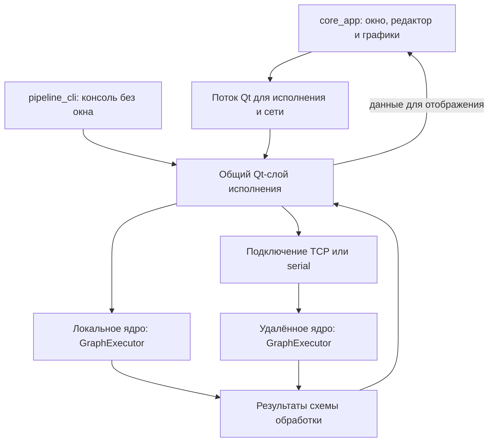
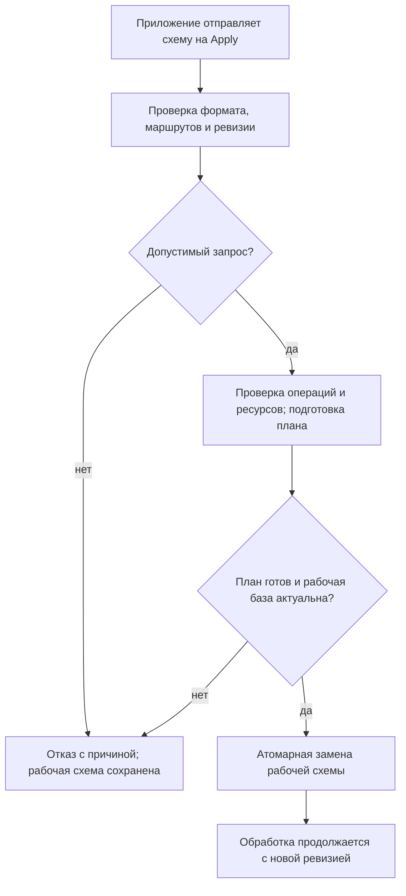

# Общий слой исполнения с Qt

[Карта архитектуры](README.md) · [Переносимое ядро](portable-core.md) · [Интерфейс](interface.md)

`core_app` — графическое Qt-приложение: редактор, настройки и графики.
`pipeline_cli` — консольное Qt-приложение: выполняет схему обработки без окна.
Оба используют общий Qt-слой исполнения, который подключает переносимое ядро
к устройствам, файлам, таймерам и сети. Математические операции и выполнение
схемы принадлежат единственной реализации `dataflow_runtime::GraphExecutor`.
Каждое локальное или удалённое ядро владеет своим экземпляром этого исполнителя.

Существующие реализации Qt-слоя находятся в `adapters/desktop/`: захват через
miniaudio, TCP/serial через Qt и платформенные ресурсы ОС, включая политику
таймеров Windows. Наличие Qt не делает эти адаптеры автоматически переносимыми
на микроконтроллер. Прошивка подключает общий вычислительный SDK через свои адаптеры.

## Состав и ответственность

| Часть | Назначение |
| --- | --- |
| `NumericEngine` | Связывает `GraphLifecycle` и `ProcessingControlService` с executor, захватом и доставкой результатов |
| `NumericDesktopHost` | В GUI размещает локальное или удалённое подключение, CONTROL-сервер и реестр в отдельном потоке Qt |
| `SourceIngress` | Управляет физическим захватом, локальными часами, генераторами и внешними входами |
| `ExecutionBoundary` | Сериализует доступ к executor и его опубликованному состоянию |
| `DeliveryHub` | Создаёт ограниченные владеющие результаты для потребителей и диагностические previews |
| `NumericRoutingAdapter` | Связывает NetworkInput/NetworkOutput с выбранными адресами портов данных и транспортными адаптерами |
| `NumericRemoteEndpoint` | Представляет удалённое ядро через тот же `EnginePort`, согласует управление и подписки на адреса портов данных |

Платформенные ресурсы собираются в entrypoint приложения. `NumericEngine` получает
фабрику захвата и обработчики routing-адаптера; переносимое ядро не создаёт Qt
объекты и не читает JSON. Код границ находится в
[Qt-адаптерах исполнения](../../adapters/desktop/runtime/src/), а сборка подключений GUI — в
[DesktopEngineProvider](../../apps/desktop_gui/include/core_app/desktop_engine_provider.h).

Ошибка вычисления в потомке не означает потерю входного PCM-пакета.
`SourceIngress` не превращает такую ошибку в разрыв захвата и не сбрасывает
состояние ресэмплера или скользящего окна в других ветвях. Реальные потери
определяются интервалами принятых отсчётов и признаками разрыва источника.

## Два способа запуска

`pipeline_cli` создаёт `QCoreApplication`, загружает canonical-проект или строит
стандартную схему, выбирает `NumericEngine` либо `NumericRemoteEndpoint` и
отправляет Apply. Его Qt event loop обслуживает команды и transport без
графического интерфейса. При `--server` локальный executor доступен другим
клиентам; запись разрешается отдельным флагом `--allow-mutations`.

CLI использует общий ограниченный reader canonical-проекта. Выбор пресета и
частоты анализа отделён от создания транспорта и исполнения. `CliRuntime`
владеет подключением, сервером, discovery и таймером завершения: сервер
уничтожается до ядра, а discovery остаётся живым до завершения routing-адаптера.

`core_app` создаёт `QApplication`, редактор и представления. `NumericDesktopHost`
размещает локальное ядро или удалённое подключение и сетевые ресурсы в отдельном
`QThread`. Между worker и GUI передаются ограниченные владеющие сообщения. Задержка GUI не превращается
в остановку executor; скрытие графика меняет подписку/отрисовку.
CLI собирает подключение к ядру непосредственно в своём event loop, без этого GUI-моста.

Очередь обычных GUI-предпросмотров удерживает не более 32 владеющих кадров.
Повтор одного выхода заменяется его последним кадром; при большем числе
выходов приоритет получают те, которые дольше не передавались GUI. Порядок
обработки узлов не должен постоянно вытеснять одну и ту же ветвь. Учёт
приоритета хранит только метаданные подписок; отдельные очереди строк History
и холодных снимков сохраняют свои ограничения.
Локальный холодный запрос выдаёт снимки пачками в очередь из восьми элементов:
при заполнении он ждёт освобождения места и продолжает с того же порта.

На схеме ниже два приложения являются участниками верхнего уровня. Общий
Qt-слой выбирает локальное исполнение либо управляющее подключение к удалённому
ядру — другому процессу или устройству. GUI дополнительно использует отдельный
поток, чтобы его отрисовка не задерживала обслуживание ядра. Блоки исполнителя
обозначают экземпляры одной переносимой реализации.

При запуске GUI пытается Apply текущего редакторского draft, включая выбранное
TCP/serial-ядро. Валидные вычислительные правки затем применяются автоматически;
сохраняемое `ui.pipeline_auto_apply` сейчас не отключает этот режим, ручная
кнопка скрыта. Подключение не гарантирует успешный Apply: права, ревизия,
metadata адаптеров или возможности удалённого ядра могут привести к отказу.

## Активация и обработка

Apply проходит декодирование, проверку маршрутов, domain admission и подготовку
памяти. Дорогая подготовка desktop-плана выполняется вне processing lock;
перед регистрацией и заменой повторно проверяется исходная рабочая база.
Успешный Apply согласованно заменяет рабочую схему в executor и публикует её
ревизию. При отказе существующая рабочая схема продолжает работать.

Участники следующего процесса — приложение, Qt-адаптер и переносимое ядро.
Приложение отправляет новую схему; адаптер проверяет внешние данные и маршруты;
ядро проверяет допустимость операций, контрактов и ресурсов, затем готовит
план. Рабочая схема заменяется только после успешного завершения всего пути.
Для удалённого запроса также проверяются права и ревизия выбранного ядра.

Пользовательской команды Start/Stop в `EnginePort` нет. После Apply обработка
активна; завершение источников, transport и executor выполняет владелец при
teardown. Подавление узла и изменение проводов меняют данные/маршрут, а не
жизненный цикл приложения. Заимствованный processing frame используется только
синхронно; асинхронная доставка удерживает owning buffer.

Физический источник согласуется с фактическим Fs и числом выходов устройства
до Apply. Один выход соответствует одному потоку. Если известный источник
временно недоступен, исполнитель может продвигать его ветвь типизированными нулями;
несоответствующий обнаруженный формат не подменяется незаметно.

`desktop_source_formats` объявляет native source rate/ports и вызывает общий
domain resolver с изменённым источником. Он не выбирает частоту генератора,
не меняет чужие clock bindings и не округляет analysis interval под Fs устройства.
Согласование выполняется над кандидатом схемы. Если обнаруженное число каналов
удаляет подключённый выход, кандидат отклоняется целиком, а существующее ребро
остаётся в черновике. Типизированная диагностика содержит узел и номер выхода;
Qt-слой переводит причину для пользователя.
Resolver получает admission limits выбранного исполнителя явным аргументом;
проверка размера и владения выполняется до копирования кандидата. Собственного
скрытого профиля лимитов у согласования формата нет.
Для преобразования Fs используется явный ресэмплер. Storage adapter не владеет
алгоритмом согласования устройств и не содержит собственного DSP kind dispatcher.

## Наблюдаемость

Исполнитель считает вызовы, выпущенные результаты, ошибки, собственное время узла,
histogram и deadline misses. Qt-адаптеры добавляют диагностику захвата, очередей,
потерь, Mixer и локальных часов. Это позволяет различать Fs сигнала, темп
анализа и темп представления; значение GUI FPS не измеряет нагрузку DSP.
Достижимость конкретной частоты требует измерения выбранной схемы и устройства.

См. [API исполнения](../reference/runtime-api.md),
[сборку и запуск](../reference/build-and-run.md),
[конфигурацию](configuration-and-storage.md) и
[обмен между ядрами](embedded-and-exchange.md).

Полная история составного музыкального ряда может превышать32768 значений.
Настольный frame admission допускает131072 элементов и512 KiB payload.
Обычные delivery/preview арены сохраняют128 слотов по256 KiB; полная History
запрашивается отдельно в арене восьми снимков по512 KiB с16 KiB metadata.
Эта ограниченная память учитывается в process reservation, а её shared lifetime
сохраняется контекстом доставленного кадра. Компактные realtime строки истории
не копируют всю матрицу и продолжают использовать обычные delivery арены.
