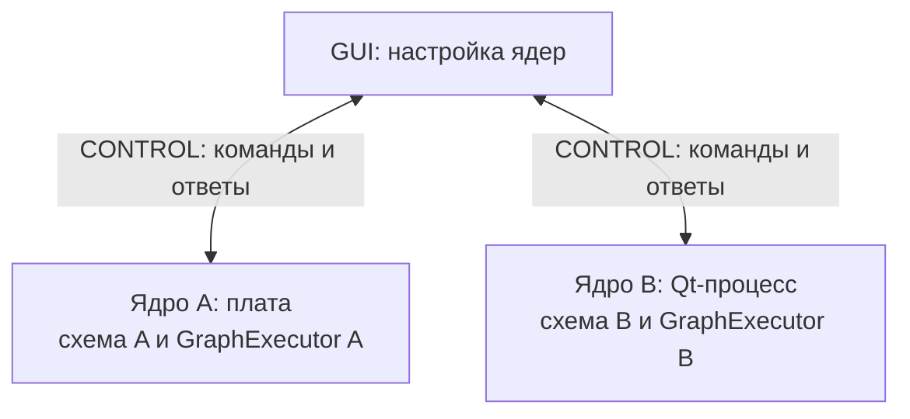
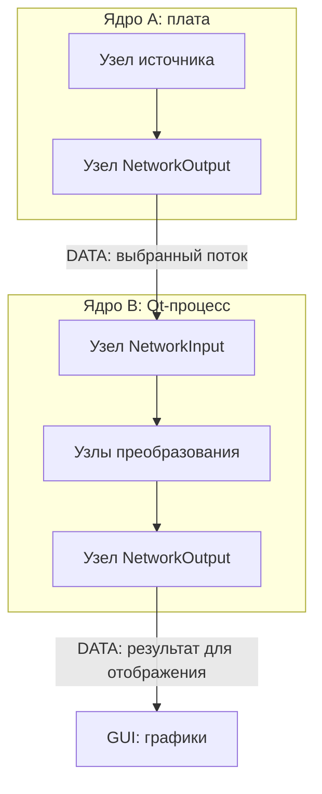
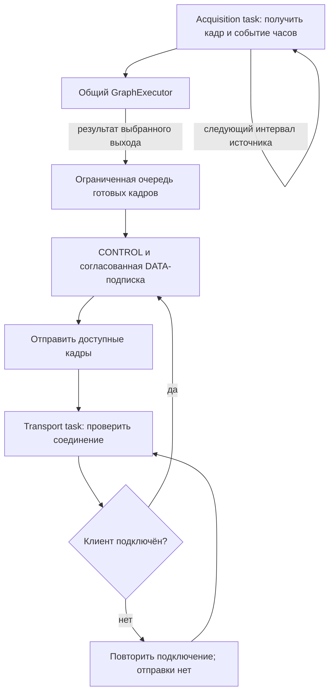

# Embedded и обмен между ядрами

[Карта архитектуры](README.md) → embedded и обмен

Устройство исполняет ту же переносимую схему, что и desktop. Компоненты ESP-IDF
компилируют общие исходники контрактов, domain/application, DSP, runtime и протокола
с toolchain целевой платформы. Аппаратные задачи, таймер, TCP/UART, NVS и драйвер
источника принадлежат внешнему слою. [SDK guide](../reference/embedded-sdk.md)
описывает подключение к собственной прошивке.

## Устройство как удалённое ядро

**Endpoint сервиса** — доступный экземпляр ядра: настольный процесс или плата
со своей схемой обработки, рабочей ревизией, `GraphExecutor` и профилем ресурсов.
**Адрес данных** внутри него уточняет схему, узел, направление и порт. Например,
выход 1 узла-источника — адрес данных, а не ещё один экземпляр ядра.
Термины «схема обработки», «узел» и «график» различаются в
[общем словаре](README.md#термины).

Инженер явно соединяет `NetworkOutput` и `NetworkInput`; реестр помогает
обнаружить участников и потоки. Код не размещает произвольные узлы автоматически
на других устройствах. GUI настраивает и наблюдает выбранное ядро через его интерфейсы.

В stock-примере `examples/esp32_streamer` устройство собирает один executor,
`GraphLifecycle` и `ProcessingControlService`. Отдельная acquisition/DSP task
подаёт кадры и clock events; другая task обслуживает CONTROL и TCP/UART. Доступ
к исполнителю сериализуется. Между DSP и отправкой стоит ограниченная владеющая
очередь: отсутствие клиента или медленный транспорт не переводят обработку
в ветвь «только пока подключено».

Пример по умолчанию создаёт mono RAW Float32 источник на 8 кГц с блоком 256
отсчётов, восемью изменяющимися тестовыми тонами и явным Converter перед сетевым
выходом. Опциональная спектральная схема добавляет Window → Hann → FFT → Mel8.
History в этом профиле выключена. Это профиль примера, а не предел возможностей
общего ядра и не требование воспроизводить тестовые тоны через динамики.

## CONTROL и DATA

CONTROL означает управление ядром: запрос состояния, настройку и применение
схемы. DATA означает кадры сигнала или готового результата. В следующем примере
сервис A на плате передаёт поток настольному сервису B; B обрабатывает его своей
схемой. `NetworkOutput` и `NetworkInput` — узлы на соответствующих сторонах связи.
GUI является клиентом обоих сервисов и может показывать результаты B.

| Участник | Собственное состояние и роль |
| --- | --- |
| Сервис A на плате | Схема A и её executor; периферию и транспорт подключает прошивка |
| Сервис B в Qt-процессе | Схема B и её executor; источники и сеть подключает Qt-слой |
| GUI | Посылает команды выбранному сервису и рисует полученные данные |
| CONTROL / DATA | Два назначения обмена; могут идти по одному физическому соединению |

Первый рисунок показывает управление. GUI выбирает нужное ядро и отправляет
ему CONTROL-команды. Каждое ядро хранит собственную рабочую схему и имеет
собственный экземпляр `GraphExecutor`.

Второй рисунок показывает данные. В ядре A узел источника передаёт сигнал
сетевому выходу `NetworkOutput`. В ядре B сетевой вход `NetworkInput` принимает
его и передаёт своим узлам преобразования. Результат B публикуется для GUI.
Узлы внутри каждого прямоугольника исполняет соответствующий `GraphExecutor`;
провод DATA между прямоугольниками соединяет два самостоятельных ядра.

Рисунки показывают границу между двумя схемами. Размещение узлов по ядрам
задаёт инженер. Консольный `pipeline_cli` и графический `core_app` используют общий
Qt-слой исполнения; в обоих случаях DSP выполняет переносимый executor.
Пример `esp32_streamer` предоставляет локальный source/publisher profile: он
публикует результаты платы, но в текущей composition отвергает `NetworkInput`.
Поэтому рисунок направляет DATA с платы в desktop, где доступен сетевой вход.
Для приёма сетевого потока самой платой нужна другая firmware composition.

CONTROL использует schema version 4 и согласует CBOR либо Protobuf. Он переносит
capabilities, состояние, Prepare/Apply, зарегистрированные параметры и явное
Persist. Подготовленный кандидат, активная схема и сохранённая конфигурация
различаются. Запросы защищены session/request/revision и токеном кандидата;
повтор в поддерживаемом replay scope не выполняет мутацию заново.

DATA payload version 6 переносит кадр конкретного узла/порта, контракт, исходное
время и отдельную идентичность доставки. Подписка активируется после положительного
Subscribe/Ack; `NumericSession` принимает только выбранную binding. CONTROL и DATA
могут использовать общий `PacketStream`, а крупный кадр передаётся фрагментами.
Apply и reconnect выводят старые binding/очереди из обращения, чтобы поздний
кадр прежней ревизии не стал текущим результатом.

Транспортный byte API не владеет сокетом или UART. Их подключают desktop/ESP-IDF
адаптеры. Ограничение очереди, sequence gaps и discontinuity сообщают о пропусках.
Часы доставки не заменяют время сигнала. Для разных Fs нужен явный Resampler;
межустройственная синхронизация и компенсация drift сейчас не выполняются.

Независимость обработки от клиента видна в stock firmware: acquisition task
получает отсчёты и вызывает executor, transport task обслуживает соединение и
отправку. Очередь между ними ограничена и владеет своей памятью. В рисунке
ветка «нет соединения» принадлежит только отправке; DSP продолжает обработку.

Реальная очередь может отбросить полный кадр при переполнении и отмечает пропуск.
Она не создаёт неограниченный backlog. Эта организация программных задач не
является измерением их сроков выполнения, heap/stack или физической связи.

## Ресурсы и сохранение

`embedded_support::Profile` задаёт бюджет памяти, stack reservations, размеры
кадров и пакетов, лимиты очереди и пропускной способности. Device capabilities
проверяют сочетание операции, геометрии и ресурсов, а `graph_link_admission`
добавляет стоимость всех публикуемых выходов и fragmentation. Числа профиля
являются лимитами admission, их нельзя выдавать за измеренный heap или CPU.

Stock entrypoint берёт минимум настроенного memory ceiling и бюджета, который
сообщил host. Prepare учитывает работающую схему и кандидат одновременно.
Недостаточный бюджет отвергает замену, сохраняя рабочую схему; размеры FFT,
History и частота не уменьшаются скрыто.

NVS-адаптер хранит схему в namespace `numeric`, в двух CRC-защищённых слотах.
Restore проверяет записи и admission, выбирает последнюю допустимую схему и
применяет её через тот же service. Повреждение не запускает частично прочитанный
описание схемы и не вызывает erase partition. Запись происходит только при явном Persist,
а не на каждом кадре или изменении параметра.

Сборка SDK, host consumer, fake-IDF исполнение, Xtensa compilation и запуск на
плате — разные виды проверки. Исходники и host-тесты не доказывают достижимость
120 Гц, реальные heap/stack, throughput WiFi/UART, периферию или power-cut
durability на конкретном устройстве.

## Связанные документы и исходники

- [Переносимое ядро](portable-core.md), [Qt-слой исполнения](desktop-runtime.md).
- [Протокол](../reference/protocol.md), [SDK guide](../reference/embedded-sdk.md).
- [Профиль admission](../../libs/embedded_support/include/embedded_support/profile.h), [DATA session](../../libs/embedded_support/include/embedded_support/session.h).
- [Entrypoint устройства](../../examples/esp32_streamer/main/main.cpp), [платформенные hooks](../../examples/esp32_streamer/main/host_hooks.h).
