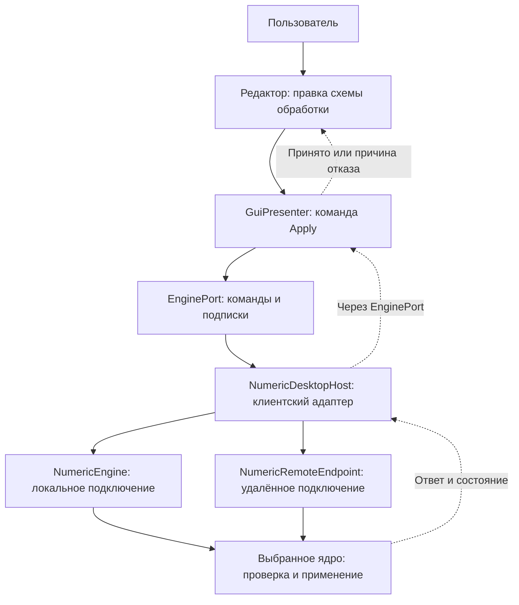
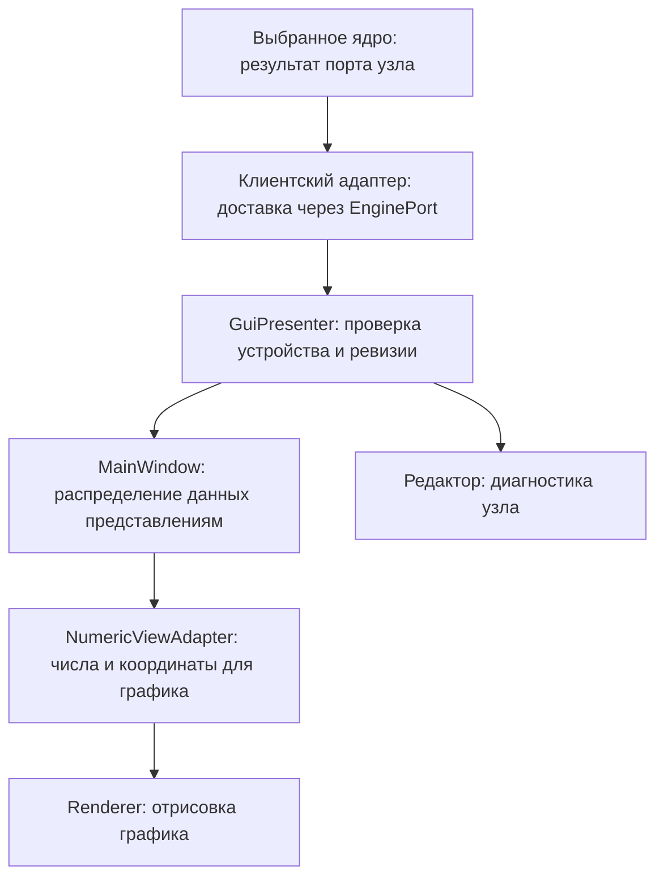

# Интерфейс и представление данных

Продукт называется **Barelief**, разработчик и издатель — **Koba Production**.
Заголовок главного окна в RU и EN: `Barelief | Signal Processing & Visualization`.
Идентичность и ресурсы собираются в `apps/desktop_gui`: исходный SVG встроен в Qt,
многоразмерный ICO и Windows VERSIONINFO встроены в `Barelief.exe`.
Остальные окна наследуют общую иконку приложения. Техническая цель CMake остаётся
`core_app`, репозиторий — `Barelief`; контракты обработки не меняются.
Публичные заголовки UI используют префикс `barelief/`, библиотека CMake называется
`barelief`, планирование отрисовки находится в `barelief::rendering`.
QML-регистрация 3D-элементов использует URI `Barelief.Surface`.
Старые include aliases не сохраняются. Правила DEPS продолжают запрещать
зависимости переносимых модулей от этого UI-модуля.

Меню «Справка → О программе Barelief» показывает версию из `VERSION.txt`,
издателя, ссылку на `KobaProduction/Barelief`, MIT и индекс лицензий зависимостей.
Ручная проверка обновлений обращается к публичному GitHub Releases API, ограничена
10 секундами и 1 MiB ответа. Стабильные `vX.Y.Z` сравниваются численно;
отсутствие опубликованных релизов отличается от ошибки сети. Открытие страницы
релизов выполняется отдельной кнопкой. Автопроверка, загрузка и запуск установщика
в текущий сценарий не входят. Внешний I/O не попадает в обработку схемы.

[Карта архитектуры](README.md) · [Термины](README.md#термины) · [Работа с интерфейсом](../guides/interface.md) · [Графики](../guides/graphs.md)

`core_app` — графическое Qt-приложение. Его интерфейс редактирует схему обработки,
настраивает устройства и отображает результаты общего исполнителя. Интерфейс
расположен в `presentation/qt`; зависимости
от Qt Widgets, Qt Quick, QtNodes, OpenGL и docking-библиотеки остаются здесь.
Вычисления описаны в [переносимом ядре](portable-core.md), доставка команд и
кадров — в [Qt-слое исполнения](desktop-runtime.md). Этот общий слой
используют и `core_app`, и `pipeline_cli` — консольное Qt-приложение.

## Как действие пользователя доходит до ядра

`GuiPresenter` связывает действия и состояние интерфейса с выбранным ядром:
получает редактируемую схему, отправляет команды, собирает подписки графиков
и сообщает интерфейсу результат. Он не рисует график и не вычисляет сигнал.

Типизированный отказ передаётся в `EngineReply.diagnostic`: код, причина,
идентификаторы и имя параметра принадлежат ответу. Локальный адаптер копирует
их перед асинхронной доставкой, удалённый — до освобождения области декодера.
Общий formatter строит RU/EN сообщение; сохранённая причина форматируется
заново при смене языка и очищается при смене состояния ошибки. Транспортные
и файловые I/O ошибки сохраняют собственный текст. UI не извлекает причину
разбором английского сообщения.

`EnginePort` — интерфейс этой связи: через него отправляются команды и подписки,
возвращаются ответы, состояние и данные. Это граница взаимодействия, а не
отдельный процесс или ещё одно ядро. Слово «клиент» обозначает обращающуюся
к ядру сторону. В GUI реализацию `EnginePort` предоставляет `NumericDesktopHost`:
он связывает интерфейс с локальным ядром или клиентом удалённого ядра.

На схеме ниже редактор (`SchemeEditorWidget`) хранит правку пользователя,
presenter отправляет её через `EnginePort`, а клиентский адаптер
`NumericDesktopHost` доставляет запрос локальному `NumericEngine` либо
удалённому `NumericRemoteEndpoint`. Выбранное ядро проверяет и применяет схему;
его ответ возвращается тем же путём и сообщает, принята правка или отклонена.
Локальный и удалённый варианты — альтернативы выбранного подключения.

## Редактор схемы

`SchemeEditorWidget` объединяет полотно QtNodes, историю Undo/Redo, каталог
блоков, инспектор и управление черновиком. `NumericEditorGraphModel` хранит
типизированные снимки узлов и связей; `AudioNodeModel` адаптирует их к QtNodes.
Ни модель графического узла, ни его встроенный виджет не выполняют DSP.
Каталог группирует обработчики по предметным операциям: оконная обработка,
преобразования Фурье, спектр и масштабирование, массивы и матрицы,
ресэмплинг, измерения и музыкальные признаки. Маршрутизация и накопление
имеют отдельные ветви. `Switch` остаётся маршрутизатором; `Spectrogram`
накапливает массивы в матрицу истории, а `NumberAccumulator` — числа в массив
истории. Пользовательские подписи не меняют stable kind IDs.

Соединение числового параметра проверяет primitive dtype и скалярную форму,
а не наличие вычисленного значения в момент прокладки провода. Типизированную
точку разводки можно соединить с потребителями до подключения её источника.
Проверка значений Fs, N и коэффициентов остаётся частью подготовки схемы:
неполный черновик с неразрешённым параметром не применяется к исполнителю.

`NodeParameterModel` описывает поля, допустимые значения, секции и доступность
без QWidget и QtNodes. `NodeParameterForm` создаёт по этому описанию Widgets.
Основные параметры и краткое резюме операции видны на карточке; остальные
можно открыть в инспекторе или включить через «Показывать на блоке».
Эти флаги принадлежат представлению и не входят в вычислительную схему.
Редакторы незакреплённых полей на карточке не создаются заранее. Событие
закрепления создаёт нужные элементы, а уже созданное поле при скрытии сохраняет
незавершённый ввод в общей модели параметров. Поле с фиксированным primitive
dtype использует тот же exact draft/commit путь без скрытого QComboBox.
Таблица осцилляторов заполняется до единственного расчёта размеров колонок;
перевод заголовков выполняет отдельный расчёт после смены языка.

Подписи с аргументами, видимость в инспекторе и текст специального значения
задаются описанием поля. Общая форма не определяет их по ключам Mixer,
осциллятора или адаптера; составной редактор осцилляторов подключает
специализация через фабрику. Лимиты изменяемой геометрии приходят из профиля
выбранного исполнителя. При неизвестном профиле такие правки недоступны;
сохранённое значение вне профиля показывается без обрезания, с диагностикой.

Редактирование контрактов портов вынесено из инспектора в модальный диалог
«Настроить контракты портов». Правки используют общую модель параметров и Undo.
Отдельный диалог подписей сохраняет текст в `presentation.port_labels`, по
направлению и стабильному ID порта. Пустая подпись возвращает стандартный текст.
Эти подписи не меняют тип, значение, связи или параметры обработки.
Действия инспектора используют общий `ui::WrappingButton`: подпись переносится
по доступной ширине с сохранением системного шрифта, поведения `QPushButton`
и общей палитры; высота кнопки рассчитывается по ширине.
«Размер массива» не имеет пустого встроенного тела и занимает ширину подписей.

Байпас доступен у операций, для которых определён обход: совместимые
преобразования передают вход, ресэмплер возвращает входную Fs и геометрию,
генератор окна выдаёт единицы, умножитель пропускает основной массив без
ожидания коэффициентов. Кнопка находится справа в заголовке. У графиков,
переключателя и точки разводки байпаса нет. Инспектор использует ту же модель
состояния; отдельной копии переключателя в теле карточки нет.

Входы одного потока переключателя расположены плотнее. Кнопка первого входа
выбирает весь поток, включая его Fs; индикатор показывает выбранный поток.
Alt-перетаскивание порта меняет только визуальный порядок и сохраняет stable
port IDs и связи; изменение участвует в Undo/Redo и сохранении представления.

Порядок входов/выходов, пользовательские подписи, координаты блоков и настройки
размеров редактора сохраняются в файле проекта. Восстановление явных координат
отменяет отложенное автоупорядочивание и подгонку масштаба при первом показе.
Автоматическая начальная раскладка используется, когда сохранённых координат нет.

Числовое соединение проверяется по dtype, форме и требованиям операции.
Подписи PCM, спектр и Mel объясняют данные, но не заменяют контракт.
В интерфейсе `SampleClock` называется «Синхронизация»; такой порт задаёт
расписание исполнения генератора или Mixer. Генератор без подключения
продвигает собственное время и может синхронизировать другой генератор.
Обычный FFTView строит частотную ось только по явно подключённому числовому
входу Δf и заданному first_bin; иначе показывает индексы, даже если
в контракте числового массива содержатся частотные координаты. При открытии
черновика редактор удаляет устаревшие разрешающие ассоциации представлений;
стабильные идентификаторы sync-портов сохранены.
Групповые переключатели
показывают поток и канал; группировка не превращает mono-порты в скрытое stereo.
Числовой Fs-выход не участвует в подсчёте каналов, групп входов и выборе кнопкой
на карточке. В основной спектрограмме переключатель сохраняет исходную Fs,
а следующий явный Resampler задаёт целевую частоту. Поля N и Fs с подключённым
источником показывают вычисленный параметр; меняют его в источнике соединения.
Re/Im, DC и модуль/фаза имеют отдельные подписанные порты. Разметка частотной
оси графика задаётся отдельным числовым проводом шага частоты; массив
передаётся напрямую.
FrequencyStep вычисляет этот Float64 шаг из Fs источника и измеренного N, без разрешающей
связи FrequencyGrid и без расчёта FFT в графической модели.

Правка вычислительных параметров или связей запускает отложенную отправку
валидного черновика. `GuiPresenter` передаёт команду Apply через `EnginePort`,
а подтверждение относится к отправленному снимку. Непринятая правка остаётся
черновиком и сопровождается ошибкой. Перемещение узлов, камера, названия
и флаги полей сохраняются как представление без подготовки DSP.
Автоматическая раскладка следует числовым связям; sync-связи не сдвигают
источник в следующую колонку и не определяют порядок преобразований данных.
Разделение документа и активной схемы описано в
[конфигурации и хранении](configuration-and-storage.md).

## Доставка и диагностика

`NumericDesktopHost` публикует состояние интерфейсу при обновлении control snapshot,
а не при каждой порции данных. Порция доставки в GUI имеет кооперативный бюджет
2 мс: после текущего callback оставшиеся владеющие данные доставляются следующим
событием. Медленный callback не прерывается; управление возвращается очереди
событий между порциями. Ответы, latest preview и восстановление History сохраняют
проверки epoch/revision и ограниченные буферы. Это не меняет темп DSP.
`EnginePort::request_numeric_snapshot(endpoint)` обновляет один подписанный выход.
Локальный host объединяет такие запросы отдельно от полного восстановления;
History notification не запускает повторный опрос всех scalar inputs.
Полный `request_numeric_snapshots()` сохраняется для cold return и восстановления
подписок; удалённый адаптер пока использует этот полный fallback.

`GuiPresenter` связывает выбранный локальный или удалённый процессор с UI.
Доставка проверяется по выбранному устройству, epoch сервиса и ревизии схемы.
Редактор подписывается на порты выбранного узла; инспектор связи запрашивает
порты её двух концов для диагностики преобразования. Без выбора эти подписки
отсутствуют. Подписки открытых графиков управляются отдельно, обработка схемы
от выбора в редакторе не зависит. Инспектор показывает доступность, точные
числовые значения и заполненность History. Preview читает данные, не меняя
параметры узла. Смена сервиса, несовместимый контракт или скрытие редактора
очищают его диагностическое представление.

Частотный график `FFTView` имеет явный числовой вход Δf. Его отдельная
настройка `first_bin` задаёт начало сетки. Renderer строит X-координаты из
этого входа; отключённый вход означает индексную ось. Данные других
представлений могут сохранять собственные неравномерные координаты.

`NumericViewAdapter` готовит полученные числа для графика: принимает кадры
и снимки History с владельцем памяти, отбрасывает устаревшую доставку
и выполняет проекцию для отрисовки. Метрики принимают scalar,
линейные графики принимают vector и одиночное scalar-значение;
2D/3D спектрограммы принимают matrix. `PianoView` отображает
готовый нотный vector клавишами и столбцами; обычный UInt32-вход задаёт первую
MIDI-ноту, а координаты входного ряда дают фактические частоты. Нужная метрика
извлекается отдельным обработчиком; график не выполняет скрытое сведение данных.
Столбцы и подсветка клавиш используют относительную шкалу текущего ряда.
Значения не выше явного порога `piano_activity_floor` не подсвечиваются;
по умолчанию порог равен `1e-9` в единицах входного ряда. Это предотвращает
растягивание численного предела шкалы dB в тишине до полной активности.
Порог редактируется в панели графика и сохраняется среди настроек вида;
ноль отключает отсечение положительных значений. Исходные значения и числовой
пик сохраняются, DSP и нотная проекция этим параметром не изменяются.
Клавиатура, подсветка, столбцы и подписи представлены удерживаемыми узлами
Qt Quick через общий `SceneHost`. Desktop entrypoint выбирает для нотного
графика встроенное native-окно; диагностические графики внутри QtNodes
сохраняют совместимый с proxy-widget текстурный host. Offscreen-проверки
используют тот же Piano scene в текстурном host. Геометрия клавиш пересчитывается при изменении
размера или нотного диапазона; повторный одинаковый ряд не создаёт новую
публикацию. `QtFramePump` ограничивает частоту тем же FPS, что у других графиков,
объединяет поступившие изменения и ждёт завершения предыдущего кадра.
Скрытый вид хранит последние данные, но не публикует кадры до повторного показа.
Точный scalar сохраняется отдельно от float-проекции. Потеря точности или
невозможность проекции видна в диагностике.

В обратном направлении ядро выпускает результаты конкретного порта узла.
Клиентский адаптер доставляет их через `EnginePort`; `GuiPresenter` проверяет
устройство и ревизию и публикует данные для UI. `MainWindow` направляет нужные
кадры в `NumericViewAdapter`, а тот подготавливает значения и координаты для
renderer — компонента, рисующего график. Редактор получает свою диагностику
из той же доставки. Эти участники показаны ниже; создание изображения происходит
в конце пути, после вычисления и доставки данных.

History накапливает ядро. GUI получает его ограниченный владеющий snapshot;
уведомление о новой строке не означает накопление второй истории в графике.
Порядок данных — `[временной кадр][полоса]`; адаптер преобразует его для
renderer. Временная шкала использует возраст: новейший кадр имеет возраст ноль.
Hz и секунды доступны только при достоверных координатах и разрешённой
конфигурационной привязке; иначе отображаются индексы.
Общий числовой слой возвращает признак наличия координат и их явную единицу,
не выбирая звуковую специализацию. Координаты столбцов могут быть отрицательными
и иметь любую объявленную единицу; они должны быть конечными и строго возрастать.
Разрешение отображения и пользовательские подписи передаются композицией отдельно.
Преобразование чисел в float сначала проверяет весь переданный набор и только
потом публикует значения и отчёт о потере точности. Полный снимок истории
сохраняет явные строки заполнения; транспортное compact-представление хранит
принятые строки кольцом и добавляет типизированное заполнение при отображении.
Совместимое изменение ёмкости сохраняет новейший суффикс строк и их координаты
даже во время недоступности источника. Неизвестные временные метки заполнения
не превращаются в секунды из частоты PCM.

## Панели и отрисовка

Общие численные представления принимают scalar/vector/matrix значения,
явные координаты и `PlotPresentation`. `NumericViewAdapter` не выбирает
аудиошкалу по Quantity/Unit или имени узла. `PlotDescriptor` передаёт доступные
режимы, категорию каталога и разрешение аудиошкалы; `PlotCapabilities` доводит
настройки до `GraphPanel`. Каталог создаёт descriptor на своей границе.
Новые виды имеют один режим на тип узла: scalar metrics или signed bars;
vector line, points, bars или pie; matrix image 2D или surface 3D. Для vector
и matrix есть общие и звуковые варианты. Звуковые matrix-варианты называются
«Спектрограмма 2D» и «Спектрограмма 3D»: это способы показать переданную
матрицу, а не требование к FFT/Mel-источнику. Каталог показывает каждый вариант
отдельным блоком и не предлагает переключатель режима внутри панели. Общий вид
не выводит звуковую ось из имени операции или положения в схеме; звуковой вид
использует только явные координаты и настройки, в том числе подключённый
`bin_hz` и заданный `first_bin` для частотной оси vector.
Прежние виды остаются читаемыми в сохранённых проектах с их режимами и
привязками рабочего пространства, но скрыты из каталога новых блоков.
Для каждого представления сохраняются `plot_modes`, `plot_category_path` и
`plot_specialization` (`audio` или `generic`). Отсутствующие поля существующего
документа дополняются при создании вида по descriptor каталога. Остальные поля
вида, в том числе неизвестные, остаются в сохранённом объекте. Встроенные
фиксированные панели получают descriptor при создании и повторно применяют его
при восстановлении preset. Для нового вида с единственным режимом сохранённые
`plot_modes` и `plot_specialization` не переопределяют его тип. У прежнего вида
неподдерживаемые режимы отфильтровываются; если допустимых не осталось,
используется список descriptor панели.
Изменённые настройки представления применяются и при неизменном наборе renderer;
повторная доставка с тем же объектом настроек не сбрасывает состояние панели.
Аудиокомпозиция
отдельно задаёт dB, единицы и подписи по числовому контракту только для видов
с аудиоспециализацией. `plot_sections` содержит явные label/begin/count;
подписи переводятся при отображении. Renderer не обходит upstream-схему ради
подписей или нотной топологии.

Структурно допустимое несовместимое ребро сохраняется в черновике, Undo/Redo
и при импорте; причина видна на связи/порте и в подсказке. Это не допуск
к выполнению: Prepare/Apply использует строгую проверку, отказ сохраняет рабочую
схему. Обычный экспорт черновика не подменяется executable resolver.
Диагностика без ребра не подсвечивает первое соединение.

`MainWindow` связывает редактор, подписки и графические представления.
`WorkspaceWindow`/`WorkspaceDock` инкапсулируют Qt Advanced Docking System:
вкладки, внутренние области, внешние окна, auto-hide и восстановление раскладки.
Один узел может иметь несколько представлений с отдельными instance IDs,
камерами и настройками. Docking перемещает существующий renderer.

Механизмы оптимизации, причины прежних задержек и ограничения измерений
собраны в [справочнике производительности](../reference/optimizations.md).

`GraphPanel` объединяет renderer и панель его настроек. Для линий используются
chart views, для матрицы — `NumericImageView` и `SpectrogramGraph`, для scalar —
`NumericMetricsView`. Настройки графика используют Qt Quick внутри
общего `SceneHost` с той же политикой размещения, что у графика;
редактор узлов остаётся Qt Widgets/QtNodes.
Desktop entrypoint выбирает native host для dock-графиков и их настроек:
это отделяет показ Quick-сцен от GUI-композиции всего окна. Текстурный host
остаётся доступен для proxy-виджетов и диагностических сценариев.
Скрытие представления прекращает его проекцию и отрисовку; работающая схема
и другие подписчики продолжают получать результаты. Частота анализа,
частота preview и ограничение FPS renderer регулируются независимо.
CPU-геометрия 3D-спектрограммы по умолчанию готовится в общем пуле из двух
потоков. У каждого представления остаётся одна выполняемая и одна заменяемая
последняя заявка; завершение будит renderer событием. OpenGL-операции остаются
в потоке renderer. Смена размеров или очистка истории инвалидирует старое
поколение результата; последний кадр обрабатывается и после остановки входа.
Без явной cadence используется `maximum`: наибольшая поддержанная частота
текущего экрана. `display` задаёт поддержанный режим Windows, `fixed` — только
ручной темп отрисовки, `screen` следует текущему режиму без переключения.
Каталог текущего разрешения читает desktop-адаптер `supported_screen_refresh_rates`.
Composition root подключает query/request callbacks к `SettingsWidget` и
владеет `DisplayRefreshSession` с внедряемой границей `DisplayModeApi`.
Сессия временно переключает режимы экранов видимых главного и отдельных окон
графиков, восстанавливает освобождённые экраны и не меняет внешние настройки,
отличающиеся от последнего применённого ею режима. Ошибка переключения
отменяет правку предпочтений. Win32 API не входит в presentation или ядро;
offscreen-проверки используют внедрённый API без физического переключения.
Renderer каждой панели получает частоту собственного экрана, доставка GUI
обслуживает максимальную cadence видимых панелей. Fs и темп DSP не меняются.

## Общие службы интерфейса

Основной существующий пример спектрограммы соединяет один аудиоканал каждого
источника и его числовой Fs через переключатель. Все native-каналы источника
остаются видимыми. Target Fs ресэмплера и размер окна редактируются на карточках.
`ArrayLength` измеряет готовое окно. В `AmplitudePhase` явно поступают Re/Im,
Fs и оконные суммы C/E; на карточке выбираются спектральная величина,
«Компенсация FFT и окна» и формат положительной половины либо полного спектра без DC.
Отдельного входа N нет: размер определяется по длине Re/Im и выбранному формату.
Применение окна видно отдельным `ArrayMultiply`: генератор окна получает N,
выдаёт w[n], C=sum(w) и E=sum(w²). Далее идут второй `ArrayMultiply` с независимым массивом
коэффициентов (по умолчанию1), независимые `BroadbandRow` и `NoteSpectrum`.
Оба получают явный Float64 шаг из `FrequencyStep`, который соединён с Fs
ресэмплера и измеренным N. Каждый ряд имеет свой накопитель и представление.
`ArrayConcat` соединяет ряды для общего накопителя; панель показывает индексные
границы НЧ/СЧ/ВЧ/нот. Отдельные выходы имеют Hz-координаты.
Два scalar выхода нотной ветви показывают совпадение пиков с полной и выбранной сеткой;
без пиков значения недоступны. Raw DC-порты Fourier скрыты по умолчанию,
доступны через действие «Показать DC-выходы»; соединённые порты остаются видимыми. Близкая точка разводки в основном примере
не требуется: соседние блоки соединены напрямую. Подписи портов показывают dtype/размер кратко,
а подробности доступны в инспекторе.

Исследовательский пример `music-research` открывается отдельно из каталога
примеров. Он показывает PCM, спектр до/после нормировки, фазу и две компактные
спектрограммы. Изменения явных конфигурационных и численных связей согласуются
в одной Undo-транзакции. Fs, N и коэффициенты берутся из собственных
зарегистрированных настроек и явных входов параметров. Соединение данных может
адаптировать входной контракт и вывести выходной контракт операции; редактор
не ищет параметры обходом предков и не меняет чужой Window ради FFT.
Нотная ось использует MIDI,
а широкополосная — центры в Hz; квантизованные значения подписываются как коды.

Меню «Инструменты» запускает отдельные задачи частотной статистики и сравнения
ресэмплеров; меню пресетов содержит только блок-схемы.
Отдельное окно частотной статистики вызывает desktop offline analysis в
пуле из 1–50 worker (не больше числа файлов). Окно отображает результаты
и передаёт параметры,
не выполняя live DSP схемы. Сравнение ресэмплеров также работает в собственном
worker на синтетическом входе без звукового вывода. Закрытие диалогов отменяет
и завершает принадлежащую им работу. Подробнее —
[руководство музыкального спектра](../guides/music-spectrum.md).

`application::frequency_profile_routes` перечисляет объявленные маршруты
`ArrayFill → ArrayMultiply` с ID схемы и устойчивыми ID обоих концов связи коэффициентов
и связи ведущего кадра. Application хранит собственные DTO объявления frontend
и получает численную проверку профиля через `ProfileMatcher`; Qt-адаптер
переводит объявление в DSP-контракт. `application::apply_frequency_profile` повторно сверяет
выбранный маршрут с текущим черновиком, проверяет профиль через порт и возвращает две
подготовленные копии узлов либо типизированный отказ. Общий `ArrayFill` с
несколькими исходящими связями отклоняется: изменение одной ветви не меняет
коэффициенты соседней. `frequency_profile_binding` переводит результат в Qt-текст;
редактор применяет копии одной отменяемой транзакцией. Fs/N, окно/C/E,
представление, каналы, ресэмплер и интервал декларируются в источнике
коэффициентов. Проверка не ищет
AmplitudePhase, окно или ресэмплер обходом предков. Диалог показывает средние и встречаемость по bins, экспортирует
профиль или передаёт числовые коэффициенты через callback composition root.
`NumericEditorGraphModel::edit_nodes` проверяет кандидат целиком и применяет
несколько параметрических изменений одной отменяемой транзакцией; live DSP
по-прежнему выполняет только PreparedGraph. Редактор не запускает анализ файлов.

`UiCommandRegistry` хранит команды, сочетания, контекст и доступность.
Undo/Redo схемы действуют при фокусе полотна; текстовые поля и диалоги
сохраняют собственную историю ввода. `ProcessorDirectoryModel` предоставляет
список процессоров, а диалог и selector отображают его. Discovery поступает
через порт из настольного адаптера.

`ui::Theme` задаёт общую палитру Light/Dark/System и централизованный стиль.
QtNodes и собственные renderer получают её семантические цвета явно.
`ui::Language`, `ui::text` и `ui::bind` обслуживают RU/EN. Тема и язык
не меняют DSP, связи, стабильные ключи или пользовательские названия.

Основные точки входа в код: [редактор](../../presentation/qt/src/editor/editor_widget.cpp),
[presenter](../../presentation/qt/src/presenter/gui_presenter.cpp),
[адаптер графиков](../../presentation/qt/src/renderer/numeric_view_adapter.cpp),
[workspace](../../presentation/qt/src/workspace/main_window.cpp).

Состояние закрытия графика сохраняется через viewToggled, отдельно от visibility
активной вкладки. Получение runtime binding не открывает представление и не меняет
его размещение. Первый запуск и явная загрузка встроенного примера задают `open=true`
для перечисленных в примере матричных представлений. Загрузка пользовательского
проекта сохраняет его собственные признаки открытия и закрытия.
Дополнительные виды создаются закрытыми; явное открытие по умолчанию
добавляет вкладку над Data Flow. При перезапуске восстанавливаются только экземпляры
существующих узлов выбранного device/graph. Подробности защищённого workspace recovery
описаны в [хранении](configuration-and-storage.md#состояние-окон-при-ошибке-проекта).
Видимость графиков меняется через действия рабочей области и dock-панелей;
глобальное окно «Настройки» не дублирует проектные переключатели представлений.

`ArrayMultiply` имеет настраиваемое число равноправных множителей.
Массив коэффициентов можно подключить к любому входу независимо от порядка
подключений. В инспекторе «Вход кадров» определяет, чьи координаты и время
использует результат; по умолчанию выбран stable PortId 0. Автоматического
выбора по quantity, unit или координатам нет. Остальные массивы
удерживаются до обновления, без повторной выдачи уже обработанного кадра.

Основной пример разделяет `BroadbandRow` и `NoteSpectrum`: у каждого свой вход
числового шага частоты, параметры и накопитель. `ArrayConcat` явно соединяет
их ряды для общего накопителя. Широкополосные и нотные координаты принадлежат
отдельным выходам; совмещённый ряд показывается по индексам секций.
Индикатор активности обновляет только графический элемент; телеметрия не
посылает событие изменения документа и не запускает сериализацию/Apply.

Офлайн-анализатор имеет три страницы: сканирование, построение кривой и
применение. Сканер по умолчанию использует48000Гц/FFT4096/Hann/пиковую амплитуду;
выбор маршрута схемы не заменяет его настройки. Порог RMS диагностирует тихие
кадры, сохраняя исходные измерения. Каждый трек получает средние/максимальные
спектры, статистику тишины/тихих кадров и bounded preview. Сканирование и готовый
профиль сохраняются/загружаются отдельно. Кривые строятся без чтения аудио,
показываются исходные измерения, аппроксимация и ошибки двух методов. Смена
настроек помечает результат устаревшим до явного перестроения. Применение
вычисляет коэффициенты функции в Гц на объявленной сетке текущего маршрута,
с единицей вне измеренного диапазона; числовой DSP остаётся прежним.
Выбор трека использует сохранённые previews. Для старых профилей без preview
доступно отдельное отменяемое фоновое задание без переобучения. DC показан
отдельно; последний bin сохраняется. Отрисовка использует общую тему и RU/EN.

Для спектра в dB неуказанные пределы Y по умолчанию равны −120…0;
явно сохранённые ручные пределы остаются пользовательскими. Столбцы dB
отсчитываются от нижней границы графика, обычные знаковые значения — от нуля.
Разрешение единиц меняет только renderer defaults, не параметры DSP и не
порождает сохранение по поступлению кадров.
Подключённый шаг частоты размечает X-ось по `first_bin`, заданному
пользователем в представлении. Координаты входного массива не изменяют
начальный индекс автоматически, включая спектр без DC.

### Навигация по числовым графикам

Плоские линейные, точечные и FFT-графики, 2D-спектрограммы и графики
анализатора частотного профиля поддерживают масштабирование колесом около
курсора и перемещение левой или средней кнопкой внутри области данных.
Shift + колесо меняет только X, Ctrl + колесо — только Y. Двойной щелчок
левой кнопкой возвращает полный настроенный диапазон.

`navigatePlotViewport` ограничивает временную нормированную область просмотра
исходным диапазоном, с минимальной долей 1e-6. Координаты осей и проекция данных
используют одну область; обратные оси учитываются при обработке жеста.
Новые кадры сохраняют эту область. Навигация не меняет DSP, исходную матрицу,
цветовой диапазон спектрограммы или сохранённые настройки осей и не сохраняется
между запусками. Для 3D сохраняется управление камерой: средняя кнопка —
перемещение, правая — вращение, колесо — приближение.

### Плотность осей и шкала значений

`GraphPanel` сохраняет независимые `grid_lines_x`, `grid_lines_y`,
`axis_labels_x`, `axis_labels_y` (0 auto, -1 hidden, 1…128 exact count).
`QuickPlotModel.axes` передаёт раздельные списки x/yTicks и x/yGrid;
векторная геометрия и 2D-изображение используют сетку независимо от подписей.

`value_scale` (source/linear/db), `db_factor` (0 auto, 10, 20),
`db_reference` и `db_floor` относятся только к отображению. Специализация
представления явно передаёт признак входных дБ и множитель через presentation
model. Общий renderer не распознаёт аудиосмысл по quantity/unit, имени узла
или подписи оси. `ValueDisplayScale` выполняет ограниченное конечное преобразование.
Векторный график хранит исходный вектор для немедленного переключения шкалы;
матрицы остаются неизменными shared snapshots. Цвет 2D, CPU mesh 3D и readouts
применяют одну и ту же шкалу; asynchronous mesh generation инвалидируется
при её изменении. Для входных дБ peak reduction выбирает максимум значения,
для линейных данных сохраняется выбор по модулю. Конфигурация DSP и контракт
источника при изменении настроек отображения не меняются.

В настройках обновления экрана доступна «Системная частота» (screen): renderer
следует текущей частоте своего монитора. Режим сохраняется в проекте, не задаёт
частоту монитора через ОС и освобождает ранее запрошенный приложением режим.
