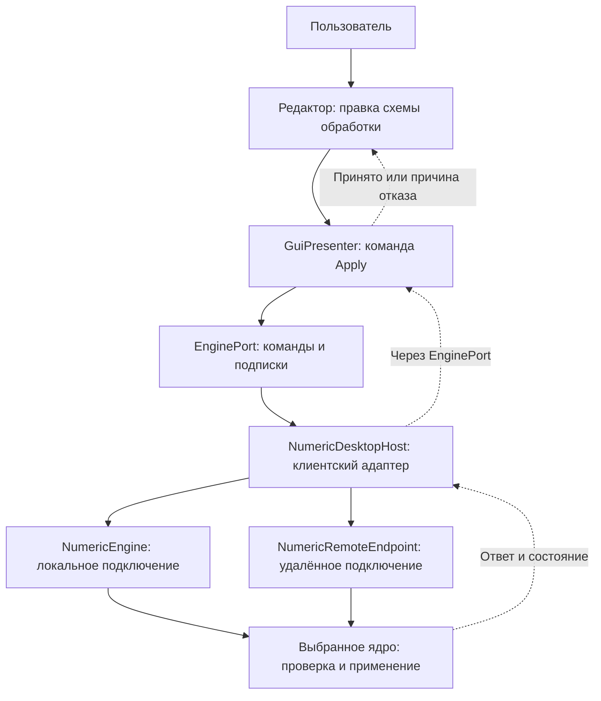
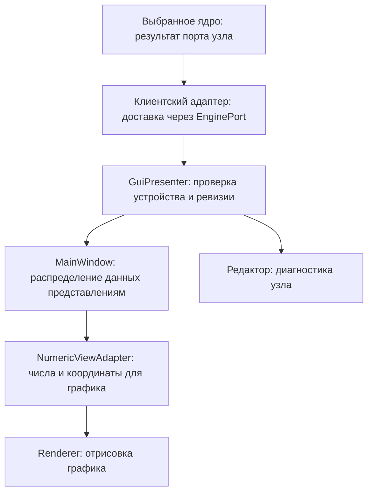

# Интерфейс и представление данных

[Карта архитектуры](README.md) · [Термины](README.md#термины) · [Работа с интерфейсом](../guides/interface.md) · [Графики](../guides/graphs.md)

`core_app` — графическое Qt-приложение. Его интерфейс редактирует схему обработки,
настраивает устройства и отображает результаты общего исполнителя. Интерфейс
расположен в `presentation/qt`; зависимости
от Qt Widgets, Qt Quick, QtNodes, OpenGL и docking-библиотеки остаются здесь.
Вычисления описаны в [переносимом ядре](portable-core.md), доставка команд и
кадров — в [Qt-слое исполнения](desktop-runtime.md). Этот общий слой
используют и `core_app`, и `pipeline_cli` — консольное Qt-приложение.

## Как действие пользователя доходит до ядра

`GuiPresenter` связывает действия и состояние интерфейса с выбранным ядром:
получает редактируемую схему, отправляет команды, собирает подписки графиков
и сообщает интерфейсу результат. Он не рисует график и не вычисляет сигнал.

`EnginePort` — интерфейс этой связи: через него отправляются команды и подписки,
возвращаются ответы, состояние и данные. Это граница взаимодействия, а не
отдельный процесс или ещё одно ядро. Слово «клиент» обозначает обращающуюся
к ядру сторону. В GUI реализацию `EnginePort` предоставляет `NumericDesktopHost`:
он связывает интерфейс с локальным ядром или клиентом удалённого ядра.

На схеме ниже редактор (`SchemeEditorWidget`) хранит правку пользователя,
presenter отправляет её через `EnginePort`, а клиентский адаптер
`NumericDesktopHost` доставляет запрос локальному `NumericEngine` либо
удалённому `NumericRemoteEndpoint`. Выбранное ядро проверяет и применяет схему;
его ответ возвращается тем же путём и сообщает, принята правка или отклонена.
Локальный и удалённый варианты — альтернативы выбранного подключения.

## Редактор схемы

`SchemeEditorWidget` объединяет полотно QtNodes, историю Undo/Redo, каталог
блоков, инспектор и управление черновиком. `NumericEditorGraphModel` хранит
типизированные снимки узлов и связей; `AudioNodeModel` адаптирует их к QtNodes.
Ни модель графического узла, ни его встроенный виджет не выполняют DSP.

`NodeParameterModel` описывает поля, допустимые значения, секции и доступность
без QWidget и QtNodes. `NodeParameterForm` создаёт по этому описанию Widgets.
Основные параметры и краткое резюме операции видны на карточке; остальные
можно открыть в инспекторе или включить через «Показывать на блоке».
Эти флаги принадлежат представлению и не входят в вычислительную схему.

Числовое соединение проверяется по dtype, форме и требованиям операции.
Подписи PCM, спектр и Mel объясняют данные, но не заменяют контракт.
Конфигурационные порты `SampleClock` и `FrequencyGrid` задают зависимости Fs
и частотной сетки отдельно от числовых данных. Групповые переключатели
показывают поток и канал; группировка не превращает mono-порты в скрытое stereo.

Правка вычислительных параметров или связей запускает отложенную отправку
валидного черновика. `GuiPresenter` передаёт команду Apply через `EnginePort`,
а подтверждение относится к отправленному снимку. Непринятая правка остаётся
черновиком и сопровождается ошибкой. Перемещение узлов, камера, названия
и флаги полей сохраняются как представление без подготовки DSP.
Разделение документа и активной схемы описано в
[конфигурации и хранении](configuration-and-storage.md).

## Доставка и диагностика

`GuiPresenter` связывает выбранный локальный или удалённый процессор с UI.
Доставка проверяется по выбранному устройству, epoch сервиса и ревизии схемы.
Редактор подписывается на нужные порты данных, показывает доступность, точные
числовые значения и заполненность History. Preview читает данные, не меняя
параметры узла. Смена сервиса, несовместимый контракт или скрытие редактора
очищают его диагностическое представление.

`NumericViewAdapter` готовит полученные числа для графика: принимает кадры
и снимки History с владельцем памяти, отбрасывает устаревшую доставку
и выполняет проекцию для отрисовки. Метрики принимают scalar,
линии и столбцы — vector, 2D/3D спектрограммы — matrix. Нужная метрика
извлекается отдельным обработчиком; график не выполняет скрытое сведение данных.
Точный scalar сохраняется отдельно от float-проекции. Потеря точности или
невозможность проекции видна в диагностике.

В обратном направлении ядро выпускает результаты конкретного порта узла.
Клиентский адаптер доставляет их через `EnginePort`; `GuiPresenter` проверяет
устройство и ревизию и публикует данные для UI. `MainWindow` направляет нужные
кадры в `NumericViewAdapter`, а тот подготавливает значения и координаты для
renderer — компонента, рисующего график. Редактор получает свою диагностику
из той же доставки. Эти участники показаны ниже; создание изображения происходит
в конце пути, после вычисления и доставки данных.

History накапливает ядро. GUI получает его ограниченный владеющий snapshot;
уведомление о новой строке не означает накопление второй истории в графике.
Порядок данных — `[временной кадр][полоса]`; адаптер преобразует его для
renderer. Временная шкала использует возраст: новейший кадр имеет возраст ноль.
Hz и секунды доступны только при достоверных координатах и разрешённой
конфигурационной привязке; иначе отображаются индексы.

## Панели и отрисовка

`MainWindow` связывает редактор, подписки и графические представления.
`WorkspaceWindow`/`WorkspaceDock` инкапсулируют Qt Advanced Docking System:
вкладки, внутренние области, внешние окна, auto-hide и восстановление раскладки.
Один узел может иметь несколько представлений с отдельными instance IDs,
камерами и настройками. Docking перемещает существующий renderer.

`GraphPanel` объединяет renderer и панель его настроек. Для линий используются
chart views, для матрицы — `NumericImageView` и `SpectrogramGraph`, для scalar —
`NumericMetricsView`. Настройки графика используют Qt Quick внутри
`QQuickWidget`; редактор узлов остаётся Qt Widgets/QtNodes.
Скрытие представления прекращает его проекцию и отрисовку; работающая схема
и другие подписчики продолжают получать результаты. Частота анализа,
частота preview и ограничение FPS renderer регулируются независимо.

## Общие службы интерфейса

`UiCommandRegistry` хранит команды, сочетания, контекст и доступность.
Undo/Redo схемы действуют при фокусе полотна; текстовые поля и диалоги
сохраняют собственную историю ввода. `ProcessorDirectoryModel` предоставляет
список процессоров, а диалог и selector отображают его. Discovery поступает
через порт из настольного адаптера.

`ui::Theme` задаёт общую палитру Light/Dark/System и централизованный стиль.
QtNodes и собственные renderer получают её семантические цвета явно.
`ui::Language`, `ui::text` и `ui::bind` обслуживают RU/EN. Тема и язык
не меняют DSP, связи, стабильные ключи или пользовательские названия.

Основные точки входа в код: [редактор](../../presentation/qt/src/editor/editor_widget.cpp),
[presenter](../../presentation/qt/src/presenter/gui_presenter.cpp),
[адаптер графиков](../../presentation/qt/src/renderer/numeric_view_adapter.cpp),
[workspace](../../presentation/qt/src/workspace/main_window.cpp).
