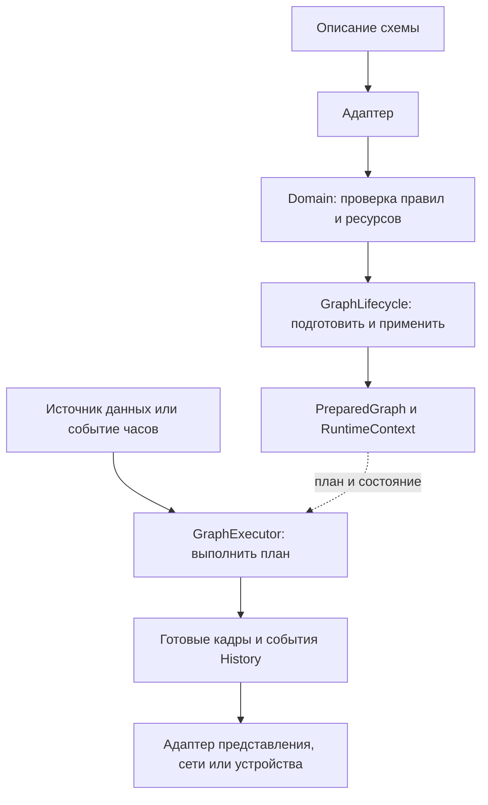
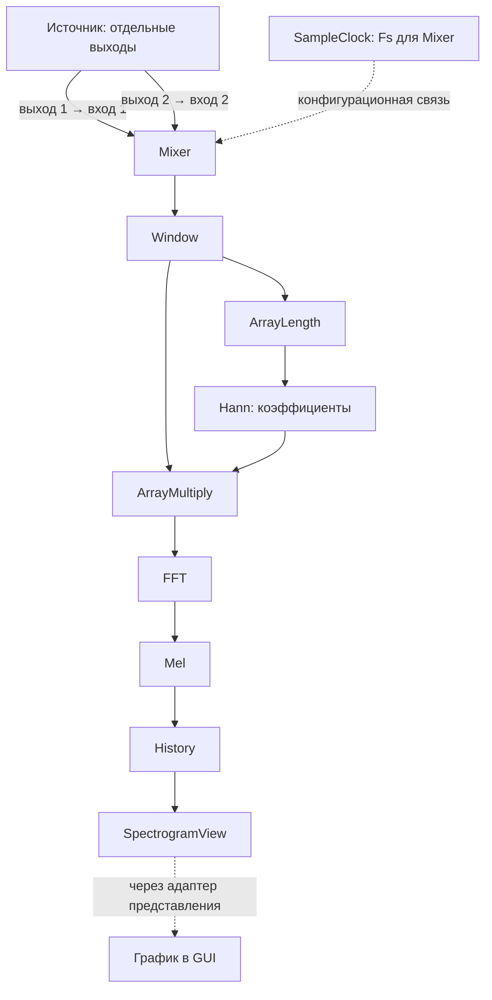

# Переносимое ядро

[Карта архитектуры](README.md) → переносимое ядро

Ядро описывает данные, проверяет схему, готовит вычисления и выполняет их. Это
общий C++20-код настольного приложения, консольного запуска и embedded-сборки.
Qt, аудиоустройства, системные сокеты и ESP-IDF подключаются через адаптеры.
Консольное `pipeline_cli` и графическое `core_app` подключают это ядро через
общий Qt-слой исполнения. На плате его подключает firmware composition.

**Схема обработки** — соединённые узлы и их настройки; **узел** — одна операция
в этой схеме; **график** — представление данных или результата узла для человека.
График не исполняет узлы. Общие определения собраны в [словаре архитектуры](README.md#термины).

## Состав и ответственность

| Модуль | Ответственность |
| --- | --- |
| `signal_contracts` | Primitive dtype, scalar/vector/matrix и structured payload, представление памяти, координаты, время и владение кадрами |
| `domain_model` | Стабильные IDs, descriptors, параметры, владеющие контракты и модель схемы |
| `domain_numeric` | Scalar/vector/matrix, генераторы массивов, явная поэлементная арифметика и матричные контракты |
| `domain_signal` | Fourier, спектральная калибровка и явные численные Fs/N/C/E порты |
| `domain_music` | Музыкальные и частотные признаки, нормализатор и проверка frontend |
| `graph_domain` | Admission, подготовка значений, configuration bindings и общий node factory поверх предметных модулей |
| `application` | Транзакционные Prepare/Apply через `GraphLifecycle`, управление ревизиями и запросами через `ProcessingControlService`, порт явного сохранения |
| `dsp_kernels` | Подготовленные численные операции: окно, FFT, Bark/Mel, генератор, преобразование типов, редукции и PCM Resampler |
| `dataflow_runtime` | Подготовленная схема `PreparedGraph`, состояние `RuntimeContext`, единственный исполнитель `GraphExecutor`, маршрутизация, Mixer, History и статистика узлов |
| `bdsp_protocol` | Кодирование CONTROL/DATA и пакетный обмен через абстрактный byte transport |
| `embedded_support` | Ограниченные профили ресурсов, DATA-сессия, admission пропускной способности, persistence через storage port и синтетический источник |

Активный состав исходников задают CMake manifests с условиями выбранного preset:

| Срез | Источник состава |
| --- | --- |
| Предметные библиотеки | [domain/CMakeLists.txt](../../domain/CMakeLists.txt) |
| Application и переносимый CONTROL | [application](../../application/CMakeLists.txt), [adapters/control](../../adapters/control/CMakeLists.txt) |
| Исполнитель на host и в firmware | [dataflow_runtime](../../libs/dataflow_runtime/CMakeLists.txt), [ESP-IDF source manifest](../../adapters/esp_idf/portable_sdk/sources.cmake) |
| Qt runtime, offline adapters и захват | [desktop/platform](../../adapters/desktop/platform/CMakeLists.txt), [desktop/runtime](../../adapters/desktop/runtime/CMakeLists.txt) |
| Композиция примеров | [apps/default_graphs](../../apps/default_graphs/CMakeLists.txt) |
| Проверки и дополнительные стенды | [tests/CMakeLists.txt](../../tests/CMakeLists.txt), [portable foundation](../../tests/portable_foundation.cmake) |

Наличие файла или старого результата проверки не означает его включения в
текущую систему. Регистрация target и CTest определяется этими manifests;
дополнительный executable стенда не обязательно является CTest. Target
`audio_pipeline` собирает `NumericEngine` и адаптер захвата; его имя не означает
наличия отдельного legacy-исполнителя `AudioPipeline`. Старые `Analyzer` и
compatibility GUI не образуют второй путь выполнения текущей схемы.

Публичные контракты находятся в `include` соответствующих модулей. Реализации
численных операций не знают о GUI, сети и формате JSON. Application зависит от
портов подготовки и исполнения; `GraphExecutor` реализует эти порты. Конкретный
процесс связывает их с источниками, хранилищем, измерительными часами и транспортом.

Описания параметров разделены между numeric, signal, music, routing, adapter
и view-модулями; общий registry служит индексом. Типизированные значения массивов
по умолчанию принадлежат предметному descriptor, а общий resolver их копирует
без распознавания ключей музыкальных параметров. Допуск схемы отдельно проверяет
объявления, связи, порядок выполнения, происхождение часов и ресурсы.

## Предметные границы и создание узлов

`domain/processing_contracts.h` агрегирует публичные предметные заголовки;
реализации численных, сигнальных и музыкальных контрактов собираются отдельно.
`domain/graph/node_factory.h` задаёт общий `make_processing_node`,
`configure_processing_input` и атомарный вывод контрактов. Редактор и композиция
примеров используют этот API вместо независимых списков default contracts.
`window_math` предоставляет общую арифметику окна без backend/runtime.

`NumericArray` хранит владеющие Float32-значения, view использует span. Domain
проверяет размер/конечность; внешний адаптер `numeric_array_codec` отвечает за
текстовое кодирование. Portable CONTROL-session находится в `adapters/control`,
а примеры схем — в `apps/default_graphs`. CMake приложения собирает композицию
сверху, адаптер не подключает приложение как свою дочернюю зависимость.

`ArrayMultiply.frame_input` явно выбирает вход, задающий контракт и время
результата. Quantity, единицы и координаты не используются для угадывания этого
входа. Коэффициенты подаются отдельным массивом. Preparation-value capability
отличается от потокового scalar: тип порта сам по себе не обещает разрешимость
значения до подготовки. Диагностика может не иметь ребра; отсутствие edge
не подменяется индексом первого соединения.
Подготовка различает недоступное значение, неверный тип, невалидное значение
и выход за допустимый диапазон. Конкретная причина и исходное ребро сохраняются
до представления диагностики; ошибка provider не сводится к общему `false`.

Новые графические sink kinds фиксируют один способ отображения в самом stable ID:
`ScalarMetricsView`/`ScalarSignedBarView`, `VectorLineView`/`VectorPointView`/
`VectorBarView`/`VectorPieView`, `MatrixImageView`/`MatrixSurfaceView`.
Они допускают соответственно числовые scalar, vector и matrix контракты,
не распознавая FFT, Mel, Window или upstream topology. Scalar kinds допускают
до восьми отдельных входных значений. Звуковые `AudioLineView`/
`AudioPointView`/`AudioBarView`/`AudioPieView` принимают vector, а
`AudioImageView`/`AudioSurfaceView` — matrix; их оси и шкалы определяются
только явными координатами/настройками представления. Для звукового vector
`bin_hz` и `first_bin` являются опциональными явными параметрами; `bin_hz`
может приходить через configuration port `frequency_step_input`. Нулевой шаг
не объявляет индекс Mel-полосы герцами. `PianoView` остаётся отдельным
звуковым видом. Старые `AudioView`, `FFTView`, `MelView`, `WindowView`,
`WindowedView`, `SpectrogramView` и `ScalarView` сохраняют свои IDs и прежнюю
обработку сохранённых схем, но новые примеры используют fixed-mode kinds.

Собственные часы `SignalGenerator` — явно сохранённая настройка source output,
доступная через `signal_generator_clock`. Она не извлекается из произведённых
кадров или чужого upstream-узла. Отдельный `SampleClock` необязателен;
явная configuration binding имеет приоритет над собственными часами.
Числовой Fs-выход готовится из этого же объявления. Встроенные startup/music
примеры используют явный SampleClock, а несвязанный генератор сохраняет
поддержку собственного времени.

`PcmResampler.input_rate` — явное объявление входной Fs; значение 0 означает,
что она ещё не задана. Fs-связь источника записывает это поле при подготовке;
`configure_processing_input` материализует явно переданную конфигурацию входа.
В bypass эффективный Fs-выход равен `input_rate`, при включённом преобразовании
— `output_rate`. Обнаружение нового формата устройства не дорисовывает Fs-связь
и не меняет независимую настройку ресэмплера за пользователя.

## Путь схемы и данных

Документ или команда CONTROL передают описание схемы. Адаптер переводит его в
`NumericProcessingGraph`. Domain проверяет правила узлов и соединений;
`GraphLifecycle` управляет подготовкой и применением. Подготовленный план
`PreparedGraph` описывает, что выполнять, а `RuntimeContext` хранит состояние
вычислений. `GraphExecutor` выполняет этот план при поступлении данных или
clock events — сообщений о продвижении локального времени сигнала.
`ProcessingVersions` внутри domain содержит только версии модели графа и
обработки (`graph`, `processing`). Версии файла, CONTROL и DATA принадлежат
адаптерам соответствующих форматов. Они проверяют внешнюю оболочку до передачи
кандидата в domain и явно переводят её в модель схемы; внешний набор версий
не становится вычислительной зависимостью ядра.
Обычные числовые связи параметров Fs/N вычисляются до admission и подготовки
буферов. Сохраняемая схема содержит эти порты и связи, а исполняемый план
использует вычисленные параметры. Дополнительный Fs-выход источника компилируется
в явную подготовленную числовую константу из настроек источника/clock binding
с сохранением исходного endpoint для наблюдения.
Он не становится дополнительным аудиоканалом. Точка разводки удаляется из
исполняемой топологии; ни GUI-модель, ни подписи портов не выполняют DSP.
На рисунке верхняя ветвь готовит обработку, нижняя подаёт в неё данные.

Prepare строит расписание, проверяет фактические сочетания операций и контрактов,
резервирует память и создаёт состояние. Apply активирует подготовленный план;
неудачный кандидат сохраняет работающую схему. Совместимое состояние переносится
при замене. JSON, сетевое чтение и системные потоки остаются за границей processing.
Владелец сериализует обращения к executor; `shutdown` освобождает его при teardown.

Входной порт получает один поток и не более одного ребра. Один выход может иметь
несколько потребителей. Источник с несколькими аппаратными каналами публикует
отдельные mono-выходы; переключатели выбирают маршрут, Mixer явно смешивает
независимые mono-входы. Для разных Fs используется отдельный `PcmResampler`.
Стабильный kind ID `StereoFFT` сохранён в формате, но текущая операция FFT
принимает один поток; название не задаёт обязательную пару каналов.

Тип допуска соединения определяется dtype, формой и физическим контрактом.
Подписи PCM, Spectrum и Mel описывают смысл, но сами не разрешают вычисление.
Операция проверяет геометрию, представление памяти, clock, координаты и конечность.
`SampleClock` и `FrequencyGrid` задаются отдельными configuration bindings, а не
числовыми рёбрами. Их происхождение сохраняется в схеме.

Ниже — пример схемы с двумя выходами одного источника. Каждый выход несёт
отдельный mono-поток с общей Fs и происхождением захвата. Это два порта одного
источника, а не два executor. Рёбра на рисунке задают путь данных между узлами.

| Участник примера | Что делает |
| --- | --- |
| Источник | Выдаёт два отдельных сигнала |
| SampleClock | Задаёт Fs и происхождение часов (clock domain) для Mixer; согласуется с входным контрактом |
| Mixer | Явно смешивает входы с заданными весами в один поток |
| Window / Hann / FFT | Собирают окно отсчётов, применяют оконную функцию и получают спектр |
| Mel | Преобразует спектр в значения частотных полос |
| History | Накапливает строки значений в матрицу |
| SpectrogramView | Узел-потребитель матрицы; передаёт результат адаптеру представления |
| График | Рисует переданную матрицу в окне интерфейса |

Mel и Bark готовят частотные веса из собственных `sample_rate`, `bin_hz`,
`first_bin` и `frequencies_hz`. Пустой `frequencies_hz` задаёт регулярную
сетку; непустой массив явно задаёт центры входных спектральных bin в Hz.
Координаты входного кадра сверяются с объявленной сеткой при допуске и
доставке, но не выбирают коэффициенты фильтра. Mel рассчитывает ограниченную
матрицу весов при подготовке; обработка кадра использует готовые веса без
повторного расчёта треугольников.

Сплошные стрелки — данные, пунктир от `SampleClock` — настройка Fs и clock domain
Mixer, согласованная с входным контрактом. Такой clock не синхронизирует независимые устройства. Перед смешиванием
разных Fs инженер добавляет явные Resampler. Эта цепочка иллюстрирует один
вариант обработки; узлы и место Mixer выбираются в схеме.

## Время, память и представления

Fs задаёт сетку отсчётов. `execution_interval` задаёт темп анализа; default новой
схемы — 1/120 секунды. Частота отрисовки выбирается отдельно в интерфейсе.
Внешние источники обрабатываются по поступлению: одинаковая Fs не устанавливает
синхронизацию аппаратных часов разных устройств.

Подготовленные операции используют заранее созданные буферы и workspace.
Синхронный `DataFrameView` заимствует память; callback не передаёт его в очередь
после возврата. Асинхронная граница удерживает ограниченный владеющий буфер.
Отказ пула или несовместимый кадр сообщается статусом, без запасного неограниченного
выделения памяти на processing path. Подготовка использует платформенный allocator;
сборка без exceptions не обещает восстановление после любого исчерпания heap.

`History` — отдельный обработчик, хранящий `[временной кадр][элемент]`. Его полная
ёмкость доступна с начала, неиспользованные строки содержат типизированные нули,
а filled count передаётся отдельно. Resize сохраняет новейшие совместимые строки.
Представление получает текущий scalar/vector/matrix или события History и переводит
их в renderer; накопление не выполняется внутри графического виджета.

Матрица обрабатывается отдельными операциями: `MatrixTranspose` меняет местами
оси и элементы `[кадр][полоса] → [полоса][кадр]`, учитывая логический порядок ring.
`MatrixCenter` вычитает из каждой строки её среднее, середину диапазона или
ручное смещение; в примере включено вычитание среднего перед окном.
`MatrixWindowFunction` применяет выбранное окно к каждой строке; по умолчанию
узел находится в bypass. `MatrixFFT` дополняет каждую строку нулями до размера
FFT и выдаёт `[полоса][bin]`. `MatrixRow` выделяет выбранную строку в vector.
Одна ветка показывает всю карту, другая — спектр выбранной полосы. Тишина,
нулевые кадры и переходные временные метки не прерывают вычисление FFT.
Подробности координат и нормализации — в [Runtime API](../reference/runtime-api.md#матричные-операции).

Отключение или разрыв известного маршрута даёт типизированные нули на известных
часах. При неизвестном контракте распространяется недоступность. Bypass допускает
передачу исходного значения только при совпадающем физическом контракте.
Отказ операции остаётся диагностикой её выходов. Зависимые операции и представления
получают недоступность данных, без повторного приписывания им исходного отказа.
`NodeStats` хранит вызовы, ошибки, self-time и deadline misses; монотонные часы
для измерений предоставляет платформа.

## Где читать дальше

`Fourier` принимает отдельные вещественную и мнимую плоскости, а `RealFourier`
имеет только вещественный вход. Оба публикуют обычные Float32 Re/Im-массивы
ненулевых частот и отдельные DC scalar; комплексный путь сохраняет полный
незеркальный спектр, real-путь сохраняет крайний коэффициент N/2.
`ComplexPolar` отдельно вычисляет сырой модуль и фазу. `AmplitudePhase` объединяет
модуль/фазу с выбором спектральной величины и нормировкой по обычным числовым
N, Fs, coherent gain и power gain окна. Fs нужен PSD и разметке, не raw FFT.
`WindowFunction` генерирует Float32 w[n] по числовому N; применение окна
выполняется общим `ArrayMultiply`. Генератор также публикует Float64 суммы
`C=sum(w)` и `E=sum(w²)`;
вычисление коэффициента и умножение окна используют общую `window_math`.
При отключённом окне обе суммы равны N.
`MusicalSpectrogram` строит составной ряд НЧ/СЧ/ВЧ/нот по явным диапазонам
и режимам редукции, отдельно выдаёт full/selected совпадения пиков с сеткой.
Нотная часть использует интерполяцию спектра, а не harmonic salience.
Геометрия готовится в domain, численные планы — в dsp_kernels; History
инвалидируется при смене смысла полос, а не только размера.
`ArrayMultiply` перемножает два и более равноправных массива одинакового размера.
Явный `frame_input` задаёт время, координаты и выпуск результата; остальные
множители удерживаются в заранее подготовленных владеющих буферах. Обновление
множителя само по себе не повторяет уже обработанный ведущий кадр. FFT, Fs/N
и совпадающие clocks для численного произведения не требуются. Fs и построение
частотной оси не входят в численную операцию Fourier; время кадра остаётся
служебным контрактом исполнения. Порты и ограничения описаны в
[Runtime API](../reference/runtime-api.md#исследовательские-музыкальные-операции).

Исследовательский PC-тракт добавляет отдельные операции `RFFT`,
`SpectrumProjection`, `FrequencyNormalizer`, `BroadbandFeatures`, `NoteSalience`
и `SpectralQuantize`. Они исполняются тем же `PreparedGraph`/`GraphExecutor`.
Комплексный RFFT — одна матрица `[bin][Re,Im]`, а не несколько аудиоканалов.
Количество коэффициентов `N/2+1`; проекции масштаба не изменяют исходный FFT.
Переносимые планы `FFT` (full complex) и `PreparedRfft` (packed real) имеют
одинаковый raw Re/Im выход. Magnitude-valued операции используют отдельный
`MagnitudeSpectrum`; raw FFT не вычисляет модуль. SIMD split и SDK dispatch
изолированы от domain/runtime, см. [FFT API](../reference/fft.md).
Domain проверяет dtype, форму, частотную сетку и согласованность объявленной
в настройках узла численной трактовки с quantity/unit входа. Quantity кадра
не выбирает формулу обработки. Фаза и dB не подходят для линейных музыкальных
признаков. `NoteSalience` явно принимает magnitude, peak amplitude, power или
PSD; подготовленный workspace переводит выбранную величину в power с отдельной
политикой DC/Nyquist, собственной суммой коэффициентов окна `coherent_gain`
для raw magnitude и заданной полосой окна для PSD.

`SpectrumProjection` использует явно заданную оконную функцию для коррекции
линейного спектра. Подготовка сохранённой схемы отклоняет несогласованное окно,
не заменяя настройку проекции. Изменение окна через редактор обновляет зависимую
настройку в черновике. При обновлении входного контракта точный проход через
`Converter` сохраняет проход; преобразование в другой тип сохраняет выбранные
выходные dtype, представление и политику масштабирования.

`PcmPacketQueue` отдельно дозирует владеющие mono PCM-пакеты по sample ticks,
проверяет порядок, разрывы и переполнения. `SourceIngress` использует её перед
сборкой окон. `PreparedResampler` меняет равномерную Fs; `Window` независимо
формирует окна с рациональным hop. Данные и provenance не удерживают borrowed
payload за пределами вызова.
FIR-профили, точная начальная фаза, модель задержки и bounded EOF drain описаны
в [справочнике ресэмплинга](../reference/resampling.md).

Переносимое ядро содержит порты внешнего resampler backend и загрузчика
частотных профилей. Desktop composition подключает SpeexDSP и JSON loader;
переносимые модули не зависят от этих реализаций. Файлы и JSON обрабатываются
на холодном пути подготовки. Новые операции требуют `music_enabled` в профиле
устройства; embedded-профиль их явно отклоняет. Существующий FIR и прежние
операции доступны по прежним capabilities.

Два потока признаков квантуются до существующих History. При изменении границ
полос, нотной сетки или шкалы квантования сбрасывается только затронутая
несовместимая история; совместимые ветви сохраняют состояние.
Формулы, настройки и ограничения описаны в
[руководстве музыкального спектра](../guides/music-spectrum.md).

- [Qt-слой исполнения](desktop-runtime.md) — общие адаптеры, источники, графический и консольный запуск.
- [Анализ ритма](../guides/rhythm-analysis.md) — переносимое причинное ядро R4,
  диагностические признаки и численные выходы экспериментального узла.
- [Интерфейс](interface.md) — настройка схемы и доставка результатов в представления.
- [Embedded и обмен](embedded-and-exchange.md) — устройство, ресурсы и границы транспорта.
- [Runtime API](../reference/runtime-api.md), [формат проекта](../reference/project-format.md) и [протокол](../reference/protocol.md) — точные внешние контракты.

Опорные исходники: [контракт схемы](../../domain/include/domain/processing_contracts.h),
[lifecycle](../../application/include/application/graph_lifecycle.h),
[executor](../../libs/dataflow_runtime/include/dataflow_runtime/runtime.h),
[DSP](../../libs/dsp_kernels/include/dsp_kernels/dsp.h).
