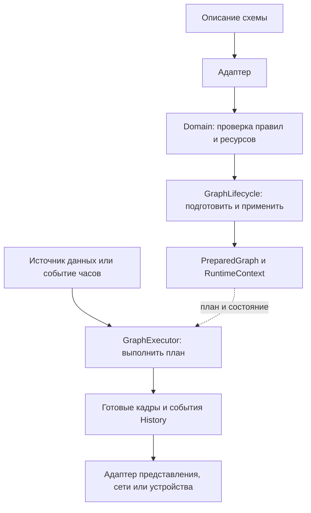
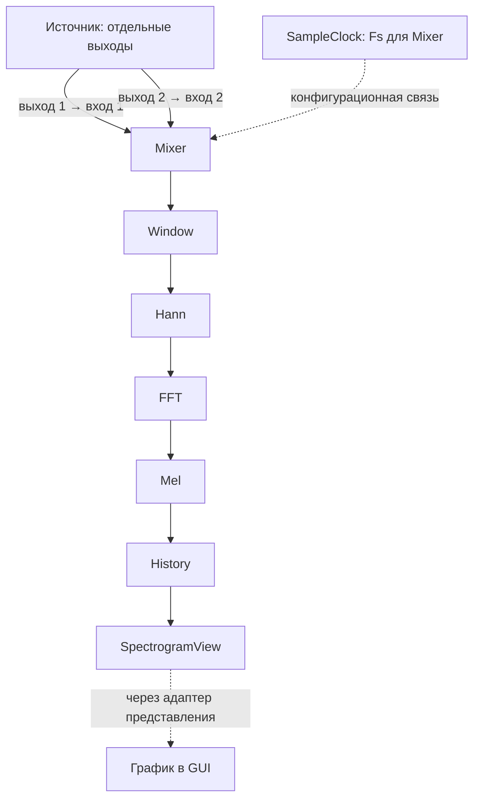

# Переносимое ядро

[Карта архитектуры](README.md) → переносимое ядро

Ядро описывает данные, проверяет схему, готовит вычисления и выполняет их. Это
общий C++20-код настольного приложения, консольного запуска и embedded-сборки.
Qt, аудиоустройства, системные сокеты и ESP-IDF подключаются через адаптеры.
Консольное `pipeline_cli` и графическое `core_app` подключают это ядро через
общий Qt-слой исполнения. На плате его подключает firmware composition.

**Схема обработки** — соединённые узлы и их настройки; **узел** — одна операция
в этой схеме; **график** — представление данных или результата узла для человека.
График не исполняет узлы. Общие определения собраны в [словаре архитектуры](README.md#термины).

## Состав и ответственность

| Модуль | Ответственность |
| --- | --- |
| `signal_contracts` | Primitive dtype, scalar/vector/matrix и structured payload, представление памяти, координаты, время и владение кадрами |
| `domain` | Узлы, порты, рёбра, конфигурационные зависимости; проверка параметров, совместимости и допустимости схемы для профиля устройства |
| `application` | Транзакционные Prepare/Apply через `GraphLifecycle`, управление ревизиями и запросами через `ProcessingControlService`, порт явного сохранения |
| `dsp_kernels` | Подготовленные численные операции: окно, FFT, Bark/Mel, генератор, преобразование типов, редукции и PCM Resampler |
| `dataflow_runtime` | Подготовленная схема `PreparedGraph`, состояние `RuntimeContext`, единственный исполнитель `GraphExecutor`, маршрутизация, Mixer, History и статистика узлов |
| `bdsp_protocol` | Кодирование CONTROL/DATA и пакетный обмен через абстрактный byte transport |
| `embedded_support` | Ограниченные профили ресурсов, DATA-сессия, admission пропускной способности, persistence через storage port и синтетический источник |

Публичные контракты находятся в `include` соответствующих модулей. Реализации
численных операций не знают о GUI, сети и формате JSON. Application зависит от
портов подготовки и исполнения; `GraphExecutor` реализует эти порты. Конкретный
процесс связывает их с источниками, хранилищем, измерительными часами и транспортом.

## Путь схемы и данных

Документ или команда CONTROL передают описание схемы. Адаптер переводит его в
`NumericProcessingGraph`. Domain проверяет правила узлов и соединений;
`GraphLifecycle` управляет подготовкой и применением. Подготовленный план
`PreparedGraph` описывает, что выполнять, а `RuntimeContext` хранит состояние
вычислений. `GraphExecutor` выполняет этот план при поступлении данных или
clock events — сообщений о продвижении локального времени сигнала.
На рисунке верхняя ветвь готовит обработку, нижняя подаёт в неё данные.

Prepare строит расписание, проверяет фактические сочетания операций и контрактов,
резервирует память и создаёт состояние. Apply активирует подготовленный план;
неудачный кандидат сохраняет работающую схему. Совместимое состояние переносится
при замене. JSON, сетевое чтение и системные потоки остаются за границей processing.
Владелец сериализует обращения к executor; `shutdown` освобождает его при teardown.

Входной порт получает один поток и не более одного ребра. Один выход может иметь
несколько потребителей. Источник с несколькими аппаратными каналами публикует
отдельные mono-выходы; переключатели выбирают маршрут, Mixer явно смешивает
независимые mono-входы. Для разных Fs используется отдельный `PcmResampler`.
Стабильный kind ID `StereoFFT` сохранён в формате, но текущая операция FFT
принимает один поток; название не задаёт обязательную пару каналов.

Тип допуска соединения определяется dtype, формой и физическим контрактом.
Подписи PCM, Spectrum и Mel описывают смысл, но сами не разрешают вычисление.
Операция проверяет геометрию, представление памяти, clock, координаты и конечность.
`SampleClock` и `FrequencyGrid` задаются отдельными configuration bindings, а не
числовыми рёбрами. Их происхождение сохраняется в схеме.

Ниже — пример схемы с двумя выходами одного источника. Каждый выход несёт
отдельный mono-поток с общей Fs и происхождением захвата. Это два порта одного
источника, а не два executor. Рёбра на рисунке задают путь данных между узлами.

| Участник примера | Что делает |
| --- | --- |
| Источник | Выдаёт два отдельных сигнала |
| SampleClock | Задаёт Fs и происхождение часов (clock domain) для Mixer; согласуется с входным контрактом |
| Mixer | Явно смешивает входы с заданными весами в один поток |
| Window / Hann / FFT | Собирают окно отсчётов, применяют оконную функцию и получают спектр |
| Mel | Преобразует спектр в значения частотных полос |
| History | Накапливает строки значений в матрицу |
| SpectrogramView | Узел-потребитель матрицы; передаёт результат адаптеру представления |
| График | Рисует переданную матрицу в окне интерфейса |

Сплошные стрелки — данные, пунктир от `SampleClock` — настройка Fs и clock domain
Mixer, согласованная с входным контрактом. Такой clock не синхронизирует независимые устройства. Перед смешиванием
разных Fs инженер добавляет явные Resampler. Эта цепочка иллюстрирует один
вариант обработки; узлы и место Mixer выбираются в схеме.

## Время, память и представления

Fs задаёт сетку отсчётов. `execution_interval` задаёт темп анализа; default новой
схемы — 1/120 секунды. Частота отрисовки выбирается отдельно в интерфейсе.
Внешние источники обрабатываются по поступлению: одинаковая Fs не устанавливает
синхронизацию аппаратных часов разных устройств.

Подготовленные операции используют заранее созданные буферы и workspace.
Синхронный `DataFrameView` заимствует память; callback не передаёт его в очередь
после возврата. Асинхронная граница удерживает ограниченный владеющий буфер.
Отказ пула или несовместимый кадр сообщается статусом, без запасного неограниченного
выделения памяти на processing path. Подготовка использует платформенный allocator;
сборка без exceptions не обещает восстановление после любого исчерпания heap.

`History` — отдельный обработчик, хранящий `[временной кадр][элемент]`. Его полная
ёмкость доступна с начала, неиспользованные строки содержат типизированные нули,
а filled count передаётся отдельно. Resize сохраняет новейшие совместимые строки.
Представление получает текущий scalar/vector/matrix или события History и переводит
их в renderer; накопление не выполняется внутри графического виджета.

Отключение или разрыв известного маршрута даёт типизированные нули на известных
часах. При неизвестном контракте распространяется недоступность. Bypass допускает
передачу исходного значения только при совпадающем физическом контракте.
`NodeStats` хранит вызовы, ошибки, self-time и deadline misses; монотонные часы
для измерений предоставляет платформа.

## Где читать дальше

- [Qt-слой исполнения](desktop-runtime.md) — общие адаптеры, источники, графический и консольный запуск.
- [Интерфейс](interface.md) — настройка схемы и доставка результатов в представления.
- [Embedded и обмен](embedded-and-exchange.md) — устройство, ресурсы и границы транспорта.
- [Runtime API](../reference/runtime-api.md), [формат проекта](../reference/project-format.md) и [протокол](../reference/protocol.md) — точные внешние контракты.

Опорные исходники: [контракт схемы](../../domain/include/domain/processing_contracts.h),
[lifecycle](../../application/include/application/graph_lifecycle.h),
[executor](../../libs/dataflow_runtime/include/dataflow_runtime/runtime.h),
[DSP](../../libs/dsp_kernels/include/dsp_kernels/dsp.h).
