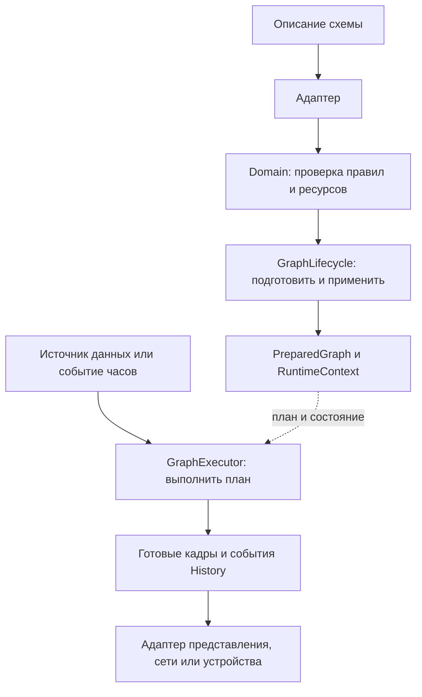
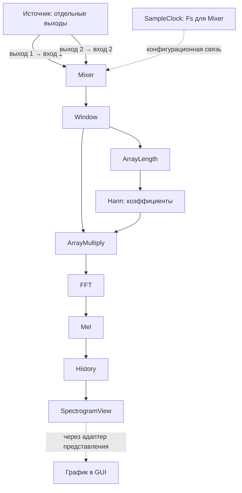

# Переносимое ядро

[Карта архитектуры](README.md) → переносимое ядро

Ядро описывает данные, проверяет схему, готовит вычисления и выполняет их. Это
общий C++20-код настольного приложения, консольного запуска и embedded-сборки.
Qt, аудиоустройства, системные сокеты и ESP-IDF подключаются через адаптеры.
Консольное `pipeline_cli` и графическое `core_app` подключают это ядро через
общий Qt-слой исполнения. На плате его подключает firmware composition.

**Схема обработки** — соединённые узлы и их настройки; **узел** — одна операция
в этой схеме; **график** — представление данных или результата узла для человека.
График не исполняет узлы. Общие определения собраны в [словаре архитектуры](README.md#термины).

## Состав и ответственность

| Модуль | Ответственность |
| --- | --- |
| `signal_contracts` | Primitive dtype, scalar/vector/matrix и structured payload, представление памяти, координаты, время и владение кадрами |
| `domain_model` | Стабильные IDs, descriptors, параметры, владеющие контракты и модель схемы |
| `domain_numeric` | Scalar/vector/matrix, генераторы массивов, явная поэлементная арифметика и матричные контракты |
| `domain_signal` | Fourier, спектральная калибровка, явные Fs/N и массив коэффициентов окна |
| `domain_music` | Музыкальные и частотные признаки, нормализатор и проверка frontend |
| `graph_domain` | Admission, подготовка значений, configuration bindings и общий node factory поверх предметных модулей |
| `application` | Транзакционные Prepare/Apply через `GraphLifecycle`, управление ревизиями и запросами через `ProcessingControlService`, порт явного сохранения |
| `dsp_kernels` | Подготовленные численные операции: окно, FFT, Bark/Mel, генератор, преобразование типов, редукции и PCM Resampler |
| `dataflow_runtime` | Подготовленная схема `PreparedGraph`, состояние `RuntimeContext`, единственный исполнитель `GraphExecutor`, маршрутизация, Mixer, History и статистика узлов |
| `bdsp_protocol` | Кодирование CONTROL/DATA и пакетный обмен через абстрактный byte transport |
| `embedded_support` | Ограниченные профили ресурсов, DATA-сессия, admission пропускной способности, persistence через storage port и синтетический источник |

Активный состав исходников задают CMake manifests с условиями выбранного preset:

| Срез | Источник состава |
| --- | --- |
| Предметные библиотеки | [domain/CMakeLists.txt](../../domain/CMakeLists.txt) |
| Application и переносимый CONTROL | [application](../../application/CMakeLists.txt), [adapters/control](../../adapters/control/CMakeLists.txt) |
| Исполнитель на host и в firmware | [dataflow_runtime](../../libs/dataflow_runtime/CMakeLists.txt), [ESP-IDF source manifest](../../adapters/esp_idf/portable_sdk/sources.cmake) |
| Qt runtime, offline adapters и захват | [desktop/platform](../../adapters/desktop/platform/CMakeLists.txt), [desktop/runtime](../../adapters/desktop/runtime/CMakeLists.txt) |
| Композиция примеров | [apps/default_graphs](../../apps/default_graphs/CMakeLists.txt) |
| Проверки и дополнительные стенды | [tests/CMakeLists.txt](../../tests/CMakeLists.txt), [portable foundation](../../tests/portable_foundation.cmake) |

Наличие файла или старого результата проверки не означает его включения в
текущую систему. Регистрация target и CTest определяется этими manifests;
дополнительный executable стенда не обязательно является CTest. Target
`audio_pipeline` собирает `NumericEngine` и адаптер захвата; его имя не означает
наличия отдельного legacy-исполнителя `AudioPipeline`. Старые `Analyzer` и
compatibility GUI не образуют второй путь выполнения текущей схемы.

Публичные контракты находятся в `include` соответствующих модулей. Реализации
численных операций не знают о GUI, сети и формате JSON. Application зависит от
портов подготовки и исполнения; `GraphExecutor` реализует эти порты. Конкретный
процесс связывает их с источниками, хранилищем, измерительными часами и транспортом.

Описания параметров разделены между numeric, signal, music, routing, adapter
и view-модулями; общий registry служит индексом. Типизированные значения массивов
по умолчанию принадлежат предметному descriptor, а общий resolver их копирует
без распознавания ключей музыкальных параметров. Допуск схемы отдельно проверяет
объявления, связи, порядок выполнения, происхождение часов и ресурсы.

## Предметные границы и создание узлов

`domain/processing_contracts.h` агрегирует публичные предметные заголовки;
реализации численных, сигнальных и музыкальных контрактов собираются отдельно.
`domain/graph/node_factory.h` задаёт общий `make_processing_node`,
`configure_processing_input` и атомарный вывод контрактов. Редактор и композиция
примеров используют этот API вместо независимых списков default contracts.
`window_math` предоставляет общую арифметику окна без backend/runtime.

`NumericArray` хранит владеющие Float32-значения, view использует span. Domain
проверяет размер/конечность; внешний адаптер `numeric_array_codec` отвечает за
текстовое кодирование. Portable CONTROL-session находится в `adapters/control`,
а примеры схем — в `apps/default_graphs`. CMake приложения собирает композицию
сверху, адаптер не подключает приложение как свою дочернюю зависимость.

Интерактивный каталог содержит только `basic-signal`: самотактируемый
SignalGenerator → Window → VectorLineView, с двумя связями данных
и начальным размером накопителя 500. Новый проект, первый запуск GUI и
CLI без выбранного проекта используют `numeric_basic_signal_graph()`.
Прежние спектральные и ритмические builders и `numeric_fixture_examples()`
сохранены для офлайн-проверок, но не входят в интерактивный каталог.
`numeric_rhythm_replay_graph()` явно собирает полный прежний тракт только
для существующего offline trace consumer; в интерактивный каталог он не входит.

`ArrayMultiply.frame_input` явно выбирает вход, задающий контракт и время
результата. Quantity, единицы и координаты не используются для угадывания этого
входа. Коэффициенты подаются отдельным массивом. Preparation-value capability
отличается от потокового scalar: тип порта сам по себе не обещает разрешимость
значения до подготовки. Диагностика может не иметь ребра; отсутствие edge
не подменяется индексом первого соединения.
Подготовка различает недоступное значение, неверный тип, невалидное значение
и выход за допустимый диапазон. Конкретная причина и исходное ребро сохраняются
до представления диагностики; ошибка provider не сводится к общему `false`.

Новые графические sink kinds фиксируют один способ отображения в самом stable ID:
`ScalarMetricsView`/`ScalarSignedBarView`, `VectorLineView`/`VectorPointView`/
`VectorBarView`/`VectorPieView`, `MatrixImageView`/`MatrixSurfaceView`.
Они допускают соответственно числовые scalar, vector и matrix контракты,
не распознавая FFT, Mel, Window или upstream topology. Scalar kinds допускают
до восьми отдельных входных значений. Звуковые `AudioLineView`/
`AudioPointView`/`AudioBarView`/`AudioPieView` принимают vector, а
`AudioImageView`/`AudioSurfaceView` — matrix; их оси и шкалы определяются
только явными координатами/настройками представления. Для звукового vector
`bin_hz` и `first_bin` являются опциональными явными параметрами; `bin_hz`
может приходить через configuration port `frequency_step_input`. Нулевой шаг
не объявляет индекс Mel-полосы герцами. `PianoView` остаётся отдельным
звуковым видом. Старые `AudioView`, `FFTView`, `MelView`, `WindowView`,
`WindowedView`, `SpectrogramView` и `ScalarView` сохраняют свои IDs и прежнюю
обработку сохранённых схем, но новые примеры используют fixed-mode kinds.

Собственные часы `SignalGenerator` — явно сохранённая настройка source output,
доступная через `signal_generator_clock`. Она не извлекается из произведённых
кадров или чужого upstream-узла. Отдельный `SampleClock` необязателен;
явная configuration binding имеет приоритет над собственными часами.
Числовой Fs-выход готовится из этого же объявления. Встроенные startup/music
примеры используют явный SampleClock, а несвязанный генератор сохраняет
поддержку собственного времени.

`PcmResampler.input_rate` — явное объявление входной Fs; значение 0 означает,
что она ещё не задана. Fs-связь источника записывает это поле при подготовке;
`configure_processing_input` материализует явно переданную конфигурацию входа.
В bypass эффективный Fs-выход равен `input_rate`, при включённом преобразовании
— `output_rate`. Обнаружение нового формата устройства не дорисовывает Fs-связь
и не меняет независимую настройку ресэмплера за пользователя.

## Путь схемы и данных

Документ или команда CONTROL передают описание схемы. Адаптер переводит его в
`NumericProcessingGraph`. Domain проверяет правила узлов и соединений;
`GraphLifecycle` управляет подготовкой и применением. Подготовленный план
`PreparedGraph` описывает, что выполнять, а `RuntimeContext` хранит состояние
вычислений. `GraphExecutor` выполняет этот план при поступлении данных или
clock events — сообщений о продвижении локального времени сигнала.
`ProcessingVersions` внутри domain содержит только версии модели графа и
обработки (`graph`, `processing`). Версии файла, CONTROL и DATA принадлежат
адаптерам соответствующих форматов. Они проверяют внешнюю оболочку до передачи
кандидата в domain и явно переводят её в модель схемы; внешний набор версий
не становится вычислительной зависимостью ядра.
Обычные числовые связи параметров Fs/N вычисляются до admission и подготовки
буферов. Сохраняемая схема содержит эти порты и связи, а исполняемый план
использует вычисленные параметры. Дополнительный Fs-выход источника компилируется
в явную подготовленную числовую константу из настроек источника/clock binding
с сохранением исходного endpoint для наблюдения.
Он не становится дополнительным аудиоканалом. Точка разводки удаляется из
исполняемой топологии; ни GUI-модель, ни подписи портов не выполняют DSP.
На рисунке верхняя ветвь готовит обработку, нижняя подаёт в неё данные.

Prepare строит расписание, проверяет фактические сочетания операций и контрактов,
резервирует память и создаёт состояние. Apply активирует подготовленный план;
неудачный кандидат сохраняет работающую схему. Совместимое состояние переносится
при замене. JSON, сетевое чтение и системные потоки остаются за границей processing.
Владелец сериализует обращения к executor; `shutdown` освобождает его при teardown.

Входной порт получает один поток и не более одного ребра. Один выход может иметь
несколько потребителей. Источник с несколькими аппаратными каналами публикует
отдельные mono-выходы; переключатели выбирают маршрут, Mixer явно смешивает
независимые mono-входы. Для разных Fs используется отдельный `PcmResampler`.
Вещественное преобразование выполняет `RealFourier`; отдельный `AmplitudePhase`
получает Re/Im, явные N/Fs и коэффициенты окна. Настольные и embedded-схемы
используют эту цепочку и положительные частоты с `first_bin=1` в Bark/Mel.

`PcmOnsetEnvelope` удалён из реестра узлов и DSP graph adapter. Его прежний
числовой слот 114 не переиспользуется. Загрузка такого узла из документа и
создание через node factory отклоняются; скрытие имени в каталоге редактора
не является запретом исполнения. Эталон Librosa собирает окно, Fourier,
извлечение мощности, Mel, dB и силу атак отдельными узлами.
Неиспользуемые Librosa PCM/envelope/PLP recipes удалены вместе с адаптерами,
экспортёрами и соответствующими наборами проверок. Числовые ID удалённых узлов
не переиспользуются. Составные анализаторы собираются явными графами из общих
операций; скрытые FFT, окна и преобразования внутри ритмического узла запрещены.
Недостающая повторно используемая математика добавляется в общий модуль, а не
в библиотечный frontend. Роли портов описываются семантическими именами и
типизированными селекторами; отображаемые RU/EN имена не определяют маршрутизацию.

Тип допуска соединения определяется dtype, формой и физическим контрактом.
Подписи PCM, Spectrum и Mel описывают смысл, но сами не разрешают вычисление.
Операция проверяет геометрию, представление памяти, clock, координаты и конечность.
`SampleClock` и `FrequencyGrid` задаются отдельными configuration bindings, а не
числовыми рёбрами. Их происхождение сохраняется в схеме.

Ниже — пример схемы с двумя выходами одного источника. Каждый выход несёт
отдельный mono-поток с общей Fs и происхождением захвата. Это два порта одного
источника, а не два executor. Рёбра на рисунке задают путь данных между узлами.

| Участник примера | Что делает |
| --- | --- |
| Источник | Выдаёт два отдельных сигнала |
| SampleClock | Задаёт Fs и происхождение часов (clock domain) для Mixer; согласуется с входным контрактом |
| Mixer | Явно смешивает входы с заданными весами в один поток |
| Window / Hann / FFT | Собирают окно отсчётов, применяют оконную функцию и получают спектр |
| Mel | Преобразует спектр в значения частотных полос |
| History | Накапливает строки значений в матрицу |
| SpectrogramView | Узел-потребитель матрицы; передаёт результат адаптеру представления |
| График | Рисует переданную матрицу в окне интерфейса |

Mel и Bark готовят частотные веса из собственных `sample_rate`, `bin_hz`,
`first_bin` и `frequencies_hz`. Пустой `frequencies_hz` задаёт регулярную
сетку; непустой массив явно задаёт центры входных спектральных bin в Hz.
Координаты входного кадра сверяются с объявленной сеткой при допуске и
доставке, но не выбирают коэффициенты фильтра. Mel рассчитывает ограниченную
матрицу весов при подготовке; обработка кадра использует готовые веса без
повторного расчёта треугольников.

Сплошные стрелки — данные, пунктир от `SampleClock` — настройка Fs и clock domain
Mixer, согласованная с входным контрактом. Такой clock не синхронизирует независимые устройства. Перед смешиванием
разных Fs инженер добавляет явные Resampler. Эта цепочка иллюстрирует один
вариант обработки; узлы и место Mixer выбираются в схеме.

## Время, память и представления

Fs задаёт сетку отсчётов. `execution_interval` задаёт темп анализа; default новой
схемы — 1/120 секунды. Частота отрисовки выбирается отдельно в интерфейсе.
Внешние источники обрабатываются по поступлению: одинаковая Fs не устанавливает
синхронизацию аппаратных часов разных устройств.

Подготовленные операции используют заранее созданные буферы и workspace.
Синхронный `DataFrameView` заимствует память; callback не передаёт его в очередь
после возврата. Асинхронная граница удерживает ограниченный владеющий буфер.
Отказ пула или несовместимый кадр сообщается статусом, без запасного неограниченного
выделения памяти на processing path. Подготовка использует платформенный allocator;
сборка без exceptions не обещает восстановление после любого исчерпания heap.

`History` — отдельный обработчик, хранящий `[временной кадр][элемент]`. Его полная
ёмкость доступна с начала, неиспользованные строки содержат типизированные нули,
а filled count передаётся отдельно. Явный `filled_only=true` публикует только
реальные строки, включая пустой стартовый снимок, поверх того же кольцевого
буфера. Публикация и запрос снимка имеют одинаковую геометрию и времена;
переключение режима не сбрасывает совместимую историю. Resize сохраняет новейшие совместимые строки.
Представление получает текущий scalar/vector/matrix или события History и переводит
их в renderer; накопление не выполняется внутри графического виджета.

`Window` — общий накопитель последних N значений, принимающий scalar или vector
любого поддержанного числового dtype без потери точности. Большой вход заменяет
содержимое своим хвостом; равный N заменяет целиком; короткий сдвигает историю
и дописывается справа. Не заполненный префикс содержит числовые нули. Одна входная
порция даёт один результат; Fs, FFT, execution interval, hop и bypass в операции
не участвуют. `Spectrogram` накапливает строки, `NumberAccumulator` — отдельные
числа; эти примитивы также не требуют известной Fs и не имеют bypass. Временные
метки и известные часы передаются как сведения доставки, без вычисления частоты.

Матрица обрабатывается отдельными операциями: `MatrixTranspose` меняет местами
оси и элементы `[кадр][полоса] → [полоса][кадр]`, учитывая логический порядок ring.
`MatrixCenter` вычитает из каждой строки её среднее, середину диапазона или
ручное смещение; в примере включено вычитание среднего перед окном.
Окно строк применяется общим `ArrayMultiply`: Float32-вектор коэффициентов
транслируется по строкам матрицы. `Fourier`/`RealFourier` преобразуют последнюю
ось, переиспользуя один подготовленный FFT-план для всех фактических строк.
Длина строки должна равняться явному N: скрытого обрезания или дополнения нет.
Дополнение нулями, если нужно, выполняется до преобразования. `AmplitudePhase`
получает отдельные Re/Im и коэффициенты окна следующим этапом.
`MatrixCenter` использует Float32 scaled-mean accumulation и Float32 midpoint.
При подготовке графа значения настройки 0, 1 и 2 переводятся в
`MatrixCenterMethod`. Подготовленный узел выбирает реализацию один раз на
строку. Цикл по отсчётам использует специализированный расчёт среднего
или середины диапазона.
`MatrixRow` выделяет выбранную строку в vector.
Одна ветка показывает всю карту, другая — спектр выбранной полосы. Тишина,
нулевые кадры и переходные временные метки не прерывают вычисление FFT.
Подробности координат и нормализации — в [Runtime API](../reference/runtime-api.md#матричные-операции).

Отключение или разрыв известного маршрута даёт типизированные нули на известных
часах. При неизвестном контракте распространяется недоступность. Bypass допускает
передачу исходного значения только при совпадающем физическом контракте.
Отказ операции остаётся диагностикой её выходов. Зависимые операции и представления
получают недоступность данных, без повторного приписывания им исходного отказа.
`NodeStats` хранит вызовы, ошибки, self-time и deadline misses; монотонные часы
для измерений предоставляет платформа.

## Где читать дальше

`Fourier` принимает отдельные вещественную и мнимую плоскости, а `RealFourier`
имеет только вещественный вход. Комплексный путь сохраняет полный незеркальный
спектр Re[N] и Im[N]. Real-путь публикует Re[N/2+1] и Im[N/2+1] от DC
до Найквиста включительно. Матрицы сохраняют ось строк. FFT строит ось
индексов бинов и сохраняет время доставки. Radix2 принимает 2^m;
комплексный radix4 — 4^m, real radix4 использует также смешанный backend.
Минимальный N равен 4 у C2C и 8 у Real FFT; верхний предел задаётся профилем.
`AmplitudePhase` вычисляет модуль/фазу через общие `complex_values` и
`PreparedSpectrumScaling`; доступны Hypot/SquaredNorm/ScaledRatioFma, Zero/Atan2 и явная
обработка реальной оси. Входы Re/Im имеют полную одинаковую геометрию.
Амплитуда и фаза исключают DC и включают Найквист для вещественного спектра.
Выход DC содержит Re[0] или Re[0]/sum(w) и выдаёт одно значение на строку
матрицы. N и sidedness заданы явно. Fs нужен для PSD и частотной разметки.
`magnitude_norm=scaled_ratio_fma` явно выбирает существующий общий Float32
scaled-ratio/FMA kernel с порядком операций NumPy complex64 absolute.
Whole-CRF включает этот режим по сравнению одинаковых Re/Im с оригиналом;
значение по умолчанию `hypot` и остальные рецепты сохраняются.
Для ограниченного выражения `1+r*r`, `0≤r≤1`, бинарный Float32 продукт
точно представим в Float64. FastTwoSum сохраняет остаток округления суммы;
поправка только точного Float32 midpoint перед финальным округлением даёт
правильный RNE результат без зависимости от реализации `fmaf` платформы.
Это локальная операция ScaledRatioFma; общий FMA и режим округления не меняются.
`WindowFunction` генерирует w[n] по числовому N; `precision=0` сохраняет Float32,
а явный `precision=1` готовит Float64. По умолчанию `evaluation=0` сохраняет
прежнюю арифметику, включая центрированную cosine-series формулу Double Hann.
Явный `evaluation=1` вычисляет окно непосредственно по нормированной позиции
`i / (N - 1)` (либо `i / N` при `periodic=true`), с заданным Double `pi`.
Для Hann порядок операций — `.5 * (1 - cos(2 * pi * position))`;
Float32 округляет полученный Double коэффициент один раз. `pi` по умолчанию
равен `std::numbers::pi`, должен быть конечным и лежать в `(0, DBL_MAX/2]`;
он участвует только в прямом вычислении. Неизвестный режим или неверный `pi`
отвергаются при выводе контракта и до записи коэффициентов. Коэффициенты обоих
типов готовятся до обработки; processing path только публикует массив.
Явный `evaluation=2` выбирает симметрический косинусный ряд. Float32 вычисляет
коэффициенты и косинус в Float32 с отражением позиции, Float64 использует
центрированную Double-формулу. Hann/Hamming/Blackman/Blackman–Harris/FlatTop
задаются общими коэффициентами ряда; Bartlett и Rectangular сохраняют свою
форму. В частности, source Hamming для smoothing выбирается этим режимом,
а не изменением Default. `pi` используется только режимом Direct.
Применение окна
выполняется общим `ArrayMultiply`. Выход генератора один: массив коэффициентов.
Он же подключается к `AmplitudePhase` одним входом подготовки 65523. Domain
оценивает объявленный конечный массив до запуска; ядро считает C=sum(w) и
E=sum(w²) один раз при подготовке и кэширует масштабы. На processing path
нет вычисления сумм или поиска изменений массива. Отключение связи очищает
оконную поправку, оставляя нормировку FFT с C=E=N. Сохранённая схема хранит
провод и параметры генератора, а не копии массивов в каждом потребителе.
Оба пути используют одну platform-free `window_math`.
`MusicalSpectrogram` строит составной ряд НЧ/СЧ/ВЧ/нот по явным диапазонам
и режимам редукции, отдельно выдаёт full/selected совпадения пиков с сеткой.
Нотная часть использует интерполяцию спектра, а не harmonic salience.
Геометрия готовится в domain, численные планы — в dsp_kernels; History
инвалидируется при смене смысла полос, а не только размера.
`ArrayMultiply` перемножает два и более массива одинаковой геометрии;
scalar транслируется по всем значениям, vector — по строкам матрицы.
Смешанные Float32/Float64 входы дают Float64 результат и владеющее Double
хранилище множителей; чистая Float32 цепь сохраняет прежнее исполнение.
`RealFourier` с Float64 входом использует существующий подготовленный
PocketFFT Double и округляет Re/Im/DC в Float32 на границе публикации.
Компактные порты, координаты и время сохраняются. Именованный Float32 backend
с таким входом отклоняется; поддержка Double плана и его cold/scratch память
проверяются до исполнения. Эти возможности включены только явно в whole-CRF;
параметры остальных rhythm recipes сохраняются.
Явный `frame_input` задаёт время, координаты и выпуск результата; остальные
множители удерживаются в заранее подготовленных владеющих буферах. Обновление
множителя само по себе не повторяет уже обработанный ведущий кадр. FFT, Fs/N
и совпадающие clocks для численного произведения не требуются. Fs и построение
частотной оси не входят в численную операцию Fourier; время кадра остаётся
служебным контрактом исполнения. Порты и ограничения описаны в
[Runtime API](../reference/runtime-api.md#исследовательские-музыкальные-операции).

Исследовательский PC-тракт добавляет отдельные операции `RFFT`,
`SpectrumProjection`, `FrequencyNormalizer`, `BroadbandFeatures`, `NoteSalience`
и `SpectralQuantize`. Они исполняются тем же `PreparedGraph`/`GraphExecutor`.
Комплексный RFFT — одна матрица `[bin][Re,Im]`, а не несколько аудиоканалов.
Количество коэффициентов `N/2+1`; проекции масштаба не изменяют исходный FFT.
Переносимые планы `FFT` (full complex) и `PreparedRfft` (packed real) имеют
одинаковый raw Re/Im выход. Magnitude-valued операции используют отдельный
`MagnitudeSpectrum`; raw FFT не вычисляет модуль. SIMD split и SDK dispatch
изолированы от domain/runtime, см. [FFT API](../reference/fft.md).
Domain проверяет dtype, форму, частотную сетку и согласованность объявленной
в настройках узла численной трактовки с quantity/unit входа. Quantity кадра
не выбирает формулу обработки. Фаза и dB не подходят для линейных музыкальных
признаков. `NoteSalience` явно принимает magnitude, peak amplitude, power или
PSD; подготовленный workspace переводит выбранную величину в power с отдельной
политикой DC/Nyquist, собственной суммой коэффициентов окна `coherent_gain`
для raw magnitude и заданной полосой окна для PSD.

Калиброванный модуль имеет отдельный `SpectrumWindowScaledMagnitude`.
Legacy `magnitude` у `NoteSalience` допускается с ним только при явном C=1;
конфликт отклоняется с указанием `coherent_gain`. `BroadbandFeatures` различает
агрегаты `SpectrumPower` и `SpectrumBinPower` пятью отдельными Quantity,
без скрытого масштабирования. После `SpectralQuantize` передаются целочисленные
коды с единицей `Values`; диапазон исходных значений остаётся явной настройкой
квантователя. Формулы, стабильные ID и диапазоны исследовательских History
описаны в [спектральных контрактах](../reference/spectral-projections.md).

Внутренний адаптер эталонных offline fixtures `SpectrumProjection` принимает
`[bin][Re,Im]` с явными N/Fs/first_bin/sidedness; он переиспользует то же ядро
масштабирования. `RFFT`, `MatrixFFT`, `MatrixWindowFunction`,
`ComplexPolar`, `SpectrumAmplitude`, `SpectrumProjection`, `WindowGain` исключены
из обоих каталогов редактора. Их старые fixture-адаптеры не создают альтернативного
пути в новой схеме: используются `WindowFunction`, `ArrayMultiply`, `Fourier`/
`RealFourier`, `AmplitudePhase`. DFT-узел в эту итерацию не входит.
Raw выбранная норма и `magnitude_exponent` отделены от calibrated Power/PSD.
`normalize=false` сохраняет raw математику; `normalize=true` использует либо
симметричное/периодическое выбранное окно, либо явно переданные C/E через
`scaling_source=coefficients`. Окно, Fs и N не ищутся по upstream-топологии.
При обновлении входного контракта точный проход через
`Converter` сохраняет проход; преобразование в другой тип сохраняет выбранные
выходные dtype, представление и политику масштабирования.

Составные temporal-узлы с внутренними окнами и преобразованиями удалены.
Librosa собирает явную цепочку коэффициентов окна, умножения, `DirectCorrelation`
и `VectorNormalize`. Два входа корреляции подключены к одному оконному снимку,
число задержек поступает отдельной связью от `ArrayLength`, а `TempoEstimate`
получает нормированный профиль и отдельные Fs/hop. Отсутствие FFT здесь —
свойство выбранного общего алгоритма прямой корреляции; другой тракт должен
подключать Fourier, мощность и inverse Fourier отдельными узлами.

Опциональный `NumericOperationFactory` подключается владельцем профиля через
`shared_ptr`; переносимое ядро не зависит от конкретных source-адаптеров.
Чистый assessment читает borrowed настройки без выделений. Cold prepare
создаёт владеющий descriptor/processor и сверяет actual allocations с admission.
Runtime удерживает ограниченные input latches, сопоставляет объявленные
port/interval/batch rules, передаёт explicit batch/EOF/reset controls и атомарно
публикует per-port availability/status/stamps и владеющие координаты.
ValueDomain объявлен для каждого входа/выхода; explicit координаты конечны.
Cold clone независим, несовместимый warm state transfer приводит к reset.
Native Float32 fast path предоставляется только как proof-backed typed span;
перечитывание байтов как `float*` запрещено.

Численная граница расширений использует `NumericBufferContract/View`: только dtype,
rank/extents, представление памяти, число плоскостей и фактическую геометрию.
`NumericOperationNodeView` передаёт явные настройки и ограниченные порты;
`NumericOperationProfile` содержит лимиты и capabilities без runtime callbacks,
preparation providers или доступа к схеме. Полные контракты преобразуются только
на composition boundary через `numeric_operation_binding.h`; обратного преобразования
в интерфейсе расширения нет. Fs/N/hop, коэффициенты и управляющие величины задаются
параметрами или отдельными входами и не извлекаются из чужого кадра.

Clock, quantity/unit, coordinate declarations и временные метки остаются private
в runtime. Фабрика объявляет ограничения в `NumericOperationPolicy`, исполнитель
проверяет их при подготовке и доставке до вызова численного обработчика.
Выходные координаты либо записываются через ограниченный write-only writer,
либо доставляются по явно объявленному coordinate route/правилу сетки.
Writer привязан к конкретному выходу и текущему вызову; после вызова или удаления
контекста он недействителен. Происхождение результата передаётся opaque `Origin`
без getter метаданных. Его можно удерживать для buffered EOF, но публикация требует
происхождения своего экземпляра операции; пустое и чужое отвергаются.
Runtime атомарно проверяет все выходы, принадлежность памяти, координаты и значения
до публикации. Вызовы обработчика не получают `NumericView`, `FrameStamp` или
полный контракт. Это ограничение API, а не изоляция произвольного небезопасного C++.

Нейтральный optional target `dsp_graph_adapters` связывает общие ядра и
классические последовательности с этим же executor. `FilterMatrixProjection`,
`LogCompression`, `VectorNormalize`, `RecursiveFilter`, `DirectCorrelation`,
`CurveInterpolation`, `CombFilterBank`, `ValueHistogram`, `InterpolatedPeaks`,
`SameConvolution`, `InverseFourier` зарегистрированы отдельными стабильными
операциями. Окна/FFT/polar/calibration/Mel/dB/ACF используют существующие блоки.
Форма и оси сохраняются там, где преобразование их не меняет; отдельные выходы
публикуют веса/центры, состояния фильтра, counts и offsets. Exact counts — UInt64,
аналитические значения — Float32. InverseFourier принимает полный N-bin complex
Re/Im и использует существующий normalized IDFT, без догадки по magnitude.
Точный контракт описан в [API адаптеров](../../libs/dsp_graph_adapters/README.md).

Production opt-in задаётся `dsp_graph_adapters::with_dsp_operations(profile,models)`
либо explicit optional `rhythm_graph_adapters::with_reference_operations` с
владеющими models/resampler providers. Эти helper устанавливают factory в
существующий `NumericRuntimeProfile`, не создавая другой GraphExecutor и не
увеличивая resource limits. Основное приложение и SDK не получают implicit
GPL/AGPL dependency. Готовность остальных source-family bindings и numerical
parity подтверждается отдельно; наличие composition helper её не доказывает.
Для `SessionSequence`/`ExactInterval` binding явно объявляет
`SharedProvenance`: общую сессию задаёт совпадающий набор
`producer_epoch/generation/epoch/graph_revision`, а stream IDs могут различаться.
Для точного сравнения интервалов дополнительно проверяются непустой clock domain,
эквивалентные положительные tick durations и одинаковые sample rates.
Несовместимый descriptor отклоняется до замены рабочей схемы; несовпавшие
текущие кадры ждут согласованного набора без публикации нового результата.
Explicit reset доставляет unavailable/discontinuity downstream и observers.
Недоступные отдельные выходы получают contract-minimum extents и пустые
coordinate views; непроверенные размеры не попадают в сохранённую публикацию.

Отдельный AGPL target `rhythm_graph_adapters` предоставляет optional source
bindings `BeatIntervalHistogram`, `HarmonicTempoCandidates`,
`TempoChangeSections`, `DetrendedFluctuation`. Main/SDK не линкуют его неявно;
composition root устанавливает его factory явно. Без factory соответствующая
комбинация не проходит capabilities. Остальные source rows остаются отдельными
этапами интеграции; наличие factory не означает их готовность.

`PcmPacketQueue` отдельно дозирует владеющие mono PCM-пакеты по sample ticks,
проверяет порядок, разрывы и переполнения. `SourceIngress` использует её перед
сборкой окон. `PreparedResampler` меняет равномерную Fs; `Window` сохраняет
последние N входных значений без знания Fs или расписания. Данные и provenance не удерживают borrowed
payload за пределами вызова.
FIR-профили, точная начальная фаза, модель задержки и bounded EOF drain описаны
в [справочнике ресэмплинга](../reference/resampling.md).

Неиспользуемые графовые композиции ratio/metrical tempogram удалены.
Общие estimator, interpolation и feature reduction остаются самостоятельными
переносимыми операциями; новые композиции должны связывать их явными рёбрами.

Для source-рецептов явный `NumericalPrecision::DesktopReference` сохраняет
Double-окно, оконное умножение и real FFT до исходной границы Complex64;
ACF остаётся Double до нормировки и hybrid-интерполяции. Публичные порты и
диагностические stage views остаются Float32 с явным округлением. Mel, dB,
onset и остальные аналитические цепочки не переводятся под Double автоматически.
В спектральном source-рецепте этот desktop-профиль вычисляет модуль Complex64
через `ScaledRatioFma`, когда выбран `Hypot`: сохраняется порядок Float32
операций NumPy. Явный `SquaredNorm` и режим `PortableFloat32` не меняются.
По умолчанию действует прежний `PortableFloat32`; настройки схемы и metadata
не выбирают профиль скрыто. Оба пути используют одни и те же входы/параметры
original-reference harness. Float32-counterexamples сохраняются как baseline
для последующего возврата к Float32 с проверкой численных ошибок, событий,
путей состояний, lifecycle, времени и памяти.

Desktop real FFT использует подготовленный PocketFFT с неизменённой математикой
и внешним заранее выделенным scratch. Собственный `PreparedFourierTransform`
вычисляет в Float32 и не заменяет этот профиль Float64 без изменения точности.
Вендорный include-каталог PocketFFT подключён как private system dependency;
исходники адаптера проверяются обычной C++ диагностикой проекта.
Копии разделяют только неизменяемый plan;
рабочие буферы принадлежат каждому экземпляру. Консервативные storage queries
учитывают Double payload и cold construction. Этот профиль ограничен FFT до
65536; circular/zero-phase rotation использует общие операции размещения окна
и циклического сдвига с Double-перегрузками, без дополнительного workspace.
Ограничение source-рецепта на чётный circular frame остаётся явным;
общие операции размещения поддерживают нечётные и чётные размеры.
Hybrid поддерживает linear interpolation.
Остальные существующие режимы доступны через PortableFloat32.

Диагностический `RhythmFeatures` выдаёт Float32 полосы без квантования;
`input_representation` явно связывает комплексный RFFT4096 либо положительные
peak amplitudes с соответствующей проекцией. Сумма квадратов переиспользует
общий `project_filter_weights`; сохраняются64/96 полос, масштаб и0…1 clipping.
Runtime использует свои обычные Float32 input/output buffers. `RhythmAnalyzer`
в Graph принимает только Float32 историю; отдельный byte-codec API ядра
не включён в этот аналитический путь. Конечные значения выше1 ограничиваются
единицей только на входе Analyzer: исходная History и другие потребители
сохраняют прежние значения. Отрицательные и неконечные значения отвергаются;
clipping не считается ошибкой исполнения. Значения0…1, включая слабые уровни,
не квантируются и не нормируются по максимуму кадра.
`PreparedTempoEvidence` хранит кандидатов, опоры, ранжирование и maturity в
Float32; domain/runtime/recorder сохраняют этот dtype. При спектральном
уточнении отношения соседних амплитуд к центральной и их логарифмы вычисляются
в Double: общий масштаб исключается до интерполяции, без потери точности при
вычитании больших логарифмов. Результат уточнения округляется в Float32.
Целые counts/flags и Double time/frequency coordinates остаются отдельными.
Музыкальные descriptor/onset/rhythm/evidence узлы используют существующую
PartitionOutput-политику: изменение вычислительных настроек создаёт новую
content lineage, поэтому зависимая History не смешивает разные режимы
при совпадающей форме выходного массива.

Существующий Graph-узел `OnsetStrength` разрешает `aggregate=mean`,
`median`, `sum` и `none`. Первые три режима выдают вектор по времени;
`none` сохраняет матрицу `[time][feature]` и координаты признаков.
Domain contract, cold preparation/resource query и исполнение используют
один явный aggregation mode. Features пишутся напрямую в подготовленный
output frame без дополнительного scalar staging; вычисление остаётся Float32.

Librosa использует явный граф: окно коэффициентов → умножение PCM →
RealFourier → извлечение мощности → Mel → dB → OnsetStrength.
Темпограмма для оценки темпа также разложена: окно Hann → умножение истории →
DirectCorrelation с двумя явными входами → VectorNormalize → TempoEstimate.
Число лагов передаётся отдельной связью ArrayLength. DirectCorrelation здесь
использует прямое суммирование Float32; побитовая идентичность прежнему FFT
не подразумевается. Неиспользуемые grouped-onset/detection/ratio композиции
удалены; проверки используемого PreparedOnsetStrength сохранены.

В BTrack-пресете общий Double Hann, оконное произведение, Float32 Converter,
перестановка отсчётов и KISS Fourier образуют явный frontend. `BTrackOnset`
сохраняет Double positive-complex ODF по отдельным Re/Im. Общие AbsoluteValue,
сложение с Double epsilon и Converter предшествуют seeded `BTrackHistory`;
whole-window sinc выделен отдельным узлом и не скрыт в накопителе.

ACF также представлена рёбрами: source threshold → padding → Fourier1024 →
Re²+Im² → normalized InverseFourier → complex magnitude → первые512 lag →
деление на явные512…1. Отдельные source comb response, threshold128 и41 tempo
observations не выполняют FFT и не меняют tempo state. `BTrackBeatDecision`
сочетает prediction с переходом вероятностей только на beat_due; его tempo state
не выделяет Fourier-план. Старые PCM predictive wrappers и их graph adapters
удалены, без compatibility routes. Общие численные/оконные/SRC kernels сохранены.

В этих source-рецептах точность коэффициентов окна задаётся явно:
`SpectralWindowConfig::precision` и `window_precision` составных конфигураций
по умолчанию используют `NumericalPrecision::PortableFloat32`.
`DesktopReference` вычисляет исходные выражения коэффициентов в Double перед
сохранением во Float32. Нормировка окна и последующий FFT остаются Float32;
это отдельная настройка от desktop FFT/ACF-профиля, описанного выше.
Нормированное source-окно имеет `sum(abs(window))=2`. Диапазон Double-результата
проверяется до преобразования во Float32; настройки не выбираются скрыто.

Холодный расчёт коэффициентов `PreparedErbFilterBank` сохраняет порядок
source-выражений, включая Float32 exponent комплексной степени и Double там,
где его задают исходные литералы. Коэффициенты записываются во Float32;
параметры, хранение и горячая матричная проекция остаются Float32.
Это mixed-precision подготовка коэффициентов, а не перевод обработки в Double.

Source-оценка `PreparedBeatAgreement` приводит относительную ошибку фазы
положительным floor-modulo: `shifted - floor(shifted) - 0.5f`.
Это сохраняет исходное поведение на отрицательных и полных периодах;
знаковый `std::fmod` здесь не эквивалентен. Расчёт и гистограмма остаются Float32.

`PreparedRecursiveFilter` поддерживает Transposed Direct Form II по умолчанию
и Direct Form I с раздельными сложением feedforward и вычитанием feedback.
Форма и порог обнуления входа задаются при подготовке; тёплая смена коэффициентов
сохраняет состояние только при прежнем порядке. Direct I хранит две истории
`[input][output]`, newest-first; `storage_bytes` учитывает обе и scratch.
Aubio peak picker использует этот общий фильтр с исходным порогом2e-42,
сбросом между прямым и обратным проходами и Float32 арифметикой.
Общая медиана явно различает lower, `(a+b)/2` и `a/2+b/2` для чётного размера.
Среднее, pre-scaled compensated mean и variance с correction0/1 находятся
в общих численных операциях; Percival, onset pickers и tempo estimator
выбирают соответствующие исходные правила без собственных копий формул.
Общий accumulator различает plain и compensated суммирование; variance явно
выбирает порядок преобразования делителя N−correction в Float32. Старый beat DP
использует compensated deviation с целочисленным N−1 до преобразования.
Scalar и per-feature detrend `PreparedOnsetStrength` используют тот же DirectI
фильтр с `[1,-1]/[1,-.99]`, отдельным reset для каждого полного вызова и
подготовленными независимыми состояниями. Resource query включает коэффициенты,
input/output histories, scratch и объекты фильтров.

В Madmom общий frontend и история ODF обслуживают три выхода одного графа.
Fixed/Local/CRF связывают SameConvolution, CombFilterBank, AxisMaximum,
AxisSum, ArrayGather, NumericMap и OrderedPeaks явными рёбрами.
AxisMaximum публикует все tied maxima; AxisSum задаёт обычное или накопительное
суммирование. ArrayGather принимает одноплоскостной вектор UInt64 индексов.
Выключенные map/reduction/comb выдают типизированные нули фактической
геометрии входа с учётом выбранной оси, без расширения до capacity. Fixed/Local используют Float32, CRF сохраняет Double до явного
преобразования перед декодером. Alpha остаётся Float32 согласно Cython
аргументу исходного backward comb. BeatTrackingSequence и CrfBeatSequence
получают готовые интервалы отдельным обязательным входом и не оценивают темп
внутри. Удалённые TempoHistogram/TempoAnalysis не имеют compatibility route.

В Essentia интерполяция, FIR и перенос его состояния, проекция полос,
log/normalization, ACF, гребёнка и квантильная маска выражены общими узлами.
PeriodPath выполняет только поиск пути периодов; RenewalBeatDecoder получает
кривую новизны, периоды и границы участков отдельными входами. Пять кандидатов
используются одним combined-графом; Degara и MultiFeature имеют разные выходы.

На MinGW x86 этот профиль требует доступных CPU и ОС AVX/FMA: холодная
подготовка отклоняется до выделения памяти, если их нет. Локальная аппаратная
FMA обходит некорректное округление Double `std::fma` этой toolchain; остальные
conforming toolchains используют `std::fma`. Double-свёртка с overlap менее 16
и empty-kernel bypass доступны без FMA; больший overlap отклоняется до записи
результата. Reference-арифметика предполагает IEEE binary64, nearest/even и
gradual underflow, не изменяя FENV. Общие флаги сборки и доступность остальных
reference FFT/ACF не меняются.

Переносимое ядро содержит порты внешнего resampler backend и загрузчика
частотных профилей. Desktop composition подключает SpeexDSP и JSON loader;
переносимые модули не зависят от этих реализаций. Файлы и JSON обрабатываются
на холодном пути подготовки. Новые операции требуют `music_enabled` в профиле
устройства; embedded-профиль их явно отклоняет. Существующий FIR и прежние
операции доступны по прежним capabilities.

Отдельный режим `speex_q15` использует Int16-вход/выход внешнего backend;
Window сохраняет Int16 до явного Converter перед оконным умножением.
`hann_periodic` и симметричный `hann` имеют разные стабильные настройки.
`WindowFunction` имеет один выход коэффициентов. Их явная подготовительная связь
к `AmplitudePhase` заменяет отдельные выходы сумм; выключение `normalize`
отключает FFT/оконную компенсацию, не меняя фазу. Пустой коэффициентный вход
соответствует прямоугольному окну при нормировке FFT.
BroadbandFeatures допускает `peak_amplitude` для `maximum`, сохраняя амплитудную
единицу; другие статистики по-прежнему требуют power/bin-power.
Композиция этого тракта описана в [компактной спектрограмме](../guides/compact-spectrogram.md).

Два потока признаков квантуются до существующих History. При изменении границ
полос, нотной сетки или шкалы квантования сбрасывается только затронутая
несовместимая история; совместимые ветви сохраняют состояние.
Формулы, настройки и ограничения описаны в
[руководстве музыкального спектра](../guides/music-spectrum.md).

- [Qt-слой исполнения](desktop-runtime.md) — общие адаптеры, источники, графический и консольный запуск.
- [Анализ ритма](../guides/rhythm-analysis.md) — переносимое причинное ядро R4,
  диагностические признаки и численные выходы экспериментального узла.
- [Интерфейс](interface.md) — настройка схемы и доставка результатов в представления.
- [Embedded и обмен](embedded-and-exchange.md) — устройство, ресурсы и границы транспорта.
- [Runtime API](../reference/runtime-api.md), [формат проекта](../reference/project-format.md) и [протокол](../reference/protocol.md) — точные внешние контракты.

Опорные исходники: [контракт схемы](../../domain/include/domain/processing_contracts.h),
[lifecycle](../../application/include/application/graph_lifecycle.h),
[executor](../../libs/dataflow_runtime/include/dataflow_runtime/runtime.h),
[DSP](../../libs/dsp_kernels/include/dsp_kernels/dsp.h).
