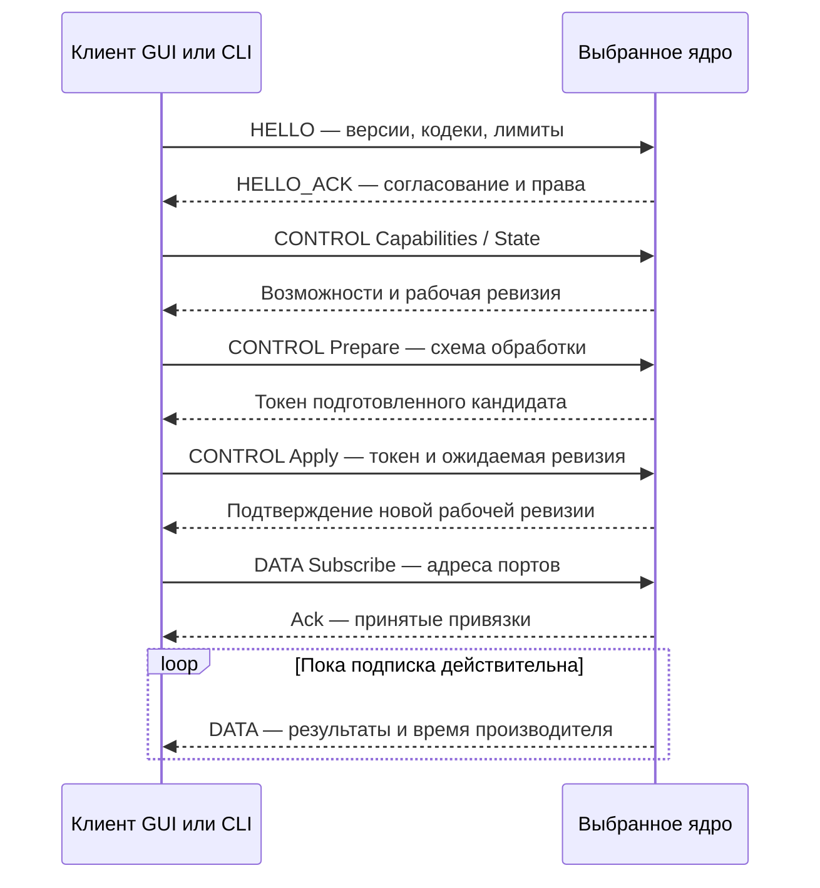

# CONTROL и DATA

[Обмен между ядрами](../architecture/embedded-and-exchange.md) · [API исполнения](runtime-api.md)

TCP и UART используют общие переносимые кодеки `bdsp_protocol`, BDSP framing
и один packet parser на соединение. CONTROL управляет схемой выбранного ядра;
DATA переносит результаты конкретного порта. Codec и транспорт не выполняют DSP.

## Кто с кем взаимодействует

DATA сохраняет отдельную компонентную ось `Component` для комплексного RFFT,
а quantity/unit различают спектральные проекции и музыкальные признаки.
Новые символы дописаны к прежним числовым кодам; старые коды не переименованы.
Приёмник, не знающий нового символа или операции, явно отклоняет контракт.
Типизированные UInt8/UInt16 History передают коды и исходные координаты,
не превращая их в скрытые аудиоканалы или автоматически нормированные Float32.

**Клиент** — графическое приложение, консольное приложение или другой участник,
который подключается к ядру. **Ядро** — процесс или устройство со своей схемой
обработки и исполнителем. **CONTROL** передаёт возможности, состояние и команды
изменения схемы. **DATA** передаёт результаты конкретных узлов и портов.
Оба вида сообщений могут идти по одному TCP/UART-соединению.

Адрес подключения к ядру выбирает устройство или процесс. Адрес порта данных
внутри этого ядра выбирает схему, узел, направление и порт. Различие терминов
объяснено в [архитектурном словаре](../architecture/README.md#термины).

На рисунке упрощённый успешный сеанс: сначала согласуются версии и права,
затем клиент получает возможности, подготавливает и применяет схему, подписывается
на её выходы. `Prepare` создаёт кандидата, `Apply` активирует его, `Subscribe`
выбирает результаты для доставки. При отказе Prepare/Apply рабочая схема
сохраняется; DATA начинается после положительного подтверждения подписки.

## Редакции и источники ABI

| Граница | Поддержанная редакция | Источник |
| --- | --- | --- |
| Graph / processing | 5 / 4 | [domain DTO](../../domain/include/domain/processing_contracts.h) |
| HELLO envelope | 2 | [ControlSession](../../adapters/desktop/runtime/src/numeric_control_session.cpp) |
| CONTROL schema | 4 | [CONTROL DTO](../../libs/bdsp_protocol/include/bdsp_protocol/numeric_control_message.h), [Protobuf schema](../../libs/bdsp_protocol/schema/numeric_control.proto) |
| DATA payload / delivery grammar | 6 / 1 | [DATA DTO](../../libs/bdsp_protocol/include/bdsp_protocol/numeric_data_message.h), [DATA codec](../../libs/bdsp_protocol/src/numeric_data_codec.cpp) |

Номера этих границ независимы. На провод передаются символические идентификаторы,
а не C++ enum ordinals или память `struct`. Точную таблицу полей CBOR/Protobuf
задаёт [CONTROL codec](../../libs/bdsp_protocol/src/numeric_control_codec.cpp).

| BDSP ID | Содержимое |
| --- | --- |
| 21 / 22 | HELLO / HELLO_ACK |
| 23 / 24 / 25 | CONTROL Command / Reply / Fragment |
| 26 / 27 | DATA Subscribe / Ack |
| 28 | DATA Events |
| 29 / 30 / 31 | History Query / Snapshot / DATA Fragment |

## Согласование и управление

Версия CONTROL packet равна 4, DATA payload — 6. `GraphVersions` внутри
CONTROL сохраняет отдельную оболочку схемы с document=4, graph=5,
processing=4, control=4, data=5. Последнее поле — processing data edition,
оно не задаёт версию сетевого DATA payload. В API этим величинам соответствуют
разные константы: `bdsp_protocol::data_version` для payload и
`bdsp_protocol::processing_data_version` для оболочки и persistence header.
Mapper явно переводит оболочку в domain `graph/processing`; domain не решает
поддержку версий файла или транспорта. Registry advertising использует
фактические версии пакетов.

HELLO содержит nonce, CONTROL schema, codec mask, лимиты сообщения/пакета и
ожидаемую identity. HELLO_ACK подтверждает согласованные параметры, writable,
выданные client/session/epoch и identity. CBOR имеет mask 1, Protobuf — 2;
при доступности обоих выбирается CBOR. Неуспешное согласование не открывает
доставку или право мутации. Регистр обнаружения сообщает адрес и capabilities;
это не аутентификация и не разрешение записи.

CONTROL-команды имеют стабильные symbols: Capabilities=1, State=2, Prepare=3,
Apply=4, SetParameters=5, Persist=8, Release=9. Start=6 и Stop=7 зарезервированы
и отвергаются. Apply сразу активирует обработку, завершает её владелец runtime.
Persist доступен только при объявленной capability и подключённом persistence-порте.

Одна pending preparation принадлежит session и token, имеет ограниченный TTL.
Apply проверяет identity, token и expected revision; отказ сохраняет working graph.
Повтор последнего запроса с тем же ID и содержимым получает replay; другое
содержимое с тем же ID даёт conflict. Replay владеет DTO, не retired DSP-контекстом.

`Message.expected_revision` относится к CONTROL revision. Desktop
`EngineCommand::ApplyGraph.expected_revision` относится к graph revision;
remote-адаптер выполняет перевод. DATA ссылается на applied graph revision.
Extension 1024 CONTROL передаёт LE u64 graph revision и persisted graph revision.
Capabilities описывает реальные сочетания параметров, backend и ресурсов.

## Доставка данных

Endpoint — `(graph_id, node_id, direction, port_id)`. Envelope разделяет
transport nonce/session/sequence, delivery epoch/generation, graph revision и
request. FrameStamp сохраняет происхождение и время производителя. Reconnect
не является новым sample clock и не синхронизирует независимые устройства.

DATA начинается с magic `NDAT`, payload version 6, grammar 1, kind, flags,
value domain и envelope. Полный descriptor несёт dtype, форму, representation,
координаты, clock, planes/strides; accepted reference разрешается только после
положительного ACK привязки. Numeric storage имеет явное wire encoding;
structured payload содержит ограниченный schema/encoding descriptor.
FrameStamp передаёт рациональную номинальную задержку и
`frequency_dependent_latency`: частотозависимая задержка IIR не выдаётся за
нулевую. Source-aligned Mixer отклоняет такие данные, поскольку одного
числа задержки недостаточно для выравнивания. Старая версия DATA не согласуется.

History realtime передаёт компактную строку, capacity, filled и ordinal.
Query/Snapshot восстанавливают полную согласованную матрицу отдельно.
Empty, Reset и Unavailable — разные маркеры. Async-получатель удерживает owning
payload; borrowed ring нельзя сохранять после callback.

## Ограничения и восстановление

Каждый codec работает с явными wire/arena/text/depth/resource limits и отказывает
до публикации неполного DTO. Фрагменты ограничены размером, числом assemblies,
TTL и session/revision. Частичная запись сохраняет неотправленный suffix;
устаревшие поколения и привязки не публикуются как актуальные.
Отправка прекращается при потере транспорта, локальный executor продолжает работу.

Профили размеров: [CONTROL limits](../../libs/bdsp_protocol/include/bdsp_protocol/numeric_control_limits.h)
и [DATA limits](../../libs/bdsp_protocol/include/bdsp_protocol/numeric_data_limits.h).

PC-адаптер расширяет CONTROL-профиль для встроенного `profile_json`:
1 MiB на строку, 4 MiB на суммарный текст, wire message и decode arena.
Перед Prepare проверяется также помещаемость полного Reply с applied graph,
capabilities и диагностикой; допустимый отдельный профиль не отменяет
общих пределов сообщения. На peer заданы 17 MiB storage и 13 MiB in-flight
budget, максимум четыре peer. Их 120 MiB учитываются консервативно в desktop
admission отдельно от replay; это верхняя резервация, не измеренный RSS.
Embedded CONTROL-профиль этих расширений не получает.
PC read chunk равен 65535 байтам: крупный ответ не дозируется по 4 KiB
через каждый 5-ms poll. Обработка вызова остаётся ограниченной,
а timeout сессии сохраняется равным 5 секундам.
Их maxima не обещаются одновременно; device profile и схема проходят admission.
Checksum обнаруживает повреждение пакета и не является шифрованием.
